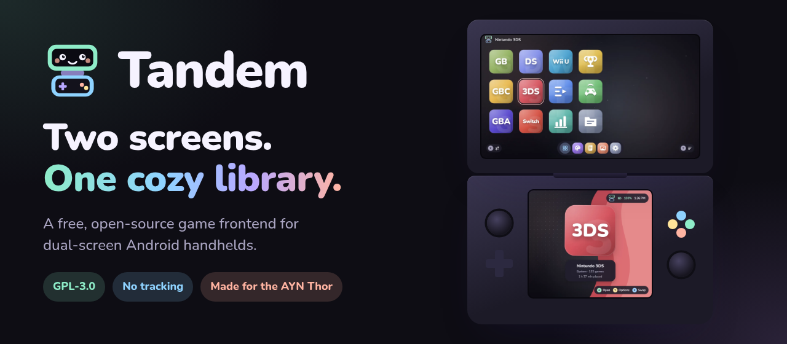
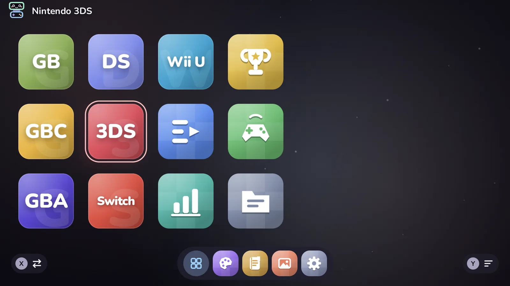
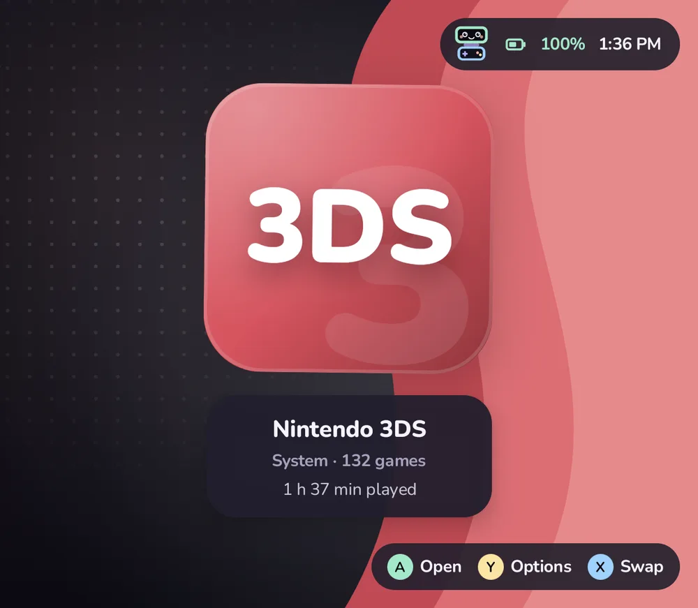
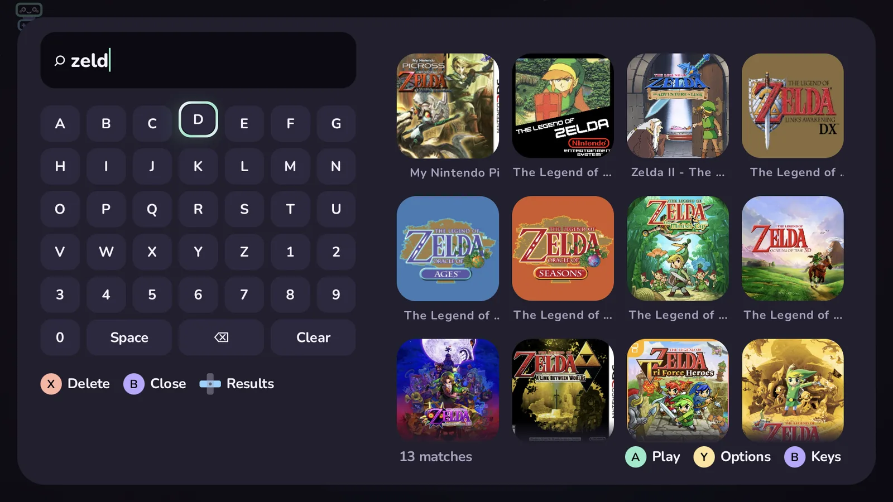

<p align="center">
  
</p>

<p align="center">
  <a href="https://github.com/ZahakJ/tandem/actions/workflows/ci.yml"></a>
  <a href="https://github.com/ZahakJ/tandem/releases/latest"></a>
  
  <a href="LICENSE"></a>
</p>

Tandem is a free, open-source game frontend for Android handhelds, made for
dual-screen devices like the AYN Thor. The top screen is your library; the
bottom screen shows the art and details for whatever is highlighted. Pick a game
and Tandem starts it in the right emulator. Press Home, pick it again, and you're
back where you left off instead of at the title screen.

No ads, no accounts, no analytics. Tandem only goes online for things you start
yourself: scraping artwork, and RetroAchievements if you sign in.

**[Website](https://zahakj.github.io/tandem/)** ·
**[Docs](https://zahakj.github.io/tandem/docs/)** ·
**[Download](https://github.com/ZahakJ/tandem/releases/latest)** ·
**[Roadmap](ROADMAP.md)**

<table>
  <tr>
    <td width="61%"></td>
    <td></td>
  </tr>
  <tr>
    <td></td>
    <td></td>
  </tr>
</table>

<sub>Real screenshots from an AYN Thor: top screen on the left, bottom screen on the right.</sub>

## Features

- **Two screens.** Library on top; art, details and play time on the bottom. **X** swaps the screens with a little animation, and everything works on a single screen too.
- **While you play,** the bottom screen can show the game's art and session time, or a companion with a clock and quick controls, or stay free for emulators that use it.
- **Resume where you left off.** If a game is still open in its emulator, Tandem brings it back instead of restarting it; a game switcher lists every running game. Needs [Shizuku](https://shizuku.rikka.app/); without it, games start fresh as usual.
- **Controller first.** A to play, B back, Y options on anything, an on-screen keyboard for search, a **Start** side panel, **hold Start** for brightness, volume and Wi-Fi, **Select** for a random unplayed game. Bluetooth pads get a working Home button and per-controller Nintendo A/B layout, and with Shizuku or root a pad connected mid-game can take over the built-in controls in any emulator. Touch works too.
- **Make it yours.** 24 built-in themes, five home layouts (shelves, an icon grid with 1 to 5 rows, carousel, list, console), theme packs, wallpapers, 15 widgets, original background music (Meadow Tales, Pastel Arcade) and five UI sound packs.
- **Artwork and details.** Optional scraping from LaunchBox and libretro thumbnails (no account), ScreenScraper, IGDB and SteamGridDB (your keys) and HowLongToBeat. A setup guide tests each source; scrapes run in the background with progress on the bottom screen.
- **Play tracking.** Play time, sessions and streaks in a stats screen, a journal for notes, CSV export, and RetroAchievements progress.
- **Organized your way.** Folders, smart folders that fill themselves, collections, favourites and Up next; hide anything you'd rather not see, with an optional PIN.
- **Discord status** (optional, in builds with Discord's Social SDK): shows the game you're playing with its cover; off until you connect.
- **Home-screen mode,** with an apps drawer, a dock, and a screensaver (also as Android's own).
- **Your files as they are.** Reads `ROMs/<system>/`, turns subfolders into folders, uses and saves art in `ROMs/downloaded_media/` (the ES-DE layout), and imports `gamelist.xml` and other launchers' backups.
- **Open data.** Over 100 systems and their emulators live in an editable [`platforms.json`](app/src/main/assets/platforms.json); your library and settings are plain JSON with backup and restore.

## Supported systems

Tandem detects the emulators you have installed and offers every one that fits.
A few of the 104 systems it knows:

| System | Emulators |
| --- | --- |
| Nintendo 3DS · DS | Azahar · melonDS, DraStic, RetroArch |
| Switch · Wii U · Wii and GameCube | Eden · Cemu · Dolphin |
| Game Boy, Color, Advance · NES · SNES · N64 | RetroArch cores (mGBA, Gambatte, Mesen, Snes9x, Mupen64Plus…) |
| PlayStation · PS2 · PSP · Vita | DuckStation · NetherSX2, ARMSX2 · PPSSPP · Vita3K |
| Dreamcast · Saturn · Genesis and friends | Flycast, Redream · Yaba Sanshiro · RetroArch |
| Arcade · Windows · DOS · ScummVM | FinalBurn Neo, MAME · GameNative, Winlator · DOSBox Pure · ScummVM |

Any other emulator can be added by editing `platforms.json`, without rebuilding
the app: see [Systems and emulators](docs/guide/platforms.md).

## Install

- **[GitHub Releases](https://github.com/ZahakJ/tandem/releases/latest):** download `tandem-<version>.apk` and open it on your handheld.
- **[Obtainium](https://obtainium.imranr.dev/):** add `https://github.com/ZahakJ/tandem` to get updates straight from releases.
- **F-Droid:** planned; the listing is ready in [`fastlane/`](fastlane/metadata/android/en-US).

Tandem needs Android 11 or newer. It doesn't include games, BIOS files or emulators.

## Quick start

1. Put your games in `ROMs/` in internal storage, one folder per system (`ROMs/n3ds`, `ROMs/gba`, …).
2. Install and open Tandem, then allow **All files access** so it can read `ROMs/`.
3. Pick the **ROMs** folder when asked, so Tandem can share games with emulators that need it.
4. Optional: with Shizuku running, allow Tandem in it to enable resume. For artwork, **Settings › Art & accounts › Scrape library**.

The [getting started guide](docs/guide/getting-started.md) has the details, and
[Setting up on the AYN Thor](docs/guide/ayn-thor.md) covers the Thor.

## Documentation

The docs are at **[zahakj.github.io/tandem/docs](https://zahakj.github.io/tandem/docs/)**,
built from the Markdown in [`docs/`](docs/):

| | |
| --- | --- |
| [Getting started](docs/guide/getting-started.md) | Install, lay out your games, first launch |
| [AYN Thor](docs/guide/ayn-thor.md) | Emulators, the bottom screen, Shizuku on the Thor |
| [Your library](docs/guide/library.md) | Folders, artwork, collections, play time, your data |
| [Controller reference](docs/guide/controls.md) | Every button on every screen |
| [Systems and emulators](docs/guide/platforms.md) | The `platforms.json` reference |
| [Importing](docs/guide/importing.md) | From ES-DE gamelists and launcher backups |
| [Resume and Shizuku](docs/guide/resume.md) | How resume works, and what it needs |
| [Themes](docs/guide/themes.md) · [Widgets](docs/guide/widgets.md) | Looks, layouts, packs, sounds; widgets |
| [Android apps](docs/guide/apps.md) | The app menu, the drawer, choosing and moving screens |
| [Privacy and scraping](docs/guide/privacy.md) | What is stored, and what each service receives |
| [FAQ and troubleshooting](docs/guide/faq.md) | Common questions and fixes |
| [Architecture](docs/ARCHITECTURE.md) · [Contributing](CONTRIBUTING.md) | For developers |

## Building

JDK 17 and the Android SDK (platform 34, build-tools 34.0.0):

```sh
./gradlew assembleDebug
```

On Nix or NixOS, `nix-shell --run './gradlew assembleDebug'` provides everything.
Release builds are shrunk with R8 and ship a baseline profile for quick starts.
[Building from source](docs/guide/building.md) has more, and every pull request
gets a debug APK from CI.

To preview the website and docs locally:

```sh
node scripts/build-docs.mjs && python3 -m http.server -d site 8000
```

## Contributing

Bug reports, emulator configs, docs and code are all welcome; see
[CONTRIBUTING.md](CONTRIBUTING.md). Please report security problems privately, as
described in [SECURITY.md](SECURITY.md).

## License

GPL-3.0-or-later. See [LICENSE](LICENSE). Tandem uses the Nunito typeface
(SIL Open Font License). It is an independent project, not affiliated with AYN
or any emulator project. Game titles and artwork in the screenshots belong to
their owners.
