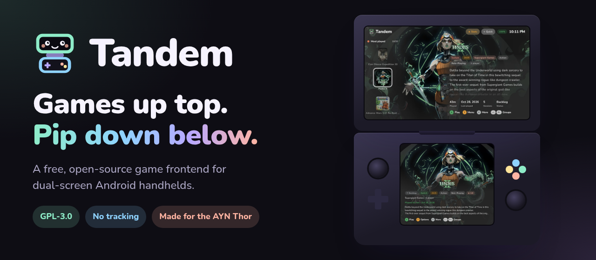
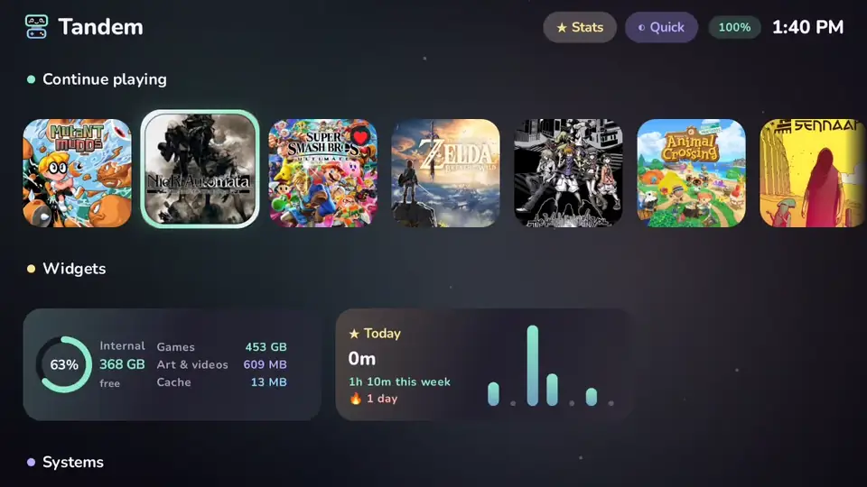
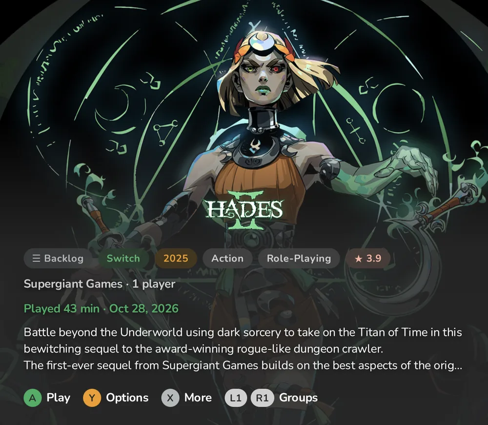
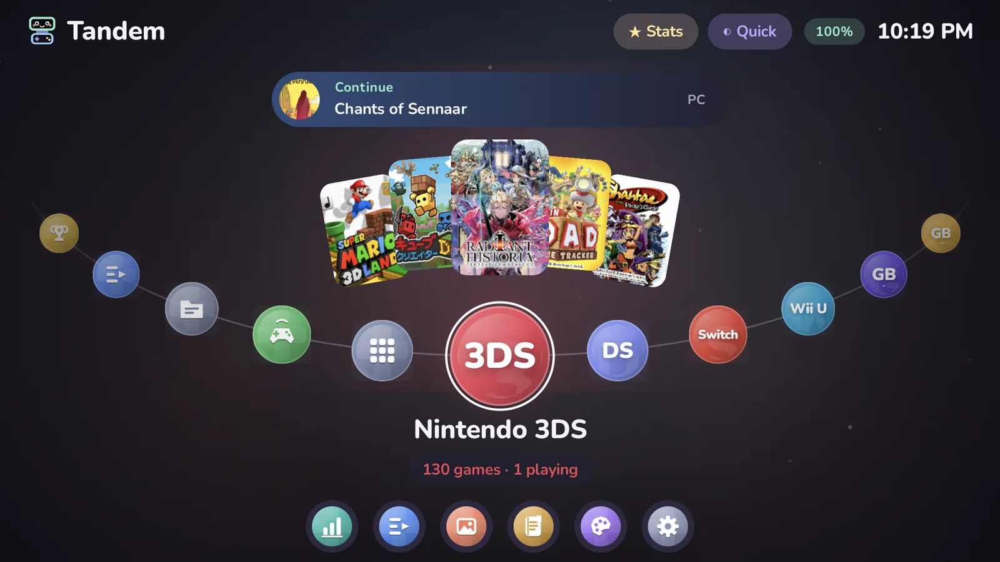
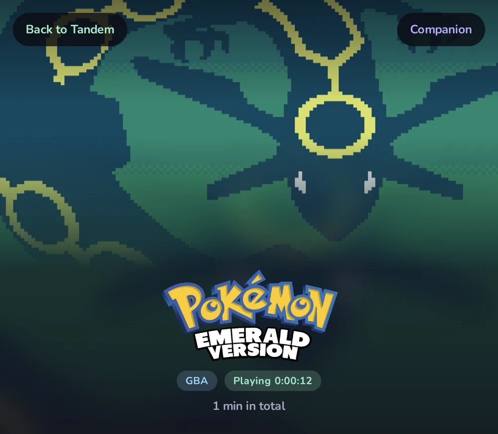
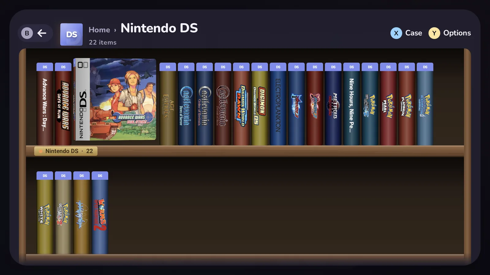
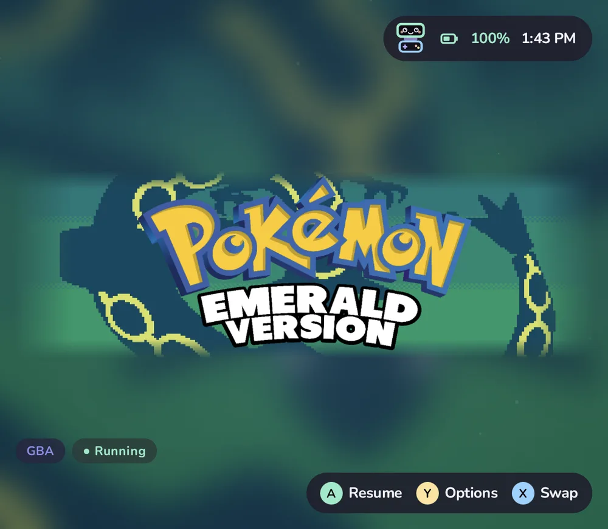

<p align="center">
  
</p>

<p align="center">
  <a href="https://github.com/ZahakJ/tandem/actions/workflows/ci.yml"></a>
  <a href="https://github.com/ZahakJ/tandem/releases/latest"></a>
  
  <a href="LICENSE"></a>
</p>

<p align="center">
  
</p>

**Tandem is a game frontend for Android handhelds with two screens, like the AYN Thor.** You pick a game on the top
screen and the bottom screen shows its art, details and play time. Press A and it opens in the right emulator. Press
Home mid-game, pick it again, and you're back where you were, not at the title screen. Free and open source.

**[Download](https://github.com/ZahakJ/tandem/releases/latest)** ·
**[Website](https://zahakj.github.io/tandem/)** ·
**[Docs](https://zahakj.github.io/tandem/docs/)** ·
**[Roadmap](ROADMAP.md)**

## What it does

- **Uses both screens.** Browse on top, details below. X swaps them. One screen works too.
- **D-pad first.** A opens, B goes back, Y has options for anything, Start opens the side panel. Touch works too.
- **Finds your emulators.** It knows 104 systems and offers the emulators you have installed for each. Add more in a
  JSON file, no rebuild. With Shizuku, a running game resumes instead of restarting.
- **Plays Switch ports natively.** Games that [Peanuts Native](docs/guide/switch.md) has rebuilt run as native apps
  (with Shizuku), and on a rooted handheld they share one save with Eden Duo.
- **Looks the way you like.** Eight home layouts you try on live, themes and theme packs, drawn system art or real
  console photos, nine sound packs and three original background grooves (Plaza, Lagoon, Terrace).
- **Meets other Tandems.** Make a character, turn on Bump, and swap a small card over Bluetooth with any Tandem you
  pass. Everyone you meet walks around your [Plaza](docs/guide/plaza.md). Off until you turn it on.
- **Private.** No ads, no account, no analytics. It goes online only for things you start ([details](#privacy)).

<table>
  <tr>
    <td width="61%"></td>
    <td></td>
  </tr>
  <tr>
    <td></td>
    <td></td>
  </tr>
  <tr>
    <td></td>
    <td></td>
  </tr>
</table>

<!-- Screenshots to add as a fourth row once taken: site/assets/screenshots/plaza.webp (top) and plaza-bottom.webp (bottom). -->

<sub>Real screenshots from an AYN Thor: top screen on the left, bottom screen on the right.</sub>

## Coming from another frontend

Setup takes a few minutes: install, allow file access, pick your games folder, answer or skip a short welcome.
Tandem never changes another frontend's files, so your old one keeps working.

What Tandem picks up by itself:

- **Your games, where they are.** Any folder, on the device or an SD card. A folder per system (`n3ds`, `3DS`,
  `Nintendo 3DS` all work), the `ROMs/<system>` layout ES-DE and Cocoon use, or everything mixed together.
  Subfolders become folders.
- **Your emulators.** Installed ones are found and offered for each system. Cocoon and Daijisho platform files in
  `ROMs/platforms/` are read too, so what they could launch, Tandem can.
- **Your artwork.** Art in `ROMs/downloaded_media/` (ES-DE's layout) is used as it is.
- **Your details.** The first scan reads ES-DE `gamelist.xml` files and Cocoon backups: titles, descriptions,
  genres, favourites, play time and art paths. It only fills gaps.
- **Cocoon looks.** Cocoon theme packs show up in Settings, and **Import my Cocoon setup** brings over your home grid,
  folders and theme (you can undo it).
- **PC games.** Games installed in DroidDeck and GameNative join the Windows system, with their art (needs Shizuku
  with root).

No art yet? LaunchBox needs no account: one download and you can scrape. [Getting started](docs/guide/getting-started.md)
walks through it, and [Importing](docs/guide/importing.md) has the details.

## Features

**Playing**

- Resume a game that's still open, and a switcher for every running game (needs [Shizuku](https://shizuku.rikka.app/)).
- While you play, the bottom screen shows the game's art and session time, a companion with a clock and quick
  controls, the manual, notes, or stays free for emulators that use it.
- Switch games in Eden Duo or natively in Peanuts Native, with one save across them (needs root). A game built in
  both Peanuts apps plays in the official one, and with root its save comes along.
- Stream PC games with Moonlight; per-game performance and fan modes on AYN handhelds; Do Not Disturb while you play.

**Your library**

- **This week:** every Monday, a board of picks from your own library, each with the reason: a Pick of the week,
  Because you finished, Almost there and more. X re-rolls just the row you're on. Worked out on the handheld.
- **Surprise me** (Select) spins a reel of covers and stops on a game for you.
- Folders as a grid, bookshelf, cartridge case or carousel; smart folders with rules (rating, developer, play
  time…); collections, favourites and Up next. Multi-disc games are one tile.
- Search with filters by system, genre, year, rating, status and more.
- Art and details from LaunchBox and libretro (no account), ScreenScraper, IGDB and SteamGridDB (your keys) and
  HowLongToBeat, scraped in the background.

**Progress**

- Play time, sessions and streaks in a stats screen, and a status for every game (backlog, playing, finished...).
- Tandem's own trophies on every system, RetroAchievements with full lists and players' hints, and Steam
  achievements.
- Notes per game as plain Markdown: checklists, sketches, and screenshots from the bottom screen.

**Make it yours**

- Eight home layouts (shelves, icon grid, carousel, list, console, Orbit, Spotlight and Stage), tried live from
  **Start › Layout**.
- Built-in themes and theme packs (Cocoon's work too), animated or picture wallpapers, your own pictures and GIFs as
  tile art, 15 widgets.
- Real system art from the web, or Tandem's own drawn art sets.
- Three original background grooves (Plaza, Lagoon, Terrace), nine UI sound packs, or your own music.
- Share your look, or get one from the community gallery.
- English, العربية (every screen mirrors), 日本語, 简体中文 and Français; Gregorian, Hijri or Chinese calendars.

**Everyday**

- Home-screen mode with an apps drawer, a dock and a screensaver.
- Quick settings (hold Start), a notifications panel, Bluetooth pads with a working Home button and Nintendo-style
  A/B per controller.
- A tour of what's new after each update, updates in one press, and a bug report without adb.

- Settings on eight tiles with a search, and a small glyph for every row.
- Light when idle: half a minute after your last press, Tandem stops animating and draws almost nothing.

**Bump and the Plaza**

- Make a character of yourself in **Me**: face, eyes and eye colour, hairstyles, hats, outfits, glasses and more.
  L1 and R1 switch tabs; the Card tab holds your name, a greeting and a favourite game.
- Turn on Bump and carry your handheld around. When another Tandem with Bump on comes within Bluetooth range, a
  phone included, you swap a small card.
- Everyone you met walks around your Plaza, a little town square whose sky follows the clock. Wave back, hide or
  block anyone.
- Off until you turn it on; no internet, no account. Android 12 or newer. ([How it works](docs/guide/plaza.md))

## Privacy

No ads, no accounts, no analytics. Tandem goes online only for things you start: scraping art, fetching system art,
RetroAchievements or Steam if you sign in, the Discord status if you connect it, and the look gallery. Two exceptions
run by themselves: a daily check on GitHub for a new Tandem (you can turn it off), and Steam store pictures for Steam
shortcuts that have no art. Private mode keeps all of it offline. [What each service receives](docs/guide/privacy.md).

## Supported systems

Tandem detects the emulators you have installed and offers every one that fits. A few of the 104 systems it knows:

| System | Emulators |
| --- | --- |
| Nintendo 3DS · DS | Azahar · melonDS, DraStic, RetroArch |
| Switch · Wii U · Wii and GameCube | Eden Duo, Eden, Peanuts Native · Cemu · Dolphin |
| Game Boy, Color, Advance · NES · SNES · N64 | RetroArch cores (mGBA, Gambatte, Mesen, Snes9x, Mupen64Plus…) |
| PlayStation · PS2 · PSP · Vita | DuckStation · NetherSX2, ARMSX2 · PPSSPP · Vita3K |
| Dreamcast · Saturn · Genesis, Master System, Game Gear | Flycast, Redream · Yaba Sanshiro · RetroArch |
| Arcade · Windows · DOS · ScummVM | FinalBurn Neo, MAME · GameNative, Winlator · DOSBox Pure · ScummVM |

Missing one? Add it to `platforms.json`, no rebuild needed: see [Systems and emulators](docs/guide/platforms.md).

## Install

- **[GitHub Releases](https://github.com/ZahakJ/tandem/releases/latest):** open `tandem-<version>.apk` on your
  handheld. Tandem then tells you about new versions and installs them when you press Update.
- **[Obtainium](https://obtainium.imranr.dev/):** add `https://github.com/ZahakJ/tandem`.
- **F-Droid:** planned; the listing is ready in [`fastlane/`](fastlane/metadata/android/en-US).

Android 11 or newer. Bring your own games: Tandem doesn't include games, BIOS files or emulators, and never downloads
them.

## Quick start

1. Put your games in any folder, one subfolder per system. `ROMs/` in internal storage is the default.
2. Open Tandem and allow **All files access**.
3. Pick your games folder when asked, so emulators that need it can open your games.
4. Optional: allow Tandem in Shizuku for resume.
5. Art with no account: **Settings › Library & art › Set up sources › LaunchBox › Download**, then **Scrape library**.

More in [Getting started](docs/guide/getting-started.md), and [Setting up on the AYN Thor](docs/guide/ayn-thor.md).

## Documentation

All of it is at **[zahakj.github.io/tandem/docs](https://zahakj.github.io/tandem/docs/)**, built from [`docs/`](docs/).
The [guide index](docs/guide/README.md) lists every page. Good places to start:

| | |
| --- | --- |
| [Getting started](docs/guide/getting-started.md) | Install, your games, first launch, art with no account |
| [Every setting](docs/guide/settings.md) | Every row in Settings, with its default |
| [Controller reference](docs/guide/controls.md) | Every button on every screen |
| [Your library](docs/guide/library.md) | Folders, This week, collections, achievements, play time, backups |
| [Systems and emulators](docs/guide/platforms.md) | The `platforms.json` reference |
| [Switch games](docs/guide/switch.md) | Eden Duo, Peanuts Native and one save |
| [Themes](docs/guide/themes.md) | Layouts, packs, art sets, sounds and music |
| [Bump and the Plaza](docs/guide/plaza.md) | Your character, bumping into other Tandems, privacy |
| [Privacy](docs/guide/privacy.md) · [FAQ](docs/guide/faq.md) | What goes where; common fixes |

## Building

JDK 17 and the Android SDK (platform 34, build-tools 34.0.0):

```sh
./gradlew assembleDebug
```

On Nix, `nix-shell --run './gradlew assembleDebug'`. Every pull request also gets a debug APK from CI.
[Building from source](docs/guide/building.md) has more. To preview the website and docs:

```sh
node scripts/build-docs.mjs && python3 -m http.server -d site 8000
```

## Contributing

Bug reports, ideas, emulator entries, translations, themes and code all help. Small pull requests are easiest to
review. See [CONTRIBUTING.md](CONTRIBUTING.md). Security problems go privately, as in [SECURITY.md](SECURITY.md).

## License

GPL-3.0-or-later. See [LICENSE](LICENSE). Tandem uses the Nunito typeface (SIL Open Font License). It is an
independent project, not affiliated with AYN or any emulator project. Game titles and artwork in the screenshots
belong to their owners.
