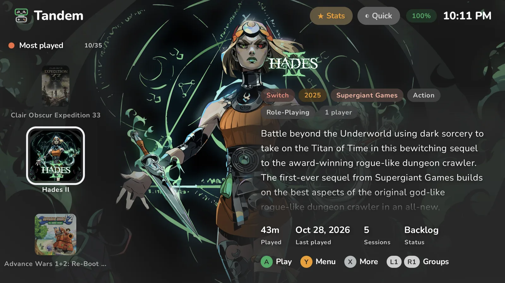

<p align="center">
  
</p>

<p align="center">
  <a href="https://github.com/ZahakJ/tandem/actions/workflows/ci.yml"></a>
  <a href="https://github.com/ZahakJ/tandem/releases/latest"></a>
  
  <a href="LICENSE"></a>
</p>

<p align="center">
  
</p>

Tandem is a free, open-source game frontend for Android handhelds, made for
dual-screen devices like the AYN Thor. The top screen is your library; the
bottom screen shows the art and details for whatever is highlighted. Pick a game
and Tandem starts it in the right emulator. Press Home, pick it again, and you're
back where you left off instead of at the title screen.

Tandem speaks English, العربية (every screen mirrors), 日本語, 简体中文 and Français, and shows dates in the
Gregorian, Hijri or Chinese calendar, or two at once.

No ads, no accounts, no analytics. Tandem only goes online for things you start
yourself: scraping artwork, RetroAchievements if you sign in, and the Discord status if you
connect it. The exceptions: a daily check on GitHub for a new Tandem (which you can turn off), and Steam
shortcuts missing art get Steam's store pictures by app id after a scan. Private mode keeps all of it offline.

**[Website](https://zahakj.github.io/tandem/)** ·
**[Docs](https://zahakj.github.io/tandem/docs/)** ·
**[Download](https://github.com/ZahakJ/tandem/releases/latest)** ·
**[Roadmap](ROADMAP.md)**

<table>
  <tr>
    <td width="61%"></td>
    <td></td>
  </tr>
  <tr>
    <td></td>
    <td></td>
  </tr>
  <tr>
    <td></td>
    <td></td>
  </tr>
</table>

<sub>Real screenshots from an AYN Thor: top screen on the left, bottom screen on the right.</sub>

## Features

- **Two screens.** Library on top; art, details and play time on the bottom. **X** swaps the screens with a little animation, and everything works on a single screen too.
- **While you play,** the bottom screen can show the game's art and session time, or a companion with a clock and quick controls, or stay free for emulators that use it.
- **Resume where you left off.** If a game is still open in its emulator, Tandem brings it back instead of restarting it; a game switcher lists every running game. Needs [Shizuku](https://shizuku.rikka.app/); without it, games start fresh as usual.
- **Controller first.** A to play, B back, Y options on anything, an on-screen keyboard for search, a **Start** panel, **hold Start** for quick settings (brightness, volume, Wi-Fi, Battery saver), **R2** for a side panel with your notifications, **Select** for a random unplayed game. Bluetooth pads get a working Home button and per-controller Nintendo A/B layout, and with Shizuku or root a pad connected mid-game can take over the built-in controls in any emulator. Touch works too.
- **Make it yours.** Theme packs (Tandem's own and Cocoon's, with their music and sounds) on top of three built-in themes, eight home layouts (shelves, an icon grid with 1 to 5 rows, carousel, list, console, Orbit, Spotlight with one game's art across the screen, and Stage, a page per system that L1/R1 slide across), tried live from Start › Layout, animated and picture wallpapers, 15 widgets, three original soundtracks (Plaza, Calm and Meadow Tales) or your own music, nine UI sound packs (Thock among them), and real system art (console photos and logos) or Tandem's own drawn art sets.
- **Playing.** Stream PC games from a home computer with Moonlight, set performance and fan modes per game on AYN handhelds, keep notifications quiet with Do Not Disturb while a game plays, read a game's manual on the bottom screen, or turn that screen off.
- **Switch games** play in Eden Duo (with each game's own second screen on the bottom), or natively in Peanuts Native once it has built them, and keep one save across the two ([how](docs/guide/switch.md)).
- **Artwork and details.** Optional scraping from LaunchBox and libretro thumbnails (no account: one LaunchBox download and you can scrape), ScreenScraper, IGDB and SteamGridDB (your keys) and HowLongToBeat. A setup guide tests each source; scrapes run in the background with progress on the bottom screen.
- **Play tracking.** Play time, sessions and streaks in a stats screen, a status for every game (backlog, playing, finished...), Tandem's own trophies on every system, a journal for notes, CSV export, RetroAchievements progress and Steam achievements.
- **Notes while you play,** per game, as plain Markdown files: text, checklists, glossaries with drawn symbols, sketches, and screenshots taken from the bottom screen straight into a note.
- **Organized your way.** Folders (shown as a grid, a bookshelf, a cartridge case or a carousel), smart folders that fill themselves, collections, favourites and Up next; hide anything you'd rather not see, with an optional PIN that also keeps Tandem offline.
- **Discord status** (optional, in builds with Discord's Social SDK): shows the game you're playing with its cover; off until you connect.
- **Home-screen mode,** with an apps drawer, a dock, and a screensaver (also as Android's own).
- **Your files as they are.** Reads `ROMs/<system>/`, turns subfolders into folders, uses and saves art in `ROMs/downloaded_media/` (the ES-DE layout), and imports `gamelist.xml` and other launchers' backups.
- **Open data.** Over 100 systems and their emulators live in an editable [`platforms.json`](app/src/main/assets/platforms.json); your library and settings are plain JSON with backup and restore.

## Supported systems

Tandem detects the emulators you have installed and offers every one that fits.
A few of the 104 systems it knows:

| System | Emulators |
| --- | --- |
| Nintendo 3DS · DS | Azahar · melonDS, DraStic, RetroArch |
| Switch · Wii U · Wii and GameCube | Eden Duo, Eden, Peanuts Native · Cemu · Dolphin |
| Game Boy, Color, Advance · NES · SNES · N64 | RetroArch cores (mGBA, Gambatte, Mesen, Snes9x, Mupen64Plus…) |
| PlayStation · PS2 · PSP · Vita | DuckStation · NetherSX2, ARMSX2 · PPSSPP · Vita3K |
| Dreamcast · Saturn · Genesis and friends | Flycast, Redream · Yaba Sanshiro · RetroArch |
| Arcade · Windows · DOS · ScummVM | FinalBurn Neo, MAME · GameNative, Winlator · DOSBox Pure · ScummVM |

Any other emulator can be added by editing `platforms.json`, without rebuilding
the app: see [Systems and emulators](docs/guide/platforms.md).

## Install

- **[GitHub Releases](https://github.com/ZahakJ/tandem/releases/latest):** download `tandem-<version>.apk` and open it on your handheld. After that Tandem tells you when a new version is out and installs it when you press Update ([how](docs/guide/getting-started.md#software-updates)).
- **[Obtainium](https://obtainium.imranr.dev/):** add `https://github.com/ZahakJ/tandem` to get updates straight from releases.
- **F-Droid:** planned; the listing is ready in [`fastlane/`](fastlane/metadata/android/en-US).

Tandem needs Android 11 or newer. It doesn't include games, BIOS files or emulators.

## Quick start

1. Have your games in any folder on the device or an SD card: a folder per system (`n3ds`, `GBA`, `PlayStation 2`…), one system's folder, or everything together. `ROMs/` in internal storage is the default.
2. Install and open Tandem, then allow **All files access** so it can read your games.
3. Pick your games folder when asked, so Tandem can share games with emulators that need it.
4. Optional: with Shizuku running, allow Tandem in it to enable resume.
5. Artwork with no account: **Settings › Library & art › Set up sources › LaunchBox › Download**, then **Scrape library**.

The [getting started guide](docs/guide/getting-started.md) has the details, the [guide index](docs/guide/README.md) lists every page, and
[Setting up on the AYN Thor](docs/guide/ayn-thor.md) covers the Thor.

## Documentation

The docs are at **[zahakj.github.io/tandem/docs](https://zahakj.github.io/tandem/docs/)**,
built from the Markdown in [`docs/`](docs/):

| | |
| --- | --- |
| [Getting started](docs/guide/getting-started.md) | Install, lay out your games, first launch, art with no account |
| [Every setting](docs/guide/settings.md) | Every row in Settings, with its default and what it does |
| [AYN Thor](docs/guide/ayn-thor.md) | Emulators, the bottom screen, Shizuku on the Thor |
| [Your library](docs/guide/library.md) | Folders, artwork, collections, play time, your data |
| [Controller reference](docs/guide/controls.md) | Every button on every screen |
| [Systems and emulators](docs/guide/platforms.md) | The `platforms.json` reference |
| [Artwork and scraping](docs/guide/scraping.md) | Art with no account, free keys, when a scrape finds nothing |
| [Importing](docs/guide/importing.md) | From ES-DE gamelists and launcher backups |
| [Resume and Shizuku](docs/guide/resume.md) | How resume works, and everything Shizuku is used for |
| [Switch games](docs/guide/switch.md) | Eden Duo, Peanuts Native and one save across both |
| [Themes](docs/guide/themes.md) · [Widgets](docs/guide/widgets.md) | Looks, layouts, packs, sounds; widgets |
| [Android apps](docs/guide/apps.md) | The app menu, the drawer, choosing and moving screens |
| [Notes](docs/guide/notes.md) | Notes per game: text, checklists, glossaries, sketches, screenshots |
| [Streaming from a home PC](docs/guide/streaming.md) | Sunshine on the PC, Moonlight on the handheld |
| [Privacy and scraping](docs/guide/privacy.md) | What is stored, and what each service receives |
| [FAQ and troubleshooting](docs/guide/faq.md) | Common questions and fixes |
| [Architecture](docs/ARCHITECTURE.md) · [Contributing](CONTRIBUTING.md) | For developers |

## Building

JDK 17 and the Android SDK (platform 34, build-tools 34.0.0):

```sh
./gradlew assembleDebug
```

On Nix or NixOS, `nix-shell --run './gradlew assembleDebug'` provides everything.
Release builds are shrunk with R8 and ship a baseline profile for quick starts.
[Building from source](docs/guide/building.md) has more, and every pull request
gets a debug APK from CI.

To preview the website and docs locally:

```sh
node scripts/build-docs.mjs && python3 -m http.server -d site 8000
```

## Contributing

Bug reports, emulator configs, docs and code are all welcome; see
[CONTRIBUTING.md](CONTRIBUTING.md). Please report security problems privately, as
described in [SECURITY.md](SECURITY.md).

## License

GPL-3.0-or-later. See [LICENSE](LICENSE). Tandem uses the Nunito typeface
(SIL Open Font License). It is an independent project, not affiliated with AYN
or any emulator project. Game titles and artwork in the screenshots belong to
their owners.
