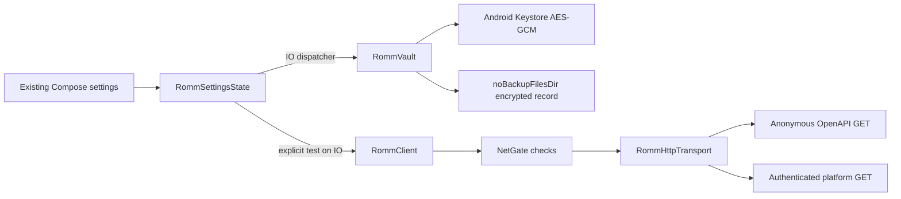

# Native RoMM integration plan

Target: RoMM 5.4.1, native Tandem on the AYN Thor. Connection milestone implemented on
`feature/romm-connection`; remote browsing and downloads remain planned.

Current status and session handoff: [ROMM_PROGRESS.md](ROMM_PROGRESS.md). The user reported successful emulator
connection, restart/persistence and private-mode checks on 2026-11-16; physical Thor validation remains pending.

## Design and current implementation

Keep the existing single `app` module and feature-owned files. Do not introduce a separate app, backend,
database, or navigation framework. Local `Game`, JSON metadata, scanner and emulator launcher remain authoritative
for installed games. Existing settings and keyboard handle controller focus on whichever display hosts the library.

New source under `app/src/main/java/io/github/zahakj/tandem/`:

| Source | Responsibility |
| --- | --- |
| `romm/RommClient.kt` | Redacted config, strict server URL validation, transport interface/implementation, version and response checks, typed safe results. |
| `romm/RommVault.kt` | Android Keystore AES-256-GCM, versioned authenticated ciphertext, atomic configuration writes and explicit removal. |
| `ui/RommSettings.kt` | Settings rows, shared state for both displays, IO jobs, enable/disable/test/cancel/forget, private-mode reaction. |
| `ui/SettingsCatalog.kt` | Place RoMM under Library & art and expose it to existing settings search. |

The app starts disabled with no configuration. Loading configuration performs local IO only. Saving a server or
token never sends a request. A saved token plus server is required before enabling. A test is explicitly initiated
by the user, and its result describes that probe rather than a persistent connection. Repeating the test row while
connecting cancels the job. Editing is serialized against pending secure writes and connection probes.

Changing the server discards the old token and disables the feature, preventing credentials from being silently
reused with a different server. Replacing a token never pre-fills the stored value in the keyboard. Empty token
entry removes it and disables the integration. Forget RoMM removes the encrypted configuration and its key; unreadable secure
storage fails closed and offers this explicit recovery action. No plaintext fallback is permitted.

## Verified API contract and compatibility

No live server OpenAPI was supplied, so compatibility with the user's deployment is **not yet verified**.
The supplied [general API documentation](https://docs.romm.app/latest/developers/) describes the project broadly;
implementation details were checked against upstream files under the **5.4.1** ref:

- [FastAPI application and router prefixes](https://raw.githubusercontent.com/rommapp/romm/5.4.1/backend/main.py):
  the OpenAPI info version comes from the running version; the platform router is mounted under `/api`.
- [Platform endpoint](https://raw.githubusercontent.com/rommapp/romm/5.4.1/backend/endpoints/platform.py):
  `GET /api/platforms` returns a list and requires `platforms.read`.
- [Platform response schema](https://raw.githubusercontent.com/rommapp/romm/5.4.1/backend/endpoints/responses/platform.py):
  platform objects contain integer `id` and string `name`; only these fields are consumed by this probe.
- [Hybrid authentication](https://raw.githubusercontent.com/rommapp/romm/5.4.1/backend/handler/auth/hybrid_auth.py):
  Client API Tokens are accepted through `Authorization: Bearer <token>`.
- [Authentication scopes](https://raw.githubusercontent.com/rommapp/romm/5.4.1/backend/handler/auth/constants.py)
  and [route protection](https://raw.githubusercontent.com/rommapp/romm/5.4.1/backend/decorators/auth.py):
  distinguish invalid credentials from insufficient permissions.

The test first reads `<website-root>/openapi.json` anonymously. It requires `info.version` to be `5.4.1` (an optional
leading `v` is accepted) and the live schema to expose `GET /api/platforms`. It then requests that platform list with
the token. A public schema alone never reports an authenticated connection. Missing/invalid JSON, unexpected platform
objects and unsupported versions produce useful errors. No endpoint path is taken from untrusted response data.

The website root may contain a plain reverse-proxy subpath; the client preserves it. Users enter the website URL,
without `/api` or `/openapi.json`. A deployment hiding OpenAPI or using percent-encoded base paths is unsupported
by this first version. Other RoMM versions require contract review before expanding the version check. Server
authentication policy must actually enforce credentials on the protected platform operation; kiosk/proxy policies
that grant anonymous access need separate deployment validation.

Only these two GET operations are used. There is no login/password exchange, token creation/refresh,
server ROM mutation, save sync or streaming. A server may record ordinary access/token usage audit metadata.

## Security and errors

- Require HTTPS, including over an existing Tailscale route. Tailscale is transport routing, not a certificate
  validation bypass. Android's default certificate and hostname checks are used.
- Reject URL userinfo, queries, fragments, invalid ports and traversal paths; reject token control characters.
- Disable all redirects, including same-origin ones, to avoid bearer leakage or HTTP downgrade. Users must supply
  the final website URL. Disable HTTP response caching. Do not store or display server error bodies.
- Check `NetGate` before both calls, immediately before sending, and between reads. Private mode cancels an active
  test and blocks further requests. A request already transmitted cannot be recalled.
- Run network and secure storage work on IO dispatchers. Socket connect/read timeouts are 12 seconds each; JSON
  responses are limited to 8 MiB. Cancellation interrupts work, but a blocking socket operation can wait for its
  timeout before returning; there is no instantaneous cancellation guarantee or automatic retry.
- Return fixed safe messages for disabled/unconfigured, private mode, 401, 403, redirects, unsupported version,
  bad schema, timeout, TLS, network failure and other server errors. Raw exceptions never enter toasts or logs.
- Encrypt server URL, token and enabled state together; write only ciphertext with `AtomicFile` into
  `noBackupFilesDir/romm-config.enc`. The key is non-exportable through the Android Keystore provider; hardware
  backing depends on the device and is not assumed. No RoMM file is added to Tandem's backup allowlist.

Android references: [Keystore](https://developer.android.com/privacy-and-security/keystore) and
[Auto Backup exclusions](https://developer.android.com/identity/data/autobackup#IncludingFiles).
JVM tests exercise the AES-GCM envelope, not the physical Android Keystore or device backup implementation.
The token necessarily exists in app memory while configuring/requesting; do not log it or collect memory dumps.

## Remote library models and mapping (future milestones)

Introduce `RommPlatform`, `RommRemoteGame`, `RommLibraryRepository` and a remote-library cache only after verifying the
live 5.4.1 schema for the actual list, pagination, metadata and media operations. These are proposed internal names,
not claims about additional API fields. For now the probe validates platform `id`/`name` and retains only a count.

Keep a remote identifier scoped to the configured server separate from Tandem's `platform/filename` local key.
Persist explicit mappings from a verified remote platform identifier to an existing Tandem platform and a
user-approved destination root/subdirectory. Use existing system aliases as suggestions, requiring confirmation for
ambiguous matches. Never equate games by display title alone, or let remote paths determine local filesystem paths.

Represent availability separately: remote only, downloading, verified local, unavailable/error. Only completed files
discovered by the existing scanner become launchable `Game` instances. A download ledger can link remote identity,
chosen destination, local key and verified integrity facts. Reconcile using actual file existence and trusted size/hash
where supplied, accounting for filename collisions and multi-file games. Removing a remote record must never delete
a local file. Disabling RoMM or losing the network must leave local scanning, metadata and launching operational.

Display remote items and metadata through existing Tandem cards/details, with explicit availability badges and
controller actions. Keep remote cache storage separate from local `Store` metadata and respect private/hidden states.
Authenticated images must obey the same gate and origin rules; do not put bearer tokens into artwork URLs.

## Android storage and download lifecycle (future)

Shared internal storage and removable SD storage should use the existing folder selection/root model. App-private
internal files need a deliberate emulator URI-sharing strategy; a raw private path is not a usable emulator handoff.
Keep SAF URI grants alongside destinations and validate app-level read/write access after restart. Handle revoked
grants, read-only/unmounted cards, full storage and unknown available space. Never infer permission from ADB access.

Proposed lifecycle: queued → preparing → streaming to a unique partial file → validating → publishing → scanning →
complete. Cancellation/failure remain explicit states. Do not overwrite a destination silently or expose partial data
as a supported ROM extension. Reject traversal, absolute paths, symlinks outside the target and unsafe remote names.
Validate bytes against trusted expected size/hash when available; reject truncated responses before completion.
Publish by same-filesystem rename where available; for SAF providers without atomic rename use a recorded recovery
strategy and make completion conditional on successful finalization. Multi-file game manifests need separate validation.

Cancellation closes the response and output, retains or removes only owned partials according to a documented policy,
and never reports completion. Persist enough job state to recover after process death. Range resume is allowed only
after confirming server support and validating the resumed representation; otherwise restart safely. A later background
downloader may justify WorkManager plus appropriate foreground behavior. Add it only with a demonstrated need.

After finalization request `LibraryScan`, then use `Launcher.launch` with the scanned game and existing emulator
configuration. No new launch path or automatic emulator reconfiguration is needed. Download implementation is outside
the current patch.

## Milestones and acceptance criteria

| Milestone | Acceptance | Status |
| --- | --- | --- |
| 1. Audit/baseline | Map architecture, dependency/license assessment, wrapper debug build, exact baseline test failures recorded. | Complete; see repository audit. |
| 2. Design | Native architecture, live contract policy, credentials, remote/local mapping, storage, lifecycle and tests documented. | This document. |
| 3. Minimal connection | Optional settings, secure token, explicit authenticated GET, safe errors, private mode, mock unit tests, successful debug build. | Implemented; connection, restart/persistence and private-mode checks passed in the emulator per user report. Physical Thor checks pending. |
| 4. Remote browsing | Verify live list/pagination/art contracts; controller search, remote badges, cache/offline behavior; local library unaffected. | Planned. |
| 5. Downloads | Verified download contract, explicit platform/destination mapping, internal and SD targets, bounded streaming, cancellation, integrity/finalization/recovery tests. | Planned; no downloader now. |
| 6. Discover and launch | Completed files rescan and launch via existing emulator config; offline and dual-screen regression tests on Thor. | Planned. |

## Test strategy and unresolved evidence

Use existing JUnit for pure connection/validation logic, injected response and connection fakes, and real JVM AES-GCM
tests. Test ordering/header separation, private mode before and between requests, URL/token rejection, empty platforms,
HTTP failures, unsupported versions, malformed JSON, redirect rejection, response bounds, cleanup and ciphertext
tampering. `SettingsPlanTest` includes the new feature so its rows cannot silently become unplaced.

Future download tests should use a local TLS mock and synthetic fixtures for interrupted/truncated streams, size/hash
mismatch, redirect leakage, collisions, unsafe names, SAF failures, process recovery and refresh behavior. Physical
Thor checks must cover the real Keystore, both screen roles, D-pad/touch focus, settings restart, HTTPS/Tailscale and,
when implemented, actual SD/SAF/emulator handoff. Follow [ROMM_TESTING.md](ROMM_TESTING.md).

Unresolved: the user's live OpenAPI/proxy/auth policy and certificate chain, real device storage/key behavior,
controller/dual-screen visual validation, and future ROM/media/download contracts. Do not claim these are verified
from a host build or fake responses.
