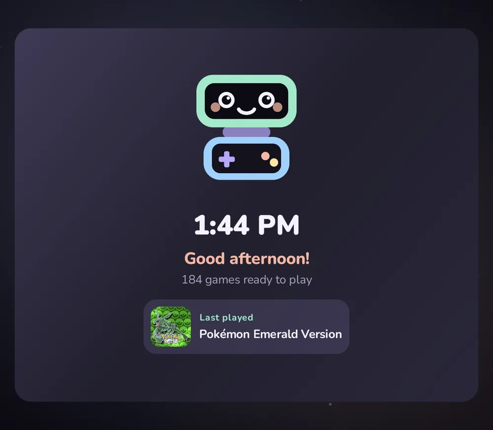
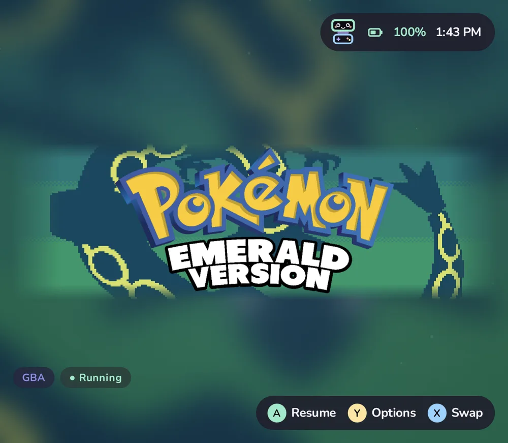
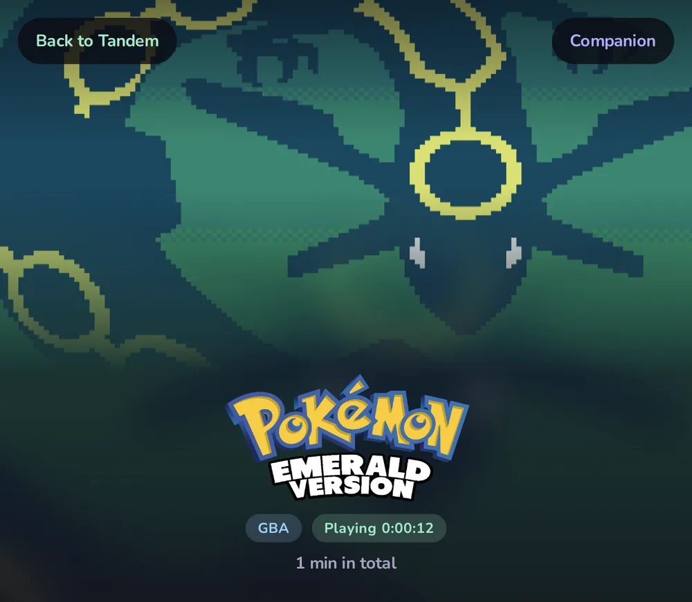
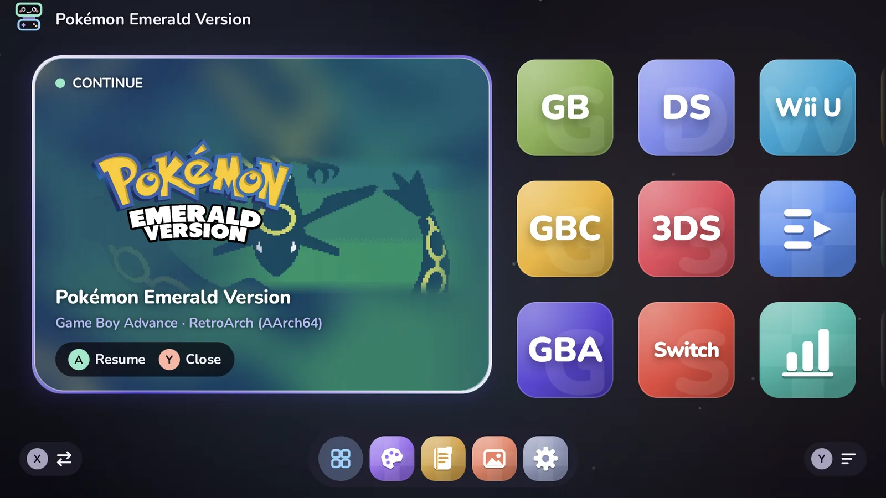

# Setting up on the AYN Thor

The AYN Thor is a clamshell handheld with a 1920×1080 top screen and a 1080×1240 touchscreen below. This page covers a setup from scratch with the emulators Tandem knows out of the box.

> [!TIP]
> Already use another frontend on the Thor? Skim to [Emulators on the Thor](#emulators-on-the-thor) and [The bottom screen](#the-bottom-screen).

## Before you start

Two quick things before installing anything.

- Update the Thor's system software from AYN's settings app.
- Copy your games to a folder in **internal storage** or on an SD card (`ROMs` is the default). See [Getting started](getting-started.md#put-your-games-in-place) for how Tandem finds them.

## Emulators on the Thor

Install the emulators for the systems you play and **open each one once**, so it can set itself up and ask for its permissions.

| System | Emulator | Notes |
| --- | --- | --- |
| Nintendo 3DS | Azahar | Point it at your system files the first time you open it. |
| Nintendo DS | MelonDualDS | A melonDS build with dual-screen support (`me.magnum.melondualds`). Turn on both screens in its settings. |
| Nintendo Switch | Eden Duo or Eden | Install keys and firmware first. Eden Duo adds game companions on the bottom screen; Peanuts Native can play games natively. See [Switch games](switch.md). |
| Nintendo Wii U | Cemu | Set up its game paths once. |
| Game Boy, Color, Advance | RetroArch (64-bit) | Package `com.retroarch.aarch64`. Download the **mGBA** and **Gambatte** cores from the Online Updater. |

Any other emulator or build works too, once Tandem knows how to start it: see [Systems and emulators](platforms.md).

## Install Tandem

Install the APK from [GitHub Releases](https://github.com/ZahakJ/tandem/releases/latest) or through Obtainium, open it, and go through the two [first-launch steps](getting-started.md#first-launch).

## The bottom screen

Tandem draws on both screens: the library on top, details for the highlighted item below. The bottom screen never takes input focus, so the controller keeps driving the library.

### While you play

What the bottom screen does while a game runs on top. Tandem keeps it in one of four styles (PC games and streams get a fifth, the [Deck](#the-deck)):

| Style | What you get |
| --- | --- |
| **Game art** (the default) | The game's art slowly drifting, its logo, this session's time and total play time. After a minute without a touch it dims and shifts a few pixels now and then against burn-in. Tap to wake it. |
| **Tandem companion** | Pip playing along, clock and battery, session time, your dock apps, brightness, volume and Wi-Fi, and buttons for Back to Tandem, Game art and Close game. A dock app you tap opens on the bottom screen. |
| **Screen off** | Black and still from the moment the game starts: the biggest battery saving the bottom screen can give you. Tap it and the game art lights up for a minute (with Back to Tandem, Screenshot, Notes and the rest), then it goes dark again by itself. That first tap only wakes it, so you never press a button by accident. |
| **Leave to emulator** | Tandem stays off the bottom screen. The default for 3DS and DS, whose emulators use both screens. Wii U gets Game art, since Cemu leaves the bottom screen empty. |

You can choose the style at three levels; the game's choice beats the system's, which beats the setting:

- **Every game:** **Settings › Two screens › While playing › Bottom screen while playing** (3DS and DS emulators keep their own screen whatever it says).
- **One system:** **Settings › Library & art › Systems and emulators**, <kbd>A</kbd> on the system › **Bottom screen while playing**.
- **One game:** <kbd>Y</kbd> › **More › Bottom screen while playing**.

Games started on the bottom screen never get it.

**Off after**, next to it, turns any style dark after 1, 2, 5 or 10 minutes without a touch on the bottom screen (Never, the default, keeps the dimmed art or companion up all game long). With Screen off it is also how long a tap lights the screen.

When a dark screen comes back, and what the timer costs

A dark screen comes back on a tap, when a controller's Home button brings the game and its companion back from under another app, when the handheld wakes, when you come back to Tandem and when the game ends.

The timer is nothing more than a delay inside the companion while it is on show: no wake lock and no alarm, so it never keeps the Thor from sleeping, and a dark screen has no timer running at all.

Why Screen off uses black pixels instead of turning the panel off

The Thor's lower panel is an OLED, so black pixels are off pixels, and nothing is drawn or timed while it is dark.

Android 13 has no way to turn one built-in screen off while the other stays on (both sit in one power group, and `cmd display` can only set the main screen's brightness), and a window's own brightness setting is one value for every screen on this Android version, so using it on the bottom screen would dim the game. On an OLED a black pixel costs the same at any brightness, so nothing is lost.

The first time a Screen off panel comes up with Shizuku running, Tandem writes what `dumpsys display` says about the bottom screen (its power group, state and brightness) and any display-related settings keys to `adb logcat -s Tandem`, in case AYN's own second-screen switch turns out to be reachable that way.

#### Buttons on the bottom screen

The Game art and Tandem companion styles share these:

- **Screenshot** (needs [Shizuku](resume.md)) saves the game's screen to `ROMs/screenshots/`, where the Gallery shows it, and copies it to the clipboard to paste into a chat.
- **Clip** records the next 15 seconds of the game's screen and sound, and your voice unless **Settings › Two screens › While playing › Voice in clips** is off; tap it again to stop sooner. Clips go to `ROMs/clips/` and play, with sound, in the Gallery, which can also share a picture or clip through Android's share sheet.
- **Notes** opens the game's notebook, by touch, with screenshots straight into a note, sketches, checklists and glossaries. See [Notes](notes.md).
- **Manual**, when the game has a manual or guide in `ROMs/manuals` (or one picked in its Edit details): bottom right in the Game art style, beside the game's name in the Tandem companion. It shows the manual on the bottom screen, page by page, under the game. Tap the sides of a page to turn, the middle to zoom, and the bar under it to jump; the page you were on is remembered for next time. See [Manuals and guides](library.md#manuals-and-guides).
- **Achievements**, for a game with a RetroAchievements set once you are signed in, next to Manual: the set under the game, the ones still to get first (**Locked**, **Missable**, **All**). Tap one for its whole description and players' hints, which that tap fetches and which stay blurred until you tap them. It doesn't dim while open. See [RetroAchievements](library.md#retroachievements).

#### Game screen

Switch games start in [Eden Duo](https://github.com/ZahakJ/eden-duo) when it is installed (Eden with per-game companions). The game opens as usual, with Tandem below. When its companion is ready (an installed package for that exact game version), a **Game screen** button puts it on the bottom screen: Animal Crossing's island map and pockets, Fire Emblem's war map and units, and so on. Its **Hide** button, top right, hands the screen back to Tandem.

Tandem gives itself Eden Duo's control permission through Shizuku the first time. Games built by Peanuts Native draw their own companion; see [Switch games](switch.md#peanuts-native).

#### The Deck

PC games (GameNative, Winlator) and [streamed games](streaming.md) get a fifth style: a keyboard and trackpad for the game on the top screen.

- **Open it** with the **Deck** chip while a game plays, or make it the game's or system's **Bottom screen while playing** choice. Its **Game art** and **Companion** chips lead back.
- **Two keyboards**, switched with the chips at the top:
  - **Full keyboard:** letters, numbers, arrows, Enter, Tab, Esc, Backspace. Its **Fn** key adds the F1–F12 row and **123** swaps the letters for a numpad with Home, End, Page Up and Down.
  - **Game keys:** the WASD cluster, Space, Shift, Ctrl, Q, E, R, F, Tab, Esc, 1–6, Enter, arrows and both mouse buttons, which stay pressed as long as your finger does.
- **Shift, Ctrl and Alt are sticky:** tap one for the next key, hold it to lock it until you tap it again. A held key repeats.
- **The trackpad** moves the game's pointer as a laptop's does: a drag moves it, a tap clicks, a two-finger tap right-clicks, and two fingers dragging or the strip at the right edge scroll.
- **Settings › Controls › Deck** sets the trackpad's sensitivity, the key sounds and haptics, and the keyboard the Deck opens with.

The Deck never dims or goes dark while it is up, whatever **Off after** says, so no key is lost to waking it.

> [!NOTE]
> The Deck needs [Shizuku](resume.md): without it the chip at the top says **Needs Shizuku**.

Direct or Shell, and games that ignore the Deck

With Shizuku, the chip at the top says how the keys reach the game:

- **Direct** puts them straight into Android's input service, in a few milliseconds, and the pointer follows your finger.
- **Shell** means Android kept Tandem from that service, so each key is an `input` command instead: a key takes a moment to land, held keys don't repeat, and the pointer on the game's screen doesn't move; a tap clicks where the pad's blue mark points instead.

Either way the controller stays with the game. A game that reads the keyboard and mouse directly (some Winlator setups with raw input, a stream whose mouse mode is captured) may ignore what the Deck sends; switch the game to the ordinary keyboard and mouse mode if it does.

#### Sleep and notifications

- **Pause games in sleep** (**Settings › Play & system › Performance & sleep**, on by default, needs Shizuku running as root): a minute after the screen goes off, games left open are paused, so an emulator's audio can't keep the handheld awake. They carry on where they were when you wake it.
- **Immersion mode** (**Settings › Play & system › Playing**, on by default): while a game plays, Do Not Disturb is on with Tandem's own rules, so nothing from Android cuts in: no notification pop-ups, sounds, lights or vibrations, only alarms and the game's own sound. Notifications still land in the shade for later. Coming back to Tandem puts Do Not Disturb back as it was, and one you turned on yourself is never touched.

Allowing Immersion mode

It needs Tandem allowed under Android's Do Not Disturb access. Letting Pip show your notifications already counts. Otherwise, with Shizuku, Tandem allows itself the first time a game starts (or when you press <kbd>A</kbd> on the setting); without either, the setting opens Android's list for you.

#### Touch and the Home button

The bottom screen answers touch only; the controller stays with the game. Tapping a dock app gives that app the controls until you touch the game's screen again, as Android always does. **Close game** needs Shizuku and asks for a second tap.

With an app open on the bottom screen over the game, <kbd>Home</kbd> brings the game and its companion back without pausing the game; press it again for Tandem. From the game itself, <kbd>Home</kbd> goes to Tandem.

The companion is designed to cost almost nothing: no continuous animation, and once dimmed it redraws only twice a minute.

### While an app is open

When Tandem is your Home app, it also fills the bottom screen when nothing else is there, so Android's own app list doesn't appear by accident:

- With an app in front on the top screen: that app's icon and name, clock, battery and **Back to Tandem**.
- Otherwise: the clock and Pip over a still of your bottom-screen wallpaper.

It dims after a minute and never takes the controller. With Shizuku it also notices apps opened from Recents or a notification.

Android's own launcher is still there when you want it: **All apps › Android home** opens Android's Home screen on top, and the **Android apps** button opens Android's app list below. Choosing another Home app gives Android back its usual bottom screen.

The bottom screen shows Android's app list or stays black

Right after installing or updating Tandem, Android may keep its old bottom screen until the next restart; Tandem covers it the next time it starts an app or game.

If the bottom screen stays black or shows something else while Tandem is open, check that the second screen is on in the Thor's display settings, then leave Tandem with <kbd>Home</kbd> and open it again.

## Performance profiles

Run a demanding game fast and loud, and everything else cool and quiet, without touching the control centre.

The Thor's control centre has a performance mode (Standard, Performance, High performance), a fan mode (Off, Quiet, Smart, Sport, or a custom speed) and a refresh rate for the top screen (60 or 120 Hz). Tandem can set them for the time a game plays, and put them back when you come back:

- **For every game:** **Settings › Play & system › Performance & sleep**, the rows **Performance mode**, **Fan mode** and **Refresh rate**. Each starts at **Keep**, which leaves that one as you set it in the control centre.
- **For one game:** <kbd>Y</kbd> on the game › **More**, the same three rows; <kbd>A</kbd> on one lists its options. **Default** follows the settings above, **Keep** leaves that one alone whatever the default says, and a value is this game's own.

A demanding Switch game can have High performance, Sport and 120 Hz while Game Boy games keep the quiet Standard mode and 60 Hz. The game's profile shows as a line on the bottom screen while it plays ("High performance · Sport · 120 Hz").

> [!NOTE]
> This needs **Shizuku** running with Tandem allowed: Android lets only the shell write AYN's keys, whatever permissions an app holds. The Playing group says so until it is.

What gets put back, and on other handhelds

When the session ends, Tandem puts back exactly what it changed, and nothing else: a mode you change yourself in the control centre mid-game stays as you set it, and a mode that was already as the profile wanted is never touched. A custom fan speed is AYN's own and is left as it is. If Tandem is closed or restarts while a game plays, the modes come back once the game's session is over.

Tandem changes the modes the way the control centre does. On a handheld without AYN's modes the rows give way to a note, and nothing is ever written.

## Resume with Shizuku

[Resume](resume.md) brings a game back mid-level instead of restarting it. It needs Shizuku:

1. Install [Shizuku](https://shizuku.rikka.app/) and start it with **wireless debugging** (needs Wi-Fi to start, not to keep running).
2. Allow Tandem, on its setup screen or later in Shizuku's list of authorized apps.
3. **Settings › Play & system › Playing › Resume running games** shows **Ready** when it works.

> [!IMPORTANT]
> Shizuku stops when the Thor restarts; start it again after a reboot. Until then, games simply start fresh.

## Controls

The essentials; the full table is in the [controller reference](controls.md).

| Button | What it does |
| --- | --- |
| D-pad or left stick | Move |
| <kbd>A</kbd> | Open or play |
| <kbd>B</kbd> | Back |
| <kbd>X</kbd> | Search |
| <kbd>Y</kbd> | Options |
| <kbd>Start</kbd> | The Start panel (Settings is in it) |
| <kbd>Select</kbd> | A random unplayed game |
| <kbd>L1</kbd> / <kbd>R1</kbd> | Flip between systems |

Tandem follows whatever Android reports as A and B; if they feel swapped, check the device's controller layout option.

## Tips

- **Keep Tandem's data with your games.** **Settings › Play & system › Your data › Back up** saves favorites, play time, the look, the home layout and emulator choices to `ROMs/tandem/backup/`; **Restore** puts them back on a new device.
- **Hide what you don't play:** <kbd>Y</kbd> on a game › **Hide this game**.
- **Already scraped with ES-DE?** Leave `ROMs/downloaded_media` where it is; Tandem uses the same artwork.
