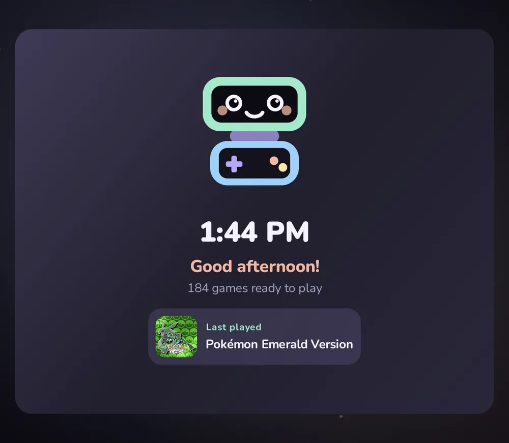
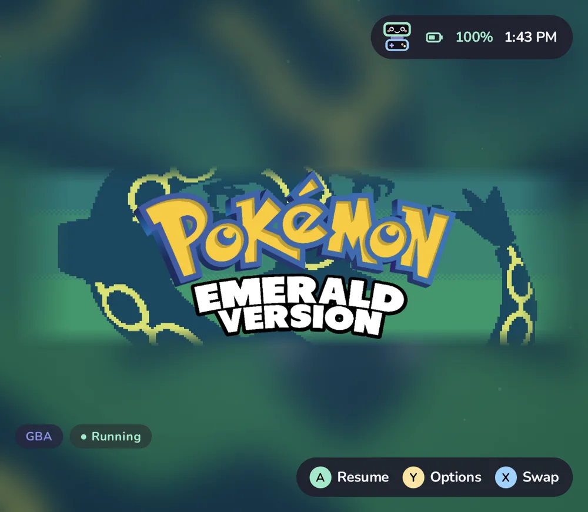
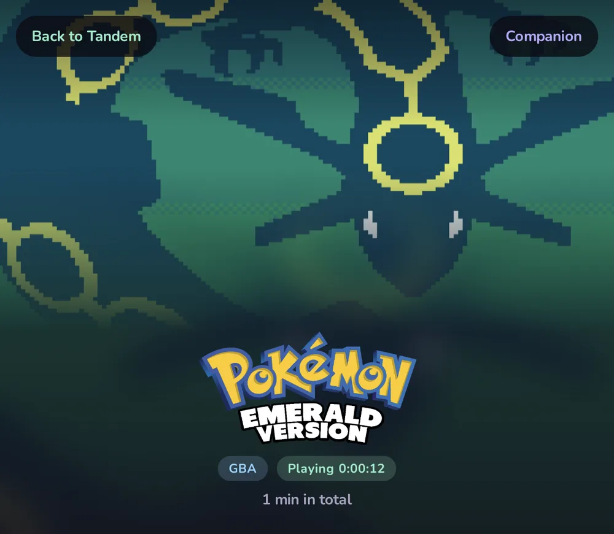
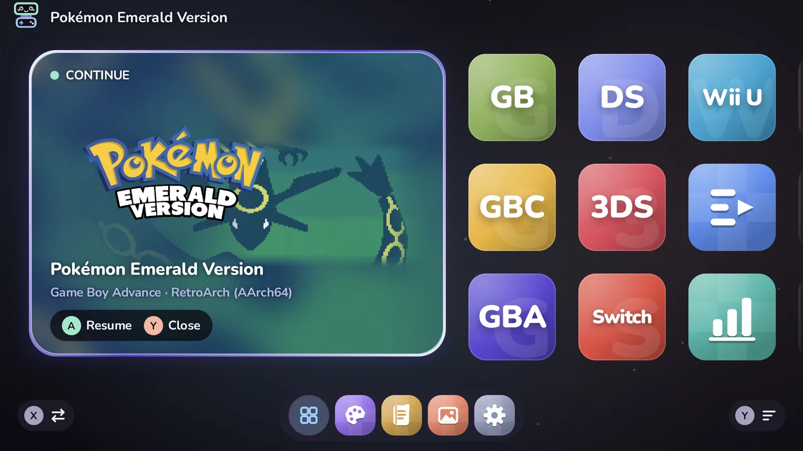

# Setting up on the AYN Thor

The AYN Thor is a clamshell handheld with a 1920×1080 top screen and a 1080×1240 touchscreen below. This page
covers a setup from scratch with the emulators Tandem knows out of the box. If you already use another frontend on
the Thor, skim to [Emulators on the Thor](#emulators-on-the-thor) and [The bottom screen](#the-bottom-screen).

## Before you start

- Update the Thor's system software from AYN's settings app.
- Copy your games to `ROMs` in **internal storage**. See [Getting started](getting-started.md#put-your-games-in-place)
  for the folder names.

## Emulators on the Thor

Install the emulators for the systems you play and open each one once, so it can set itself up and ask for its
permissions.

| System | Emulator | Notes |
| --- | --- | --- |
| Nintendo 3DS | Azahar | Point it at your system files the first time you open it. |
| Nintendo DS | MelonDualDS | A melonDS build with dual-screen support (`me.magnum.melondualds`). Turn on both screens in its settings. |
| Nintendo Switch | Eden | Install keys and firmware in Eden first. |
| Nintendo Wii U | Cemu | Set up its game paths once. |
| Game Boy, Color, Advance | RetroArch (64-bit) | Package `com.retroarch.aarch64`. Download the **mGBA** and **Gambatte** cores from the Online Updater. |

Any other emulator or build works too, once Tandem knows how to start it: see [Systems and emulators](platforms.md).

## Install Tandem

Install the APK from [GitHub Releases](https://github.com/ZahakJ/tandem/releases/latest) or through Obtainium, open
it, and go through the two [first-launch steps](getting-started.md#first-launch).

## The bottom screen

Tandem draws on both screens: the library on top, details for the highlighted item below. The bottom screen never
takes input focus, so the controller keeps driving the library.

### While you play

Tandem keeps the bottom screen during play, in one of three styles:

- **Game art** (the default): the game's art slowly drifting, its logo, this session's time and total play time.
  After a minute without a touch it dims and shifts a few pixels now and then against burn-in. Tap to wake it.
- **Tandem companion**: Pip playing along, clock and battery, session time, your dock apps, brightness, volume and
  Wi-Fi, and buttons for Back to Tandem, Game art and Close game. A dock app you tap opens on the bottom screen.
- **Leave to emulator**: Tandem stays off the bottom screen. This is the default for 3DS and DS, whose emulators
  use both screens. Wii U gets Game art, since Cemu leaves the bottom screen empty.

Choose per system (Y on a system › **Bottom screen while playing**) or per game (Y › More › **Bottom screen while
playing**). Games started on the bottom screen never get it.

Both Tandem styles have a **Screenshot** button (needs [Shizuku](resume.md)): it saves the game's screen to
`ROMs/screenshots/`, where the Gallery shows it, and copies it to the clipboard to paste into a chat.

**Pause games in sleep** (Settings › Play & stats › Privacy & rest, on by default, needs Shizuku with root): a
minute after the screen goes off, games left open are paused, so an emulator's audio can't keep the handheld
awake; they carry on where they were when you wake it.

With an app open on the bottom screen over the game, **Home** brings the game and its companion back without
pausing the game; press it again for Tandem. From the game itself, Home goes to Tandem.

The bottom screen answers touch only; the controller stays with the game. Tapping a dock app gives that app the
controls until you touch the game's screen again, as Android always does. **Close game** needs Shizuku and asks for
a second tap. The companion is designed to cost almost nothing: no continuous animation, and once dimmed it
redraws only twice a minute.

### While an app is open

When Tandem is your Home app, it also fills the bottom screen when nothing else is there, so Android's own app list
doesn't appear by accident:

- With an app in front on the top screen: that app's icon and name, clock, battery and **Back to Tandem**.
- Otherwise: the clock and Pip over a still of your bottom-screen wallpaper.

It dims after a minute and never takes the controller. With Shizuku it also notices apps opened from Recents or a
notification. Android's own launcher is still there when you want it: **All apps › Android home** opens Android's
Home screen on top, and the **Android apps** button opens Android's app list below. Choosing another Home app gives
Android back its usual bottom screen.

Right after installing or updating Tandem, Android may keep its old bottom screen until the next restart; Tandem
covers it the next time it starts an app or game.

If the bottom screen stays black or shows something else while Tandem is open, check that the second screen is on
in the Thor's display settings, then leave Tandem with Home and open it again.

## Resume with Shizuku

[Resume](resume.md) brings a game back mid-level instead of restarting it. It needs Shizuku:

1. Install [Shizuku](https://shizuku.rikka.app/) and start it with **wireless debugging** (needs Wi-Fi to start,
   not to keep running).
2. Allow Tandem, on its setup screen or later in Shizuku's list of authorized apps.
3. **Settings › Play & stats › Playing › Resume running games** shows **Ready** when it works.

Shizuku stops when the Thor restarts; start it again after a reboot. Until then, games simply start fresh.

## Controls

D-pad or left stick to move, <kbd>A</kbd> to open or play, <kbd>B</kbd> back, <kbd>X</kbd> search, <kbd>Y</kbd> options, <kbd>Start</kbd> Settings,
<kbd>Select</kbd> a random unplayed game, <kbd>L1</kbd>/<kbd>R1</kbd> to flip between systems. The full table is in the
[controller reference](controls.md). Tandem follows whatever Android reports as A and B; if they feel swapped, check
the device's controller layout option.

## Tips

- **Keep Tandem's data with your games.** **Settings › Data & about › Back up** saves favorites, play time,
  the look, the home layout and emulator choices to `ROMs/tandem/backup/`; **Restore** puts them back on a new device.
- **Hide what you don't play:** Y on a game › **Hide this game**.
- **Already scraped with ES-DE?** Leave `ROMs/downloaded_media` where it is; Tandem uses the same artwork.
