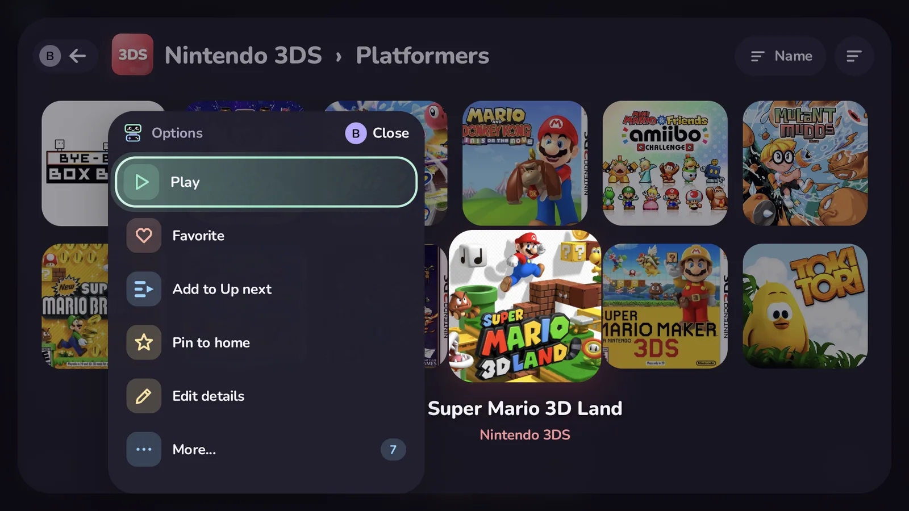

# Controller reference

Every button Tandem uses, on every screen. Tandem is built to be used entirely with a controller; touch works everywhere too (see [Touch](#touch)). A/B and X/Y can be swapped in **Settings › Controls › Buttons**; this page uses the default (Xbox-style positions, A confirms).

## Everywhere

| Button | What it does |
| --- | --- |
| D-pad or left stick | Move the highlight. Hold it and moves repeat; after about a second they come twice as fast, then three times. |
| <kbd>A</kbd> | Open the highlighted item, or play the highlighted game (it fires when you let go, so a press that started elsewhere never selects) |
| <kbd>B</kbd> | Go back, or close a menu. On the home screen B never leaves Tandem: it goes back to the first tile. |
| <kbd>X</kbd> | Search all games (on the icon grid: swap the two screens) |
| <kbd>Y</kbd> | Options for the highlighted thing (see [Y menus](#y-menus)) |
| <kbd>Start</kbd> (tap) | Open Settings, or close it |
| <kbd>Start</kbd> (hold) | Quick panel: brightness, volume, Wi-Fi, and the like |
| <kbd>Select</kbd> (tap) | Surprise me: jump to a random game you have never played |
| <kbd>Select</kbd> (hold), or <kbd>Select</kbd> + <kbd>Start</kbd> | Game switcher: every running game, to resume or close |
| <kbd>L1</kbd> / <kbd>R1</kbd> | Previous or next system, collection or genre (on the icon grid: bigger or smaller icons; in Stats: tabs) |
| <kbd>L2</kbd> / <kbd>R2</kbd> | In a list of games, the previous or next letter (or year, rating); in other long lists and grids a page up or down (on the icon grid: L2 shows the Recently played strip, R2 jumps a page along) |
| <kbd>L1</kbd> + <kbd>R1</kbd> + <kbd>Select</kbd> | Private mode only: reveal or re-hide hidden games |

Analog triggers that only report how far they are pulled (no button events) count as one L2 / R2 press each time you pull past halfway, so a trigger never fires twice.

Every screen remembers what you had highlighted. Going back, or returning from a game, puts the highlight where you left it.

## Touch

Everything works by touch too, the same way as with the buttons.

| Touch | What it does |
| --- | --- |
| Tap a game, system, collection, app or tile | Highlight it (the other screen shows it). Tap it again to open or play it. |
| Tap a button, menu row, setting or key | Use it at once |
| Long press | The same as <kbd>Y</kbd> on that item: its options. On a widget: Widget options. On a row in a Y menu: what its value means, when there is more to say. On the icon grid and in its folders a long press picks the tile up instead (below); the options are on <kbd>Y</kbd> or the **Y Options** hint. |
| Tap a button hint | The same as pressing that button (**A** Open, **Y** Options, **B** Back, **X** Search…). On a ◀▶ hint, tap the left or right side. |
| Drag a list | Scroll it. The highlight stays where it was; the next D-pad press brings it back into view. |

A long press gives a short buzz. On an empty spot of the icon grid the first tap highlights it and a second tap opens Add here.

**Drag and drop on the icon grid.** Hold a tile, folder or widget until it buzzes: it comes up under your finger and follows it. Let go without moving and it goes back. The grid scrolls when you hold near its edge; a paged grid turns the page. The spot it would land on lights up.

- Let go on an empty spot to put it there, or on a tile to swap the two.
- Hold over a folder until it opens, then go on inside it and let go where it should be (or let go on the folder itself).
- Hold over another tile until **+ Folder** shows, and let go: you name a new folder holding both.
- Drag out past the edge of an open folder to go back up a level.
- A widget moves whole and only lands where it fits.

Every drop can be undone (Select, or a tap on the message).

## The Home button

When Tandem is your Android Home app (**Settings › Data & about › Use Tandem as the Home screen**, which asks Android to make it so):

- From a game or another app, **Home** brings you back to Tandem's home screen with every popup closed and the bottom screen restored. If a game is still running, you land on its **Resume page** (**Home & layout › Icon grid › More › Home lands on Resume**).
- **Home again** while you're already on the home screen goes back to the start: the Resume page or the first tile.
- Tandem only ever runs once (one task), so Recents shows it once and Home never stacks a second copy.

Tapping Tandem's launcher icon while it is running does the same as Home.

## Bluetooth and USB controllers

Any controller Android sees works in Tandem. Two things are worth setting up in **Settings › Controls**.

### The controller's Home (guide) button

Many controllers in X-input mode send their Home (guide, Xbox) button as a button Android ignores
(`KEYCODE_BUTTON_MODE`), not as Home. Inside Tandem it works like Home anyway:

| Press | What it does |
| --- | --- |
| Tap | The same as Home: closes every popup and goes to the home screen, a second tap goes back to the first tile |
| Hold | Tandem's game switcher, or Android's recent apps (**Hold the Home button**) |

To make it work in games and other apps too, switch on **Controller Home button**: A on that row opens Android's
Accessibility settings, where you switch on **Tandem: Controller Home button**. Then a tap goes to Android's Home
screen from any app (Tandem's home screen, when Tandem is your Home app) and a hold opens recent apps or Tandem's
game switcher.

- It is an accessibility service only so it can see that one button. It does not read the screen, and it only
  keeps the Home button of external (Bluetooth or USB) controllers; everything else, including the Thor's built-in
  controls, passes straight through.
- If the switch is greyed out, Android 13 is guarding a sideloaded app: open **App info** for Tandem, then **⋮ ›
  Allow restricted settings**, and try again.
- Emulators that map the guide button themselves (to open their own menu, say) won't see it while this is on. Turn
  it off in Accessibility settings if you'd rather they did.

### Nintendo button labels, per controller

**Settings › Controls › Game controllers** lists the controllers connected right now by name. Each has a switch for
**Nintendo button labels (swap A/B, X/Y)**: for Switch-style controllers in X-input mode, whose button printed A
sends B. Switched on, A and B (and X and Y) are swapped for that controller only, so the button printed A confirms.
It applies inside Tandem; the built-in controls and other controllers are unaffected, and **Swap A and B** /
**Swap X and Y** still apply to every controller on top. Emulators have their own per-controller mapping (in
RetroArch, Settings › Input › Port 1 Controls; in standalone emulators, their controller settings), so set the same
there if you want it in games.

## Y menus

Y on anything lifts it out of the screen, a little bigger, over a blurred background, with a short list of actions beside it. The first few are the ones you use most; the rest sit under **More…**. B goes back from More, and closes the menu from the first page; the item settles back into its place.

**On a game:** Play (or Resume), Favorite, Add to Up next, Pin to home (icon grid), Edit details. More: Emulator (A cycles through the installed ones), Start on top or bottom screen, Choose artwork, Scrape this game, Hide, Reset play history, View options.

**On a system, collection or genre:** Open, Rescan games, Scrape these games, Sort by, Game titles, Show hidden games.

**On an icon grid tile:** Open, Move, Select, Move to folder…, Also add to folder…, Take out of the folder (Move up to… in a folder inside a folder), Sort and view or Game options, Design folder…, Rename folder, Sort inside…. More: Delete folder…, Hide, App info, Remove from home (Remove from folder inside one), Add to home…, Sort this folder…, Tidy up, Undo last change, Search, Swap screens.

**On an empty spot of the icon grid:** Paste (while carrying a tile), New folder…, Game…, System…, Collection or genre…, App…, Tandem app…, Widget…. More: Tidy up, Undo last change, Search, Swap screens.

**On a widget on the icon grid:** Widget options…, Move, Resize, the widget's own actions. More: Remove widget, Select, Tidy up, Undo last change, Search, Swap screens.

**With tiles selected** (Y on a tile or an empty spot): Move here, Move to folder…, Also add to folder…, New folder from selection, Remove from home (or from the folder), Hide, Select all, Clear selection.

**On an app** (dock, All apps, Android apps): Open, Open on the other screen, Move left and right (dock), Always open on, Add to home, Pin to dock or Unpin, Rename, Choose icon. More: Treat as game, Hide from drawer, App info, Uninstall… See [Android apps](apps.md).

In **All apps**, X searches. Holding Back for a moment while an app is in front moves it to the other screen ([Android apps](apps.md#moving-an-open-app)).

## The icon grid

| Button | What it does |
| --- | --- |
| D-pad | Move between icons and empty spots, one spot at a time; Left and Right keep their row, Up and Down their column, over gaps and widgets. Left from the first column reaches the Resume page when a game is running |
| <kbd>A</kbd> | Open the icon (a folder pops up over the grid). On an empty spot: the Add here menu. Hold A to select the icon |
| <kbd>Y</kbd> | The tile menu: move, folders, remove, add. On an empty spot: the Add here menu |
| <kbd>X</kbd> | Swap the screens |
| <kbd>L1</kbd> / <kbd>R1</kbd> | Bigger or smaller icons. With fixed rows (**Rows of icons**), L1 means fewer rows and R1 more, from 1 to 5 (1 to 3 on the bottom screen); L1 on the biggest automatic size steps on to fixed rows. Tiles ease to their new size and the highlighted one stays where it is. |
| <kbd>L2</kbd> | Show or hide the Recently played strip (or set it to always show) |
| <kbd>R2</kbd> | A page along the grid, onto the next icon (empty spots are skipped) |
| <kbd>B</kbd> | Back to the first icon |

At **1 row** the grid looks like the 3DS HOME menu zoomed all the way in: one row of big icons in the middle of the screen, and the highlighted item's kind, name, count or play time and a strip of its art above it.

On the **Resume page**: A resumes the game, Y closes it (press twice: closing loses unsaved progress), X opens the game switcher when more than one game runs. A long press there opens the game's options, never Close.

While **moving a tile** it rises off the grid and glides from spot to spot: the D-pad moves it one spot at a time (into empty spots too, anywhere on the empty canvas, hopping over widgets), L1 / R1 a screen at a time, A drops it, B puts it back. Y carries it instead: the D-pad moves freely again, folders open with A, and A on an empty spot › **Paste** puts it there, on the home grid or inside a folder. B stops carrying. While moving a widget, Y changes its size instead. Select puts the tile back and selects it. On a touch screen, a tap on the moving tile drops it, a tap on an empty spot puts it there, and a tap anywhere else puts it back. A move left alone for a minute goes back by itself.

### Selecting several tiles

Y › **Select**, holding A on a tile, or Select while moving a tile starts a selection on that grid (the home grid or one folder). Selected tiles sit a little smaller with a check mark, and a pill at the top shows how many. While selecting:

| Button | What it does |
| --- | --- |
| <kbd>A</kbd> or <kbd>Select</kbd> | Select or deselect the highlighted tile (folders don't open) |
| <kbd>Y</kbd>, or <kbd>A</kbd> on an empty spot | What to do with the selected tiles |
| <kbd>B</kbd> | Clear the selection |

**Move here** puts the selected tiles in the highlighted spot and the free spots after it, in the order they had on the grid; widgets take the first place they fit whole. **Move to folder…** and **Also add to folder…** put them in a folder (moved, or added while staying where they are). **New folder from selection** makes a folder of them in the place of the first one. **Hide** hides the games, systems and folders among them.

### Undo

Changes that take something away or move several things can be undone: removing, hiding, moving, deleting a folder, taking out of a folder, Tidy up, sorting the home grid, a Cocoon import, and removing or resizing a widget. After each one a message shows for 6 seconds; Select (or a tap on the message) undoes it. **Undo last change** is under More… in the Y menu, and in the Start panel while there is something to undo. The last 20 changes are kept, also after a restart.

Hiding or unhiding a game, folder or system, favouriting, and taking a game off Up next ask nothing either: their message offers Undo the same way.

### Hold to confirm

What can't be undone (deleting a game, a folder with its subfolders, a file, a screenshot, a backup or a play session; clearing sessions or downloaded media; resetting play history or the look; restoring a backup) asks you to **hold A** on the button until its ring fills, under a rising tone. Let go sooner and nothing happens. On the touch screen, press and hold the button.

### Empty spots

Empty spots look like nothing until the highlight lands on one: then the ring and a small + show. After the last item the grid always leaves room to place things: two screens of empty columns (rows on a grid that scrolls up and down, whole pages on a paged grid). Only what you place is saved. Folders have empty spots too.

A or Y on an empty spot opens **Add here**:

- **New folder…** names an empty folder and puts it in this spot (on the home grid, or inside a folder that sits on the home grid).
- **Game…** lists every game by system. A picks (several at once, numbered in order), X searches with the on-screen keyboard, Start or **Add** puts them in this spot and the free spots after it.
- **System…**, **Collection or genre…**, **App…**, **Tandem app…** list what isn't on the grid yet; what you pick goes in this spot.
- **Widget…** adds a widget in this spot (home grid only), at its usual size or the biggest that fits.
- **Paste** appears while you carry a tile.

On a touch screen, the first tap on an empty spot highlights it and a second tap opens Add here.

Removing, hiding or moving an icon leaves its spot empty; nothing else shifts. **Tidy up** (Start, or More… in the Y menu) packs every icon to the front, keeping their order and fitting widgets in whole. When the number of rows changes (L1 / R1, or swapped screens), icons keep their row and column if they still fit; otherwise they flow in order, gaps included. A grid without gaps flows as before.

### Widgets on the grid

A widget on the grid covers 1×1, 2×1, 1×2 or 2×2 cells (columns × rows); nothing else goes in the cells it covers. The D-pad moves onto and off it like any icon. Y on it: **Widget options…**, **Move**, **Resize** (the next size that fits where it is), and the widget's own actions; **Remove widget** is under More. A widget never spans two pages on a paged grid.

## Built-in apps

Tandem's own apps sit on the icon grid like any other tile (Y › Remove from home takes one off, Y › Add to home… brings it back):

| App | Buttons |
| --- | --- |
| Gallery | A views a screenshot full screen (Left / Right step through), Y deletes it after a confirm |
| Journal | A writes a note for a session, Y a note for the game; the chips switch between Timeline, Games and With notes |
| Up next | A plays (or edits a note), X adds a game or note, Y removes, Select clears played games |
| Files | A opens a folder, Y deletes the file or folder after a confirm, B goes up a folder |
| Controller test | Every button and stick lights up as you press it; hold B to leave |
| Themes, Stats, Achievements | Open their screens |

## On a system screen

| Button | What it does |
| --- | --- |
| <kbd>L1</kbd> / <kbd>R1</kbd> | Previous or next system |
| <kbd>L2</kbd> / <kbd>R2</kbd> | Jump to the previous or next letter (sorted by name), year or star rating, or a page of games for other sorts; a bubble shows where you landed |
| <kbd>Y</kbd>, on a folder | The View menu: sort order, game titles, hidden games |

## Search

X opens search from anywhere (except the icon grid, where X swaps screens; Y › Search there). The left side is a keyboard laid out for the D-pad: letters, numbers, **Space**, **⌫** to delete and **Clear**. Results appear on the right as you type; move right into them and press A to play. X deletes a letter, Y on a result opens its game menu. Search ignores case, accents and punctuation. B goes back to the keys, then closes.

## Text entry

Anywhere Tandem needs you to type something longer, such as a name or an API key, it shows a full on-screen keyboard. **⇧** switches to capitals, **#+=** to symbols, and **Done** confirms. B cancels.

## Settings

Settings opens on nine tiles, one per page, each showing what is set now; **Quick looks** below them apply a whole setup in one press (press A again to undo). On a page:

| Button | What it does |
| --- | --- |
| <kbd>A</kbd> | Switch a toggle, step to the next value, open a link, or run an action (the hints say which) |
| Left / Right | Step a choice or a slider back and forth (rows drawn ‹ value ›) |
| <kbd>A</kbd> on More options | Show the less common settings of that group |
| <kbd>X</kbd> | Search every setting by name or by what it does ("nintendo", "bigger", "quiet"); A on a result takes you to it |
| <kbd>L1</kbd> / <kbd>R1</kbd> | Previous or next page |
| <kbd>B</kbd> | Back to the tiles |
| <kbd>Start</kbd> | Close Settings |

Game search (X outside Settings) also finds systems, apps and settings: they show as chips above the games.
