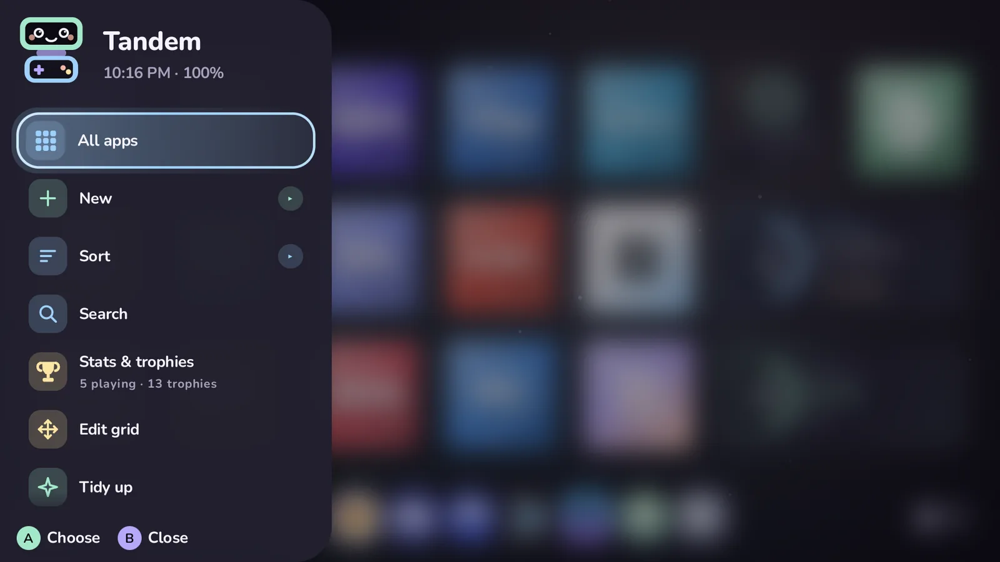
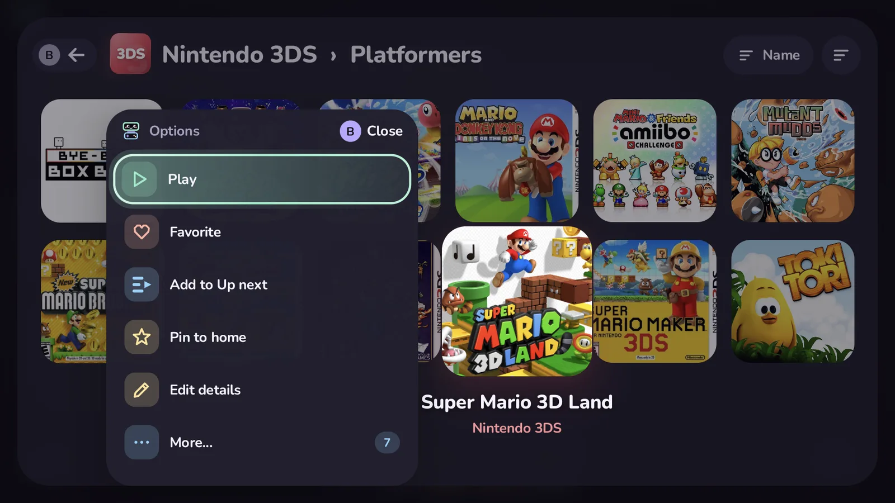
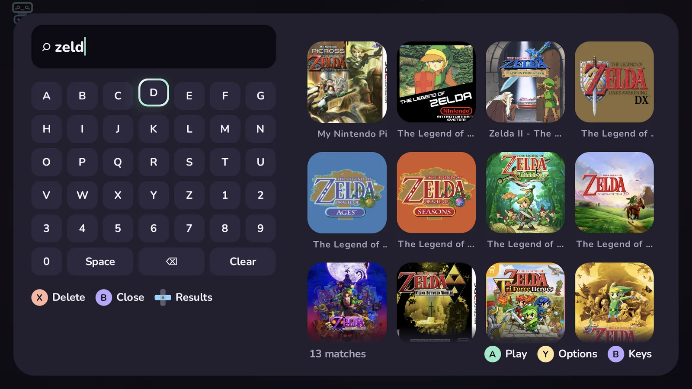

# Controller reference

Every button Tandem uses, on every screen. Tandem is built to be used entirely with a controller, and touch works everywhere too (see [Touch](#touch)).

This page uses the defaults: Xbox-style positions, <kbd>A</kbd> confirms. You can swap A/B and X/Y, or move any of Tandem's commands to another button, in **Settings › Controls › Buttons** (see [Rebinding buttons](#rebinding-buttons)).

## Everywhere

These work on almost every screen.

| Button | What it does |
| --- | --- |
| D-pad or left stick | Move the highlight. Hold it and moves repeat; after about a second they come twice as fast, then three times. |
| <kbd>A</kbd> | Open the highlighted item, or play the highlighted game (it fires when you let go, so a press that started elsewhere never selects) |
| <kbd>B</kbd> | Go back, or close a menu. On the home screen <kbd>B</kbd> never leaves Tandem: it goes back to the first tile. |
| <kbd>X</kbd> | Search all games (on the icon grid: swap the two screens) |
| <kbd>Y</kbd> | Options for the highlighted thing (see [Y menus](#y-menus)) |
| <kbd>Start</kbd> (tap) | The Start panel (see [The Start panel](#the-start-panel)); in Settings, close Settings |
| <kbd>Start</kbd> (hold) | Quick settings: brightness, volume, Wi-Fi, Battery saver and the like |
| <kbd>Select</kbd> (tap) | Surprise me: jump to a random game you have never played |
| <kbd>Select</kbd> (hold), or <kbd>Select</kbd> + <kbd>Start</kbd> | Game switcher: every running game, to resume or close |
| <kbd>L1</kbd> / <kbd>R1</kbd> | Previous or next system, collection or genre (on the icon grid and inside its folders and systems: bigger or smaller icons; in Stats: tabs) |
| <kbd>L2</kbd> / <kbd>R2</kbd> | In a list of games, the previous or next letter (or year, rating); in other long lists and grids a page up or down (on home, <kbd>R2</kbd> opens the side panel; on the icon grid <kbd>L2</kbd> shows the Recently played strip) |
| <kbd>L1</kbd> + <kbd>R1</kbd> + <kbd>Select</kbd> | Private mode off: turn it on at once. Private mode on: show hidden games (after your PIN), or tuck them away again. See [Private mode](privacy.md#private-mode) |

Every screen remembers what you had highlighted. Going back, or returning from a game, puts the highlight where you left it.

Button prompts and analog triggers

Button hints name Start and Select (<kbd>Start</kbd>, <kbd>Select</kbd>) as they are labelled on the Thor; with **Button prompts** set to Nintendo they show + and −.

Analog triggers that only report how far they are pulled (no button events) press <kbd>L2</kbd> / <kbd>R2</kbd> when you pull past halfway and let go of it when you release, so a trigger never fires twice.

## Rebinding buttons

Put any of Tandem's commands on the button you like, a chord of buttons, or a hold.

**Settings › Controls › Buttons › Rebind buttons** lists every command Tandem has on a button, with what it is on now: Open / Select, Back, Game options, Swap screens / Search, Start menu, Quick settings, Running games (held, and pressed together), Surprise me, Hidden games, Previous and Next tab or page, Page up and Page down, Side panel, Favourite, Screenshot, Clip and Controller Home.

Favourite, Screenshot and Clip have no button until you give them one. Screenshot and Clip capture the game on the other screen, as the companion's chips do, while Tandem is in front.

| Button | What it does |
| --- | --- |
| <kbd>A</kbd> on a command | Listen for its new button: press one button, several together for a chord, or hold one for a hold. You have 5 seconds (the popup counts down, and waits while buttons are still down); <kbd>B</kbd> cancels |
| <kbd>X</kbd> on a command | Put it back on its default |
| <kbd>Y</kbd> on a command | Take its button away (not for Open and Back, which always keep one) |
| <kbd>A</kbd> on **Reset all** | Every command back on its default, with Undo |

When the new binding already belongs to another command, Tandem offers to swap the two: the other command takes the old binding (or none). Every hint follows your bindings: a hint shows the button its command is on (in your **Button prompts** style), or the chord or hold in words.

Bindings Tandem refuses, and other fine print

Some bindings can't work and are refused with the reason:

- Open and Back take a single button that no chord or hold uses (they need its own press and release: <kbd>A</kbd> held on a tile, <kbd>B</kbd> to go back).
- A chord can't sit inside another chord.
- A swap that would leave Open or Back without a button, or give it a chord, is refused too.

**Swap A and B** and **Swap X and Y** are the same thing as bindings: they swap Open with Back and Game options with Swap screens / Search (an older setup's swaps become bindings on first start). Hints use + and − for Start and Select in the Nintendo style.

A button that a hold or chord uses waits for its release before it does its tap: with the defaults that is <kbd>Select</kbd>, <kbd>Start</kbd> (holds), <kbd>L1</kbd> and <kbd>R1</kbd> (part of <kbd>L1</kbd> + <kbd>R1</kbd> + <kbd>Select</kbd>), so <kbd>L1</kbd> and <kbd>R1</kbd> turn pages as you let go.

The controller's own **Nintendo button labels** switch is applied first; bindings name buttons as printed on the controller. Bindings work while Tandem is in front; outside it, the **Controller Home button** service keeps using the guide button whatever Controller Home is bound to.

## Touch

Everything works by touch too, the same way as with the buttons.

| Touch | What it does |
| --- | --- |
| Tap a game, system, collection, app or tile | Highlight it (the other screen shows it). Tap it again to open or play it. |
| Tap a button, menu row, setting or key | Use it at once |
| Long press | The same as <kbd>Y</kbd> on that item: its options. On a widget: Widget options. On a row in a Y menu: what its value means, when there is more to say. On the icon grid and in its folders a long press picks the tile up instead (below); the options are on <kbd>Y</kbd> or the **Y Options** hint. |
| Tap a button hint | The same as pressing that button (**A** Open, **Y** Options, **B** Back, **X** Search…). On a <kbd>◀</kbd><kbd>▶</kbd> hint, tap the left or right side. |
| Drag a list | Scroll it. The highlight stays where it was; the next D-pad press brings it back into view. |

A long press gives a short buzz. On an empty spot of the icon grid the first tap highlights it and a second tap opens Add here.

**Drag and drop on the icon grid.** Hold a tile, folder or widget until it buzzes: it comes up under your finger and follows it. The spot it would land on lights up.

- Let go on an empty spot to put it there, or on a tile to swap the two.
- Hold over a folder until it opens, then go on inside it and let go where it should be (or let go on the folder itself).
- Hold over another tile until **+ Folder** shows, and let go: you name a new folder holding both.
- Drag out past the edge of an open folder to go back up a level.
- A widget moves whole and only lands where it fits.
- Let go without moving and it goes back. The grid scrolls when you hold near its edge; a paged grid turns the page.

Every drop can be undone (<kbd>Select</kbd>, or a tap on the message).

## The Start panel

A tap on <kbd>Start</kbd> folds a panel open from the left, for going places and arranging the home screen. <kbd>B</kbd> goes back a page, then closes it; <kbd>Start</kbd> closes it too.

Switches for the device (brightness, Wi-Fi, Battery saver, the screensaver) are in [Quick settings](#quick-settings) instead, so nothing is in both. Its rows come in three groups:

| Row | What it does |
| --- | --- |
| Switch games | Only while a game runs: the game switcher |
| All apps | The apps drawer |
| Search | Search all games |
| Stats & trophies | The Stats screen; beside it, the trophies earned so far |
| New ▸ | On the icon grid: New folder…, Smart folder…, Add to home…, Widget…. Otherwise: Widget… |
| Sort ▸ | On the icon grid: close the gaps, or the home grid A to Z, by recently or most played, or systems first; then how games are sorted |
| Edit grid | On the icon grid: the highlighted tile starts moving; other layouts get Edit widgets |
| Undo | For 15 minutes after a change on the icon grid, with what it takes back beside it (older steps: <kbd>Y</kbd> › **More › Undo last change**) |
| Hidden | Only while something is hidden: see [Hidden games](privacy.md#hidden-games-folders-and-systems) |
| Settings | Settings' home, where every page and the search are |
| Tandem 0.6.1 is out | Only when a newer Tandem is out: <kbd>A</kbd> shows its release notes and **Update** (see [Software updates](getting-started.md#software-updates)) |

Themes, sounds and music are in **Settings › Look & feel** and **Settings › Sound & music**, and in the **Themes** app.

## The top bar

A bar along the top of every screen but the icon grid home (and folders opened full screen): where you are, and a few handy chips. From the left: Pip and where you are (**Tandem › Nintendo 3DS › RPG**), then on the right:

| Item | When it shows | <kbd>A</kbd> does |
| --- | --- | --- |
| **✦ Scraping 12/40** | While a scrape runs (**⏸ Scraping paused** while it waits) | Nothing; the progress is on the other screen |
| **▶ 2 open** | While games are running | The game switcher |
| **▦ Grid** (the games view) | Inside a system or collection | The next view: Grid, List, Carousel, Shelf, Case |
| **★ Stats** | Everywhere but Stats | The Stats screen |
| **◐ Quick** | Always | Quick settings |
| Battery, clock | As set in **Settings › Home & layout › Clock** and **Battery** | |

Press <kbd>▲</kbd> from the top of a page to reach the bar, <kbd>◀</kbd> / <kbd>▶</kbd> to move along it, and <kbd>▼</kbd> to go back to the page, onto what you had highlighted there.

## Quick settings

The switches for the device, nothing that takes you somewhere else. Hold <kbd>Start</kbd>, or choose **◐ Quick** in the top bar, or press <kbd>A</kbd> on the Battery widget.

Brightness and volume, then tiles for Wi-Fi, Bluetooth, Airplane, Controller, Discord, Battery saver, Private mode, Screensaver and Android's settings. See [Every setting › Quick settings](settings.md#quick-settings) for what each does.

## The side panel

<kbd>R2</kbd> on the home screen slides a panel in from the right: Pip with the date and time, battery and free space, the quick settings (the same sliders and tiles as holding <kbd>Start</kbd>, smaller), and your Android notifications. It all scrolls as one list. <kbd>R2</kbd> or <kbd>B</kbd> closes it.

- Notifications are grouped by app, newest app first, with the app's icon and name once above its cards.
- <kbd>A</kbd> opens a notification. <kbd>Y</kbd> clears the highlighted one (its card says **Y Clear**); it slides away and the highlight moves to the next. **Clear all** clears every one that can be cleared.
- Notices Android keeps up while something is on (USB file transfer, USB debugging, a running service) can't be cleared, so they sit apart as small chips under **On the device**; <kbd>A</kbd> still opens one. Pip only counts the ones you can clear.
- The first time, a card asks to **Let Pip show your notifications**: <kbd>A</kbd> allows Tandem straight away with Shizuku, or opens Android's **Notification access** page.
- In private mode each card shows only the app and the time, never what the notification says.

> [!NOTE]
> Notifications stay on the device and are never stored or sent.

## The Home button

What <kbd>Home</kbd> does when Tandem is your Android Home app (**Settings › Play & system › Use Tandem as the Home screen**, which asks Android to make it so):

- **From a game or another app**, <kbd>Home</kbd> brings you back to Tandem's home screen with every popup closed and the bottom screen restored. If a game is still running, you land on its **Resume page** (**Settings › Home & layout › Resume page**: Opens first).
- **With a game running and another app over it** (Discord on the bottom screen over the companion, or a browser on the top screen over the game), the first <kbd>Home</kbd> brings the game back with its companion on the bottom screen, and the game keeps the controller. <kbd>Home</kbd> again within a few seconds goes to Tandem as usual.
- **Already on the home screen**, <kbd>Home</kbd> goes back to the start: the Resume page or the first tile.

Tapping Tandem's launcher icon while it is running does the same as <kbd>Home</kbd>. Tandem only ever runs once (one task), so Recents shows it once and <kbd>Home</kbd> never stacks a second copy.

## Bluetooth and USB controllers

Any controller Android sees works in Tandem. A few things are worth setting up in **Settings › Controls**.

### The controller's Home (guide) button

Inside Tandem, a controller's Home (guide, Xbox) button works like <kbd>Home</kbd>, even on controllers that send it as a button Android ignores.

| Press | What it does |
| --- | --- |
| Tap | The same as Home: closes every popup and goes to the home screen, a second tap goes back to the first tile |
| Hold | Tandem's game switcher, or Android's recent apps (**Hold the Home button**) |

To make it work in games and other apps too:

1. Go to **Settings › Controls › Connected controllers** and press <kbd>A</kbd> on **Controller Home button**. Android's Accessibility settings open.
2. Switch on **Tandem: Controller Home button**.

Then a tap goes to Android's Home screen from any app (Tandem's home screen, when Tandem is your Home app) and a hold opens recent apps or Tandem's game switcher.

> [!TIP]
> If the switch is greyed out, Android 13 is guarding a sideloaded app: open **App info** for Tandem, then **⋮ › Allow restricted settings**, and try again.

Why an accessibility service, and what it can see

Many controllers in X-input mode send their Home button as `KEYCODE_BUTTON_MODE`, not as Home, so Android ignores it outside Tandem.

- It is an accessibility service only so it can see that one button. It does not read the screen, and it only keeps the Home button of external (Bluetooth or USB) controllers; everything else, including the Thor's built-in controls, passes straight through.
- Emulators that map the guide button themselves (to open their own menu, say) won't see it while this is on. Turn it off in Accessibility settings if you'd rather they did.

### Nintendo button labels, per controller

For Switch-style controllers in X-input mode, whose button printed A sends B. **Settings › Controls › Connected controllers** lists the controllers connected right now by name, each with a switch for **Nintendo button labels (swap A/B, X/Y)**.

Switched on, A and B (and X and Y) are swapped for that controller only, so the button printed A confirms.

How it combines with your bindings and with emulators

It applies inside Tandem; the built-in controls and other controllers are unaffected, and your bindings (**Swap A and B**, **Swap X and Y**, **Rebind buttons**) apply to every controller on top, by the buttons as printed.

Emulators have their own per-controller mapping (in RetroArch, **Settings › Input › Port 1 Controls**; in standalone emulators, their controller settings), so set the same there if you want it in games.

### Play with a controller (passthrough)

Let a Bluetooth or USB controller play **as** the built-in one, in every emulator, mid-game, with nothing to change in their settings.

Emulators bind player 1 to the built-in controls (Eden by the controller's GUID, RetroArch by its port), so a controller you connect is usually ignored until you remap it in each emulator. With passthrough, games keep listening to the built-in controls, and Tandem passes the controller's buttons, sticks, triggers and D-pad to them.

- **During a game**, a controller that connects offers itself on the bottom screen: **Play with Xbox Wireless Controller?** Press its <kbd>A</kbd> or <kbd>Start</kbd> (or tap **Play with it**). Without the companion on the bottom screen, Android shows the same question as a short message over the game. It goes away by itself after about 12 seconds.
- **Controller** in Quick settings (hold <kbd>Start</kbd>), or **Settings › Controls › Controller in games**, steps through **Built-in** and each connected controller.
- **Always use a connected pad** takes any controller that connects straight away, without asking.
- **Disconnecting** the controller (switched off, unplugged, out of range) goes back to the built-in controls by itself.
- The built-in controls keep working alongside: both drive player 1.

> [!IMPORTANT]
> Passthrough needs **Shizuku** (or root): a game only reads the built-in controller, and only they can feed it. Without either, the setting says so and the Quick settings tile stays hidden. With root and no Shizuku, the root app asks once.

**Two players.** Leave **Always use a connected pad** off and answer **Not now** (or just let the offer go): the controller then stays a controller of its own, and the emulator needs it mapped as **Player 2** in its controller settings.

How the buttons line up, and rumble

| Controller | Built-in control |
| --- | --- |
| A, B, X, Y, bumpers, stick clicks, Start | The same buttons (with **Nintendo button labels** on for that controller, A/B and X/Y swap first, as in Tandem) |
| View / Back / Select | Select |
| Guide (Xbox) button | Home |
| Sticks, D-pad | Sticks, D-pad |
| Analog triggers | The analog triggers, and L2 / R2 past 30 % of the pull (emulators such as Eden bind ZL / ZR to those buttons) |

Rumble stays on the handheld. While a controller plays as the built-in one, Android doesn't see it as a controller of its own, so its guide button is a plain Home (tap only) rather than **Controller Home button** above.

## Y menus

<kbd>Y</kbd> on anything lifts it out of the screen, a little bigger, over a blurred background, with a short list of actions beside it. The first few are the ones you use most; the rest sit under **More…**. <kbd>B</kbd> goes back from More, and closes the menu from the first page; the item settles back into its place.

**On a game:**

- Play (or Resume), Favorite, Status (Backlog, Playing, Finished, Completed, Shelved, Endless or none; see [Game status](library.md#game-status)), Add to Up next, Pin to home (icon grid).
- Build native version and Building natively (Switch games Peanuts Native can build; see [Switch games](switch.md#peanuts-native)).
- Notes, Manual (only when the game has one; see [Manuals and guides](library.md#manuals-and-guides)), Achievements (Steam games, once signed in), Edit details.
- **More…**: Emulator (the installed ones that take this file), Start on (top or bottom screen), Bottom screen while playing, Performance mode, Fan mode and Refresh rate (AYN handhelds; see [Performance profiles](ayn-thor.md#performance-profiles)), Choose artwork, Scrape this game, Hide this game, Play sessions… and Reset play history (once played), Delete game… (Uninstall app… for an Android game), View options.

Each choice in More (Emulator, Start on…) lists its options with <kbd>A</kbd>, the one in use ticked; <kbd>◀</kbd> / <kbd>▶</kbd> step through them too.

**On a system, collection or genre:** Open, Rescan games, Scrape these games, Hide this system (or Hide this folder; Unhide once hidden), Sort by, Game titles, Show hidden games. <kbd>A</kbd> on a system in **Systems and emulators** opens its emulator, start screen and **Bottom screen while playing** (see [Systems and emulators](platforms.md#the-systems-and-emulators-screen)).

**On an app** (dock, All apps, Android apps): Open, Open on the other screen, Move left and right (dock), Always open on, Add to home, Pin to dock or Unpin, Rename, Choose icon. **More…**: Treat as game, Hide from drawer, App info, Uninstall… See [Android apps](apps.md).

In **All apps**, <kbd>X</kbd> searches. Holding Back for a moment while an app is in front moves it to the other screen ([Android apps](apps.md#moving-an-open-app)).

Y menus on the icon grid: tiles, empty spots, widgets, selections

**On an icon grid tile:** Open, Move, Select, Move to folder…, Also add to folder…, Take out of the folder (Move up to… in a folder inside a folder), Sort and view or Game options, Design folder…, Rename folder, Sort inside…, View as…. **More…**: Delete folder…, Hide, App info, Remove from home (Remove from folder inside one), Add to home…, Sort this folder…, Tidy up, Undo last change, Search, Swap screens.

**On an empty spot of the icon grid:** Paste (while carrying a tile), New folder…, Smart folder…, Game…, System…, Collection or genre…, App…, Tandem app…, Widget… (in a folder, the one-spot widgets). **More…**: Tidy up, Undo last change, Search, Swap screens, and in an arranged system Show as a plain list.

**On a widget on the icon grid:** Widget options…, Move, Resize, the widget's own actions. **More…**: Remove widget, Select, Tidy up, Undo last change, Search, Swap screens.

**With tiles selected** (<kbd>Y</kbd> on a tile or an empty spot): Move here, Move to folder…, Also add to folder…, New folder from selection, Remove from home (or from the folder), Hide, Select all, Clear selection.

**Arranging a system:** <kbd>Y</kbd> on a system's tile › **Arrange like a folder**. It then opens as a folder that still holds every one of its games, new ones included, and takes empty spots, folders of its own (a **Smart folder…** made there starts limited to that system, so picking a genre is all it needs) and widgets. Your files never move. <kbd>Y</kbd> › **Show as a plain list** turns it back; folders made inside it move to the home grid.

## The icon grid

The 3DS-style home: a grid of icons, folders and widgets you arrange yourself.

| Button | What it does |
| --- | --- |
| D-pad | Move between icons and empty spots, one spot at a time; <kbd>◀</kbd> / <kbd>▶</kbd> keep their row, <kbd>▲</kbd> / <kbd>▼</kbd> their column, over gaps and widgets. <kbd>◀</kbd> from the first column reaches the Resume page when a game is running |
| <kbd>A</kbd> | Open the icon (a folder pops up over the grid). On an empty spot: the Add here menu. Hold <kbd>A</kbd> to select the icon |
| <kbd>Y</kbd> | The tile menu: move, folders, remove, add. On an empty spot: the Add here menu |
| <kbd>X</kbd> | Swap the screens. Inside a folder: the next view (Grid, Shelf, Case, Carousel; see [Home folders](library.md#home-folders)) |
| <kbd>L1</kbd> / <kbd>R1</kbd> | Bigger or smaller icons. With fixed rows (**Rows of icons**), <kbd>L1</kbd> means fewer rows and <kbd>R1</kbd> more, from 1 to 5 (1 to 3 on the bottom screen); <kbd>L1</kbd> on the biggest automatic size steps on to fixed rows. Tiles ease to their new size and the highlighted one stays where it is. |
| <kbd>L2</kbd> | Show or hide the Recently played strip (or set it to always show) |
| <kbd>R2</kbd> | The side panel (see [The side panel](#the-side-panel)) |
| <kbd>B</kbd> | Back to the first icon |

At **1 row** the grid looks like the 3DS HOME menu zoomed all the way in: one row of big icons in the middle of the screen, and the highlighted item's kind, name, count or play time and a strip of its art above it.

**On the Resume page:** <kbd>A</kbd> resumes the game, <kbd>Y</kbd> closes it (press twice: closing loses unsaved progress), <kbd>X</kbd> opens the game switcher when more than one game runs. A long press there opens the game's options, never Close.

**Moving a tile.** It rises off the grid and glides from spot to spot:

| Button | What it does |
| --- | --- |
| D-pad | Move it one spot at a time (into empty spots too, anywhere on the empty canvas, hopping over widgets) |
| <kbd>L1</kbd> / <kbd>R1</kbd> | Move it a screen at a time |
| <kbd>A</kbd> | Drop it |
| <kbd>B</kbd> | Put it back |
| <kbd>Y</kbd> | Carry it instead: the D-pad moves freely again, folders open with <kbd>A</kbd>, and <kbd>A</kbd> on an empty spot › **Paste** puts it there, on the home grid or inside a folder. <kbd>B</kbd> stops carrying. While moving a widget, <kbd>Y</kbd> changes its size instead |
| <kbd>Select</kbd> | Put the tile back and select it |

On a touch screen, a tap on the moving tile drops it, a tap on an empty spot puts it there, and a tap anywhere else puts it back. A move left alone for a minute goes back by itself.

### Selecting several tiles

Work on many tiles at once. <kbd>Y</kbd> › **Select**, holding <kbd>A</kbd> on a tile, or <kbd>Select</kbd> while moving a tile starts a selection on that grid (the home grid or one folder). Selected tiles sit a little smaller with a check mark, and a pill at the top shows how many. While selecting:

| Button | What it does |
| --- | --- |
| <kbd>A</kbd> or <kbd>Select</kbd> | Select or deselect the highlighted tile (folders don't open) |
| <kbd>Y</kbd>, or <kbd>A</kbd> on an empty spot | What to do with the selected tiles |
| <kbd>B</kbd> | Clear the selection |

- **Move here** puts the selected tiles in the highlighted spot and the free spots after it, in the order they had on the grid; widgets take the first place they fit whole.
- **Move to folder…** and **Also add to folder…** put them in a folder (moved, or added while staying where they are).
- **New folder from selection** makes a folder of them in the place of the first one.
- **Hide** hides the games, systems and folders among them.

### Undo

Changes that take something away or move several things can be undone. After each one a message shows for 6 seconds; <kbd>Select</kbd> (or a tap on the message) undoes it.

**Undo last change** is under **More…** in the Y menu, and in the Start panel while there is something to undo. The last 20 changes are kept, also after a restart.

What can be undone

Removing, hiding, moving, deleting a folder, taking out of a folder, Tidy up, sorting the home grid, a Cocoon import, and removing or resizing a widget.

Hiding or unhiding a game, folder or system, favouriting, and taking a game off Up next ask nothing either: their message offers Undo the same way. A hidden game is gone from view, so after the 6 seconds <kbd>Start</kbd> › **Hidden** is the way back.

### Hold to confirm

What can't be undone asks you to hold <kbd>A</kbd> on the button until its ring fills, under a rising tone. Let go sooner and nothing happens. On the touch screen, press and hold the button.

That covers deleting a game, a folder with its subfolders, a file, a screenshot, a backup or a play session; clearing sessions or downloaded media; resetting play history or the look; and restoring a backup.

### Empty spots

Room to place things. Empty spots look like nothing until the highlight lands on one: then the ring and a small + show. After the last item the grid always leaves two screens of empty columns (rows on a grid that scrolls up and down, whole pages on a paged grid). Only what you place is saved. Folders have empty spots too.

<kbd>A</kbd> or <kbd>Y</kbd> on an empty spot opens **Add here**:

- **New folder…** names an empty folder and puts it in this spot (on the home grid, or inside a folder that sits on the home grid).
- **Game…** lists every game by system. <kbd>A</kbd> picks (several at once, numbered in order), <kbd>X</kbd> searches with the on-screen keyboard, <kbd>Start</kbd> or **Add** puts them in this spot and the free spots after it.
- **System…**, **Collection or genre…**, **App…**, **Tandem app…** list what isn't on the grid yet; what you pick goes in this spot.
- **Widget…** adds a widget in this spot (home grid only), at its usual size or the biggest that fits.
- **Paste** appears while you carry a tile.

On a touch screen, the first tap on an empty spot highlights it and a second tap opens Add here.

Removing, hiding or moving an icon leaves its spot empty; nothing else shifts. **Tidy up** (<kbd>Start</kbd>, or **More…** in the Y menu) packs every icon to the front, keeping their order and fitting widgets in whole.

Dead spots, and what happens when the rows change

When a tile's game is renamed or deleted outside Tandem, its spot goes dead; new tiles (a game or system that just appeared) fill the first dead spots before going to the end, so they never land after a blank.

When the number of rows changes (<kbd>L1</kbd> / <kbd>R1</kbd>, or swapped screens), icons keep their row and column if they still fit; otherwise they flow in order, gaps included. A grid without gaps flows as before.

### Widgets on the grid

A widget on the grid covers 1×1, 2×1, 1×2 or 2×2 cells (columns × rows); nothing else goes in the cells it covers. The D-pad moves onto and off it like any icon.

<kbd>Y</kbd> on it: **Widget options…**, **Move**, **Resize** (the next size that fits where it is), and the widget's own actions; **Remove widget** is under More. A widget never spans two pages on a paged grid.

## Built-in apps

Tandem's own apps sit on the icon grid like any other tile (<kbd>Y</kbd> › **Remove from home** takes one off, <kbd>Y</kbd> › **Add to home…** brings it back):

| App | Buttons |
| --- | --- |
| Gallery | <kbd>A</kbd> views a screenshot full screen (<kbd>◀</kbd> / <kbd>▶</kbd> step through), <kbd>Y</kbd> deletes it after a confirm |
| Journal | <kbd>A</kbd> writes a note for a session, <kbd>Y</kbd> a note for the game; the chips switch between Timeline, Games and With notes |
| Notes | <kbd>A</kbd> opens a notebook, a note or the highlighted part of a note, <kbd>X</kbd> adds, <kbd>Y</kbd> has the options, <kbd>Select</kbd> searches; drawing has its own buttons (see [Notes](notes.md)) |
| Up next | <kbd>A</kbd> plays (or edits a note), <kbd>X</kbd> adds a game or note, <kbd>Y</kbd> removes, <kbd>Select</kbd> clears played games |
| Files | <kbd>A</kbd> opens a folder, <kbd>Y</kbd> deletes the file or folder after a confirm, <kbd>B</kbd> goes up a folder |
| Controller test | Every button and stick lights up as you press it; hold <kbd>B</kbd> to leave |
| Themes, Stats, Trophies | Open their screens (Trophies opens Stats on its Trophies tab; <kbd>L1</kbd> and <kbd>R1</kbd> switch tabs there) |

## Reading a manual

<kbd>Y</kbd> › **Manual** on a game opens its manual or guide (see [Manuals and guides](library.md#manuals-and-guides)):

| Button | What it does |
| --- | --- |
| <kbd>◀</kbd> / <kbd>▶</kbd>, <kbd>L1</kbd> / <kbd>R1</kbd> | Previous or next page (chapter, in a text guide) |
| <kbd>▲</kbd> / <kbd>▼</kbd> | Scroll a page that is taller than the screen (zoomed, or text) |
| <kbd>A</kbd> | Fit the whole page, or its width (zoomed, scrolling); in a text guide, larger or smaller type |
| <kbd>Start</kbd> | Go to a page by number |
| <kbd>B</kbd> | Back |

By touch: tap the left or right third of the page to turn, the middle to zoom, and drag or tap the slim bar under the page to jump.

## On a system screen

Inside a system, the shoulders and triggers move you through your games fast.

| Button | What it does |
| --- | --- |
| <kbd>L1</kbd> / <kbd>R1</kbd> | Previous or next system |
| <kbd>L2</kbd> / <kbd>R2</kbd> | Jump to the previous or next letter (sorted by name), year or star rating, or a page of games for other sorts; a bubble shows where you landed |
| <kbd>Y</kbd>, on a folder | The View menu: sort order, game titles, hidden games |

## Search

Find any game by typing a few letters. <kbd>X</kbd> opens search from almost anywhere; on the icon grid and Orbit homes <kbd>X</kbd> swaps screens and on Spotlight it opens the highlighted game's story, so use <kbd>Start</kbd> › **Search** (or <kbd>Y</kbd> › **Search** on the grid) there.

| Button | What it does |
| --- | --- |
| D-pad, <kbd>A</kbd> | Type on the keyboard on the left: letters, numbers, **Space**, **⌫** to delete and **Clear** |
| <kbd>▶</kbd> into the results, then <kbd>A</kbd> | Play the game |
| <kbd>X</kbd> | Delete a letter |
| <kbd>Y</kbd> on a result | Its game menu |
| <kbd>B</kbd> | Back to the keys, then close |

Results appear on the right as you type. Search ignores case, accents and punctuation, and also finds systems, apps and settings: they show as chips above the games.

## Text entry

Anywhere Tandem needs you to type something longer, such as a name or an API key, it shows a full on-screen keyboard. **⇧** switches to capitals, **#+=** to symbols, and **Done** confirms. <kbd>B</kbd> cancels.

The private mode PIN has its own keypad, laid out like a phone's: the D-pad and <kbd>A</kbd> type a digit (or tap it), <kbd>X</kbd> deletes, <kbd>Start</kbd> or **OK** confirms, <kbd>Y</kbd> is **Forgot PIN**, <kbd>B</kbd> cancels.

## Settings

Settings opens on seven tiles, one per page, each showing what is set now. On a page:

| Button | What it does |
| --- | --- |
| <kbd>A</kbd> | Switch a toggle, step to the next option, open a link, or run an action (the hints say which). On a choice with many options (its value has a small grid mark beside it), <kbd>A</kbd> opens them all as cards, starting on the one in use: pick one with <kbd>A</kbd>, or <kbd>B</kbd> to leave it as it is |
| <kbd>◀</kbd> / <kbd>▶</kbd> | Move along a choice's options (a few short ones sit on the row itself, the one in use filled) or slide a number |
| <kbd>A</kbd> on a › row that names a group (Wallpaper ›, Accounts ›) | Open that short page; <kbd>B</kbd> comes back |
| <kbd>X</kbd> | Search every setting by name or by what it does ("nintendo", "bigger", "quiet"); <kbd>A</kbd> on a result takes you to it |
| <kbd>L1</kbd> / <kbd>R1</kbd> | Previous or next page |
| <kbd>B</kbd> | Back to the tiles |
| <kbd>Start</kbd> | Close Settings |

Every setting, with its default, is on [Every setting](settings.md).
