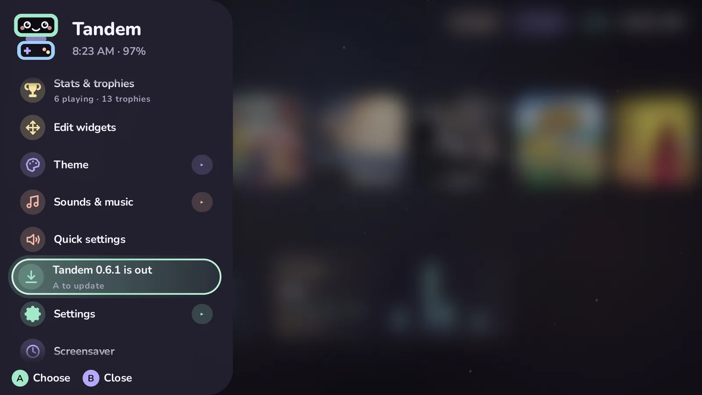
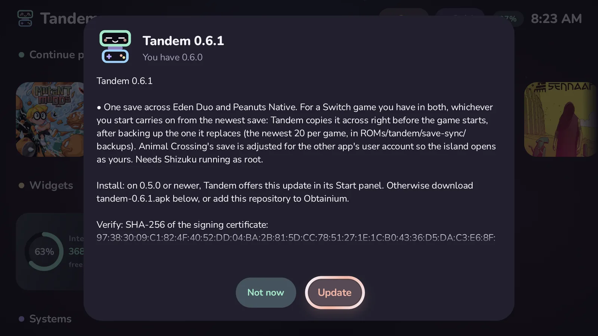
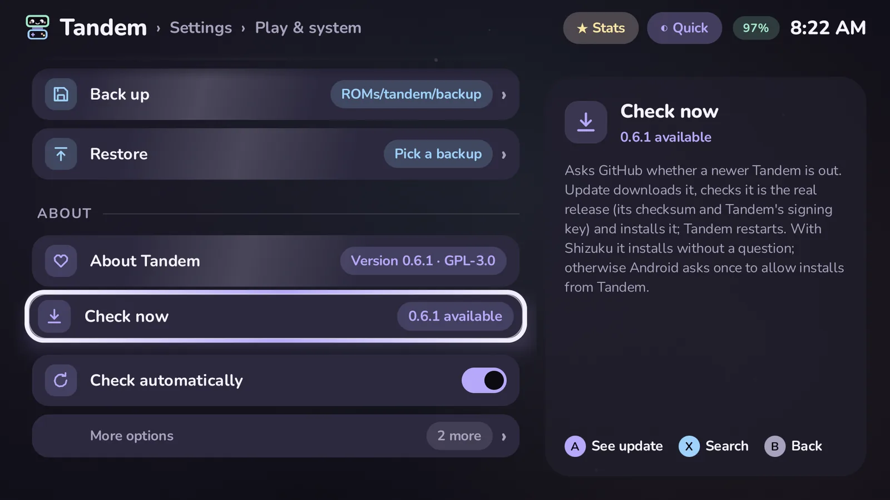
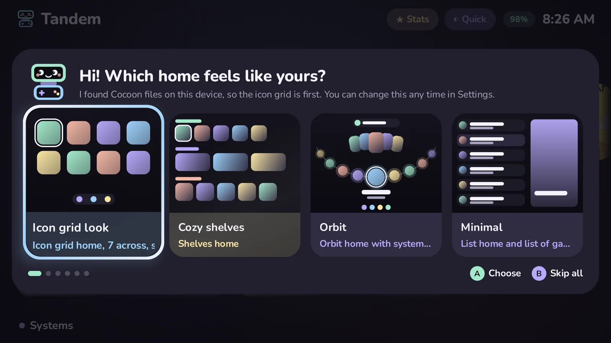
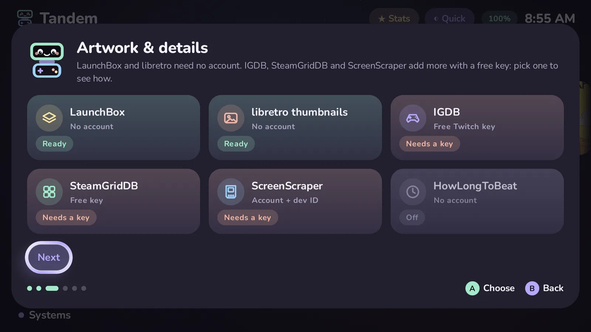
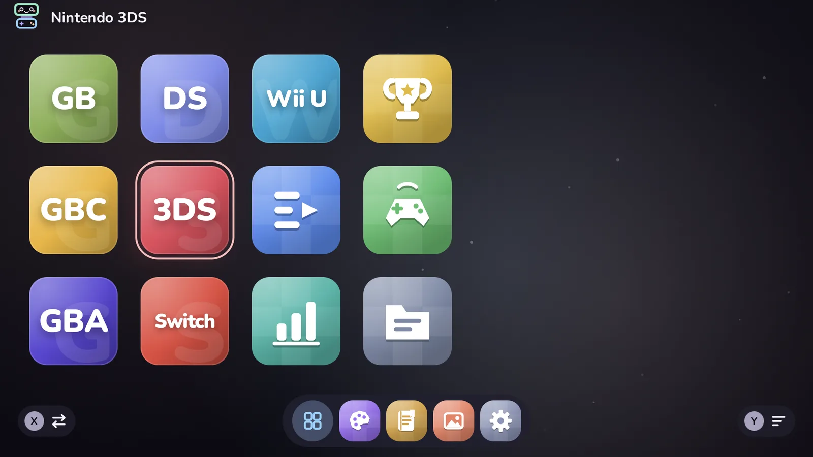
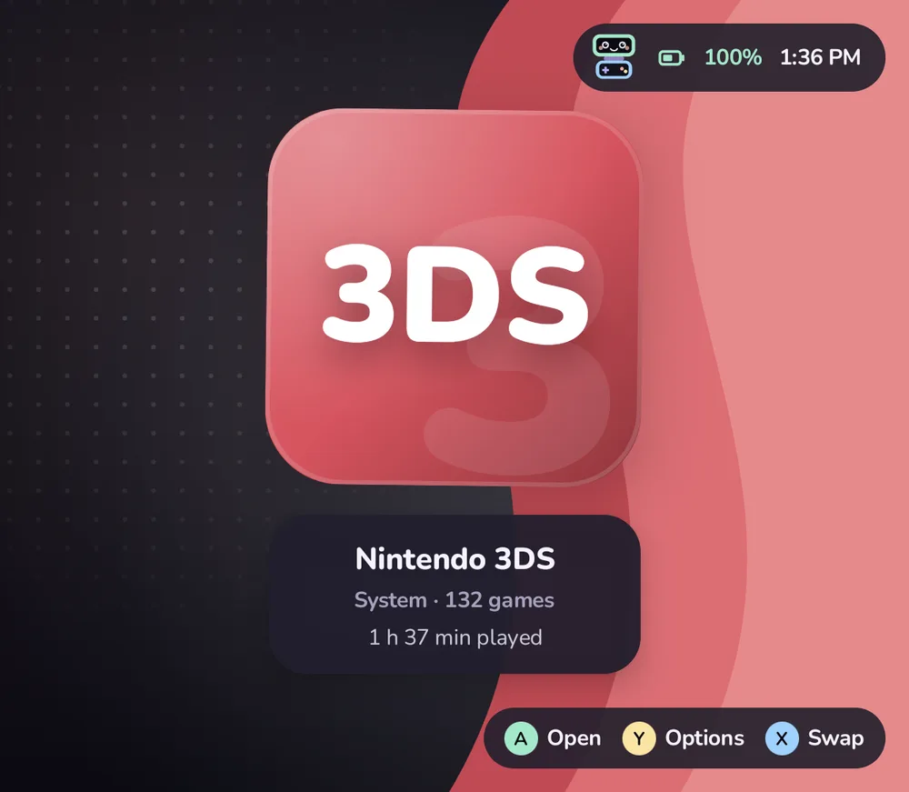
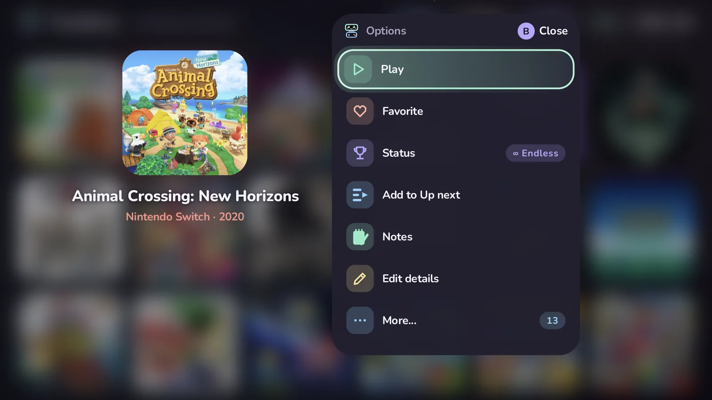

# Getting started

Install Tandem, point it at your games, and get through the two permission screens on first launch. It takes a few minutes.

## What you need

Four things, and only the first three are required.

- An Android handheld running **Android 11 or newer**. Tandem is designed around dual-screen devices like the AYN Thor, and works on a single screen too.
- Your games, in any folder on the device or an SD card (see [below](#put-your-games-in-place)).
- The emulators you want to use, installed and opened once. The ones Tandem knows out of the box are listed in [Systems and emulators](platforms.md#what-comes-built-in).
- Optional: [Shizuku](https://shizuku.rikka.app/), if you want games to [resume](resume.md) where you left them.

> [!NOTE]
> Tandem doesn't come with games, BIOS files or emulators, and never downloads any.

## Install the app

Pick whichever way you like:

- **GitHub Releases.** Download the newest `tandem-<version>.apk` from the [releases page](https://github.com/ZahakJ/tandem/releases/latest) on your handheld and open it. Android asks once whether your browser or file manager may install apps; allow it.
- **Obtainium.** [Obtainium](https://obtainium.imranr.dev/) installs apps straight from GitHub and keeps them updated. Tap **Add app**, paste `https://github.com/ZahakJ/tandem`, and tap **Add**. It then tells you when a new release is out.
- **F-Droid.** Planned; the store listing is ready in the repository.

Every release APK is signed with the same key, so updates install over the old version and keep your data.

### Software updates

Installed from GitHub Releases, Tandem keeps itself up to date, and **nothing installs until you say so**.

Once a day while Tandem is open, it asks GitHub for the number of its latest release (nothing else is sent). When a newer one is out:

- a message says so once (**Tandem 0.6.1 is out · open Start to update**), never over a game;
- a quiet **Tandem 0.6.1 is out** row waits in the Start panel until you update.



To update:

1. Press <kbd>A</kbd> on that row to read the release notes.
2. Choose **Update** (or **Not now**).
3. Tandem downloads the APK, checks it, and installs it. With [Shizuku](resume.md) running it installs straight away; otherwise Android asks once to allow installs from Tandem, then to confirm.

Tandem restarts on the new version with your data as it was.



**Checking by hand.** **Settings › Play & system › Updates** asks GitHub at once and shows where things stand: *Up to date*, *0.6.1 available* (<kbd>A</kbd> opens the notes and Update), the download's progress, or what went wrong.



<details>
<summary>How the download is checked, and turning the automatic check off</summary>

Before installing, Tandem checks the APK against the release's `SHA256SUMS` and against Tandem's own signing key, so only a genuine release goes in.

Switch **Settings › Play & system › Check automatically** off and Tandem never asks GitHub by itself: no message, no Start panel row, and it updates only when you press <kbd>A</kbd> on **Updates** and then **Update**. Private mode skips the automatic check too.

You can also update by hand: download the new `tandem-<version>.apk` from the [releases page](https://github.com/ZahakJ/tandem/releases/latest) and open it, or let [Obtainium](https://obtainium.imranr.dev/) do it. Builds made for F-Droid have no updater at all.

</details>

## Put your games in place

Your games can stay where they are. You point Tandem at the folder during setup, and it can be called anything and laid out any way.

The usual layout is a folder per system, and the names are forgiving (`n3ds`, `3DS`, `Nintendo 3DS` and `3DS ROMs` all work):

```text
Games/
├─ 3DS/           Nintendo 3DS
├─ nds/           Nintendo DS
├─ Switch/        Nintendo Switch
├─ GBA/           Game Boy Advance
└─ PlayStation 2/
```

Other layouts work too:

- **One system's folder** (`Games/3DS`) on its own.
- **Everything mixed in one folder.** A file only one system plays (`.3ds`, `.nsp`, `.gba`, `.sfc`…) is found wherever it is. Disc images and archives (`.iso`, `.chd`, `.zip`…) need a folder named for their system.
- **Subfolders** inside a system folder (for example `3DS/RPG/`) show up in Tandem as folders, up to three levels deep.

The full list of names and file types per system is in [Systems and emulators](platforms.md#what-comes-built-in).

> [!TIP]
> Games in more than one place, or on an SD card? Add each folder in **Settings › Library & art › Game folders**. Their games join the same systems. See [Your own games folder](library.md#your-own-games-folder).

<details>
<summary>The ROMs folder, and what is never taken for a game</summary>

`ROMs` at the top of internal storage (`/storage/emulated/0/ROMs`) is Tandem's own folder, where it keeps its data. It is always read for games too, in the folder-per-system layout only (`ROMs/3ds`, `ROMs/switch`…; loose files in `ROMs` itself are not games). If you already use ES-DE or Cocoon, your games are probably there already.

Folders of updates, DLC, patches or mods are never taken for games.

</details>

Artwork is optional. If you have scraped art before with another frontend, it is most likely in `ROMs/downloaded_media/`, and Tandem uses it as it is; coming from Cocoon, the first scan also brings over the art its gamelists point to. [Your library](library.md#artwork) explains which folders it reads, and [Get artwork](#get-artwork) below fetches the rest.

## First launch

Pip greets you with two steps. Both are needed once, and Tandem remembers them.

1. **Read your games.** Press <kbd>A</kbd> to open Android's **All files access** screen, switch Tandem on, and press <kbd>B</kbd> to come back. This lets Tandem read your games and their artwork quickly.
2. **Pick your games folder.** Press <kbd>A</kbd>, and Android's folder picker opens (at `ROMs`, if you have one). Go to the folder your games are in, tap **Use this folder**, then **Allow**. Some emulators (Eden, Cemu and melonDS among them) only open games that are shared with them this way, rather than by file path.

If Shizuku is installed and running, a third, optional step appears: **Resume games**. Press <kbd>A</kbd> and allow Tandem in the Shizuku prompt. You can also do this later; see [Resume and Shizuku](resume.md).

Then Tandem scans your folders. The first time, it also looks for ES-DE gamelists and Cocoon backups and brings over what it finds: titles, descriptions, genres, favorites, play time and artwork paths. A message from Pip tells you how many games it updated. [Importing](importing.md) has the details.

### The welcome

After the first scan, Pip walks you through a few choices. Every step can be skipped: <kbd>A</kbd> chooses, <kbd>B</kbd> goes back a step (on the first step, **Skip all**). It shows once, and everything in it is in Settings later.

1. **Which language do you prefer?** English, العربية, 日本語, 简体中文 or Français, each card greeting you in its own script. English starts highlighted. Picking one switches both screens at once, so the rest of the welcome is in that language; **Settings › Look & feel › Language** changes it later (and also offers System default).
2. **Which home feels like yours?** Four starting looks, drawn live:
   - **Cozy shelves**: rows of recent games, systems and collections.
   - **Icon grid look**: a dense grid of icons like the 3DS (first when Cocoon files are found).
   - **Orbit**: systems on an orbit of round icons.
   - **Minimal**: a compact list, no music.

   **Settings › Home & layout** has all eight layouts any time, and **Start › Layout** tries them live on your own home.
3. **I found your Cocoon things** (only when Cocoon files are on the device): **Bring my Cocoon setup over** copies your Cocoon home, dock and theme from its newest backup, or **Wear** its theme pack.
4. **Artwork & details**: the art sources, no-account ones first. **Get LaunchBox (105 MB, Wi-Fi)** downloads LaunchBox's index for art with no account; <kbd>A</kbd> on a source shows how to set it up. Skipping is fine: see [Get artwork](#get-artwork).
5. **Pick up right where you left off**: allow Tandem in Shizuku for [resume](resume.md), or **Skip for now**.
6. **Make Tandem your Home screen?** Then <kbd>Home</kbd> always brings you back to Tandem. Android asks you to confirm.
7. **All set. Let's play!** The four buttons worth knowing: <kbd>Y</kbd> options, <kbd>X</kbd> search (or swap screens on the home), <kbd>Start</kbd> the Start panel (hold it for quick settings), <kbd>Select</kbd> surprise me (hold it for the game switcher).




## Get artwork

Box art, logos and descriptions make the library come alive, and you can get most of it without an account.

> [!TIP]
> **Art with no account:**
>
> 1. **Settings › Library & art › Set up sources › LaunchBox › Download** (a one-time download of LaunchBox's index, about 105 MB).
> 2. **Settings › Library & art › Scrape library › Start scraping**.
>
> It is the closest thing to Cocoon's zero-setup scraper: no account, no key, and games are looked up on the handheld.

That gives most systems box art, logos, hero art, screenshots and descriptions. For more, free keys of your own for SteamGridDB (great for PC and Switch), IGDB and ScreenScraper are optional. [Artwork and scraping](scraping.md) has every step, a worked example, and what to do when a scrape finds nothing.

<details>
<summary>Why Tandem can't come with keys built in</summary>

Each service hands keys to a person under terms that don't allow publishing them, and anything built into an open-source app can be read by anyone.

</details>

## Finding your way around

A quick tour of the two screens and the buttons you'll use most.

The top screen is your library. How the home screen looks depends on the layout you picked (see [Home layouts](themes.md#home-layouts)); the Shelves home has up to three rows:

- **Continue playing**, the games you played most recently (a game still running comes first).
- **Systems**, one card per system that has at least one game.
- **Collections**: Favorites, Most played, Recently added, Never played and Genres. A collection appears once it has something in it.




The bottom screen shows details for whatever is highlighted. The basics:

| Button | What it does |
| --- | --- |
| D-pad or left stick | Move the highlight |
| <kbd>A</kbd> | Open, or play the highlighted game |
| <kbd>B</kbd> | Go back |
| <kbd>Y</kbd> | The highlighted game's menu |
| <kbd>X</kbd> | Search |
| <kbd>Start</kbd> | The Start panel, where Settings is |

The [controller reference](controls.md) lists every button.

Along the top of most screens runs the **top bar**: where you are, a **✦ Scraping** pill while a scrape runs, **▶ 2 open** while games are running (the game switcher), the games view chip inside a system, **★ Stats**, **◐ Quick** (quick settings), the battery and the clock. Press <kbd>▲</kbd> to reach it and <kbd>▼</kbd> to go back to the page. (The icon grid has no top bar: it gives its icons the whole screen.)



To play, highlight a game and press <kbd>A</kbd>. Tandem starts it in the system's emulator. When you come back to Tandem (with <kbd>Home</kbd>, or by quitting the emulator), your place in the library is just as you left it.

## Next steps

Where to go from here:

- On an AYN Thor? [Setting up on the AYN Thor](ayn-thor.md) has device-specific tips.
- What every setting does, with its default: [Every setting](settings.md).
- Artwork for your games: [Artwork and scraping](scraping.md).
- Add a system or a different emulator: [Systems and emulators](platforms.md).
- Switch games in Eden Duo and Peanuts Native, with one save: [Switch games](switch.md).
- Make games come back where you left them: [Resume and Shizuku](resume.md).
- Something not working: [FAQ and troubleshooting](faq.md).
