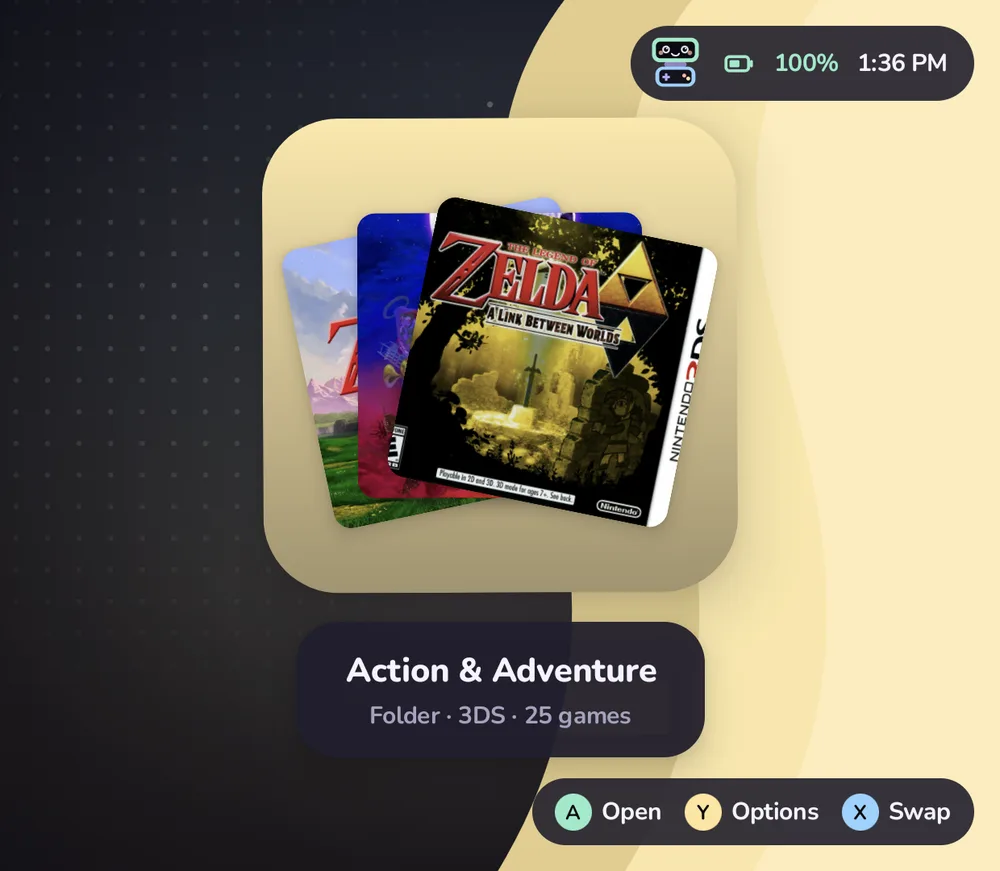
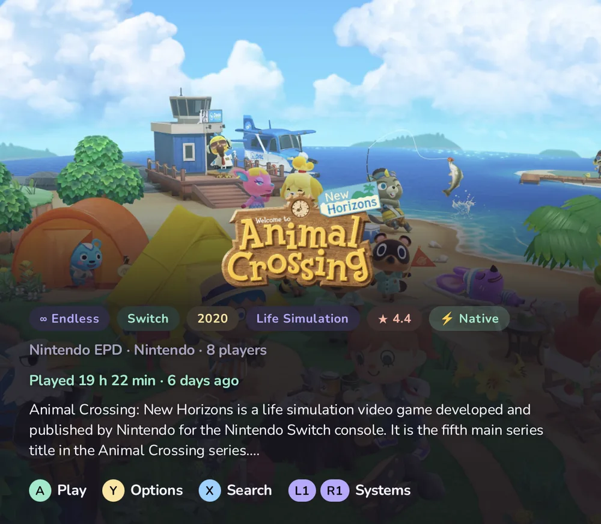

# Your library

How Tandem finds your games, where it gets their artwork, what the collections are made of, and where it keeps what it knows about each game.

## Your own games folder

Your games can stay wherever they already are, on the device or an SD card, in folders named however you like. Point Tandem at a folder and its games join your library.

1. Open **Settings › Library & art › Game folders**.
2. Choose **Pick your games folder…**. Android's folder picker opens.
3. Go to the folder your games are in, on the SD card or on the device. Use the menu in the picker's corner to switch to the SD card if it doesn't show it straight away.
4. Tap **Use this folder**.
5. Tap **Allow** when Android asks whether Tandem may use it.

That's it: Tandem looks through the folder and its games join your library a moment later. An empty home screen, and the first-run setup, offer the same **Pick your games folder…** button.

- **Any layout works.** A folder per system (`3DS`, `gba`, `PS2`…), one system's folder on its own, or every kind of game mixed together. [How games are found](#how-games-are-found) has the details.
- **Add as many as you like.** Each folder is a card with the systems found in it and how many games it holds. Your games join the same systems whichever folder they come from.
- **New games show up by themselves.** Tandem watches your folders while it's on screen, so a game copied over USB appears a few seconds later, no rescan needed.
- **<kbd>Y</kbd> takes a folder out** (or long-press it), with **Undo** for a few seconds. <kbd>A</kbd> on a folder gives you **Look for games again** and **Take it out**. Taking a folder out only hides its games; their favorites, details and play time are kept for when it comes back.
- **An SD card that's out just waits.** Its card says **Not there right now**, its games are hidden, and they come back on their own when the card is back in. Nothing is forgotten.

> [!NOTE]
> `ROMs` on internal storage is Tandem's own data folder (backups, scraped art, manuals). It's always read for games too, but your games don't need to be there.

## Where games live

Games can live anywhere on the device or an SD card: in `ROMs`, in folders you pick ([above](#your-own-games-folder)), or both. **Settings › Library & art › Game folders** shows every folder Tandem reads from.

- **`ROMs` is always in.** It's Tandem's own folder on internal storage, where it keeps its data, and it's always read for games as well. It doesn't have to exist: Tandem makes it the first time it saves something there. `ROMs` keeps the folder-per-system layout: only its system folders (`ROMs/n3ds`, `ROMs/switch`…) hold games, never loose files or other folders in it. Games mixed together in one folder need that folder added in Game folders.
- **Folders you add can be laid out any way.** Each is read the [same way](#how-games-are-found): folders named for systems, one system's folder, or games mixed together, with subfolders as folders and the same `skipDirs`. The folder itself can be called anything.
- **It's all one library.** A game is identified by its system and file name, so the same file in two folders counts once (the copy in `ROMs` wins), and moving a game to the SD card keeps its favorites, details and play time.
- **Artwork** is read from the game's own folder's `downloaded_media` first, then from `ROMs/downloaded_media`. Scraped art always lands in `ROMs/downloaded_media`, so it works for every folder.

**Watching the folders.** While Tandem is on screen it watches every game folder: the folders you added, each system's folder and every folder holding a game. A game copied over USB or MTP, deleted or renamed shows up or goes a few seconds after the copy finishes, without a rescan; an SD card put back or taken out does the same. **Settings › Library & art › Watch game folders** turns it off.

<details>
<summary>Emulator access, cloud drives, backups and the background</summary>

- Folders you pick are shared with emulators the way the `ROMs` folder is at setup, so emulators that only open shared links (Eden, Cemu, melonDS) can start games from them too.
- A folder has to be on the device or an SD card; cloud drives can't be read as files.
- The folder picker's grant and the list of folders are saved in `systems.json`, and go into backups with the systems and emulators.
- Taking a folder out keeps what Tandem knows about its games in `library.json` under the same keys, so adding the folder back loses nothing.
- Folder watching never runs while Tandem is in the background or a game is playing; coming back to Tandem checks the folders as before.

</details>

## How games are found

Tandem looks through every game folder and `ROMs` once each, when it starts and whenever you choose **Settings › Library & art › Rescan games**. A folder can be laid out three ways, and one folder can mix them:

- **A folder per system.** A folder named for a system holds that system's games: every file with one of the system's extensions. The names are forgiving: `n3ds`, `3DS`, `Nintendo 3DS`, `3DS ROMs` and `Nintendo - Nintendo 3DS` are all the 3DS.
- **One system's folder.** Pick `Games/3DS` itself and everything in it is the 3DS's.
- **Everything together.** A file only one system plays (`.3ds`, `.cia`, `.nsp`, `.xci`, `.gba`, `.sfc`, `.z64`…) is that system's wherever it sits in a folder you added (not in `ROMs` itself), up to three folders down. Kinds several systems share, and everyday ones (`.iso`, `.bin`, `.cue`, `.chd`, `.zip`, `.7z`…), only count inside a folder named for a system.

**Subfolders become folders.** `ROMs/n3ds/RPG/Some Game.3ds` appears inside an **RPG** folder on the 3DS screen, up to three folders deep. On the icon grid, a system opening as a folder gets a folder inside for each subfolder, with a genre look and a cover wall on the other screen; games copied into a subfolder later join its folder there.

**Titles are tidied.** `Mario Kart 7 (USA) (En,Fr,Es).3ds` shows as **Mario Kart 7**: region and version tags in brackets are dropped. A title imported from a gamelist wins.

> [!TIP]
> A game is identified by its system and file name, like `n3ds/Some Game.3ds`. Move it between subfolders or folders and it keeps its favorites and play time; **renaming the file** starts it fresh.

<details>
<summary>How system folder names are matched, and what is skipped</summary>

- **Folder names** match the system's `folders` and aliases in [`platforms.json`](platforms.md), its name and short name, and a few nicknames, ignoring case, spaces, punctuation, a trailing "roms" or "games" and a maker in front.
- **Emulator data is skipped.** Some emulators keep their own folders next to the games, like Azahar's `nand` and `sdmc`. Each system can list folders to ignore (`skipDirs`).
- **Hidden files are skipped:** anything starting with a dot.
- **Add-ons are never games.** Outside a system's own folder, a folder whose name says it holds updates, DLC, patches, mods or cheats (`Switch Updates`, `DLC`, `Patches (3DS)`) is never looked in, and neither are the usual data folders (`tandem`, `downloaded_media`, `manuals`, `notes`, `bios`, `saves`, `states` and the like).

</details>




### Multi-disc games

A game on several discs is **one tile**, with a **3 discs** chip on the bottom screen.

- **With an `.m3u` playlist** in the folder, the playlist is the game, and the discs it lists (beside it or in a subfolder) are not games of their own.
- **Without one**, files in the same folder whose names differ only in a disc mark are one game: `Final Fantasy VII (USA) (Disc 1).chd`, `(Disc 2)`, `(Disc 3)`. `[CD 2]`, `(Disk 2 of 3)` and a trailing ` CD2` count too, for files of the same kind. The game is disc 1.

Starting it, Tandem hands the emulator the playlist, so DuckStation, RetroArch and the others can change discs from their own menus. **Dolphin, ARMSX2 and NetherSX2** can't open a playlist handed over by Android, so they get disc 1, and you change discs in their menu (`firstDisc` in [`platforms.json`](platforms.md#using-your-own-platformsjson)). A game grouped by names starts on disc 1 everywhere.

**Make playlists (.m3u)** in **Settings › Library & art › Sorting & discs** writes a playlist next to the discs of every game grouped by names, for emulators that change discs only with one. It first shows what it will write ("Metal Gear Solid: 2 discs → `Metal Gear Solid (USA).m3u`") and moves or renames nothing. Its toast has **Undo**; later, delete the `.m3u` it made (each starts with `# Made by Tandem`).

Play time, favourites and details stay with the game: it keeps the playlist's key, or disc 1's. What other discs had as tiles of their own before (play time, sessions, a favourite) joins it once, at the next scan. Art scraped for disc 1 shows for the playlist too.

## Artwork

Tandem uses the artwork you already have, laid out the way ES-DE and similar frontends do it, and can download the rest for you.

```text
ROMs/downloaded_media/<system>/<kind>/<game file name>.png
```

A picture belongs to a game when its name is the game's file name without the extension: `Some Game.png` for `Some Game.3ds`. Anything after a double underscore is ignored, so `Some Game__2.png` matches too.

| Used for | Folders it reads, in order of preference |
| --- | --- |
| Cover (grid tiles) | `icon`, `covers`, `box2dfront`, `boxart` |
| Hero (bottom screen) | `hero`, `fanart`, `screenshot_title`, `titlescreens`, `screenshot_gameplay`, `screenshots` |
| Logo (bottom screen) | `logo`, `marquees`, `wheel` |

**Downloading art.** With no account, through LaunchBox and libretro: **Settings › Library & art › Scrape library**, **Scrape these games** on a system, or **Scrape this game** in a game's <kbd>Y</kbd> menu. [Artwork and scraping](scraping.md) walks through it, and [Privacy and scraping](privacy.md#what-is-sent-and-to-whom) says what each source receives. Tandem never changes or deletes artwork you put there yourself; **Clear downloaded media** removes only what it downloaded.

**Picking a picture.** <kbd>Y</kbd> › More › **Choose artwork** shows what every source has for one game, with <kbd>L1</kbd> / <kbd>R1</kbd> switching between box art, hero and logo, and **From this device** takes a picture of your own.

<details>
<summary>Which picture wins, system folder names, sources and filled-in details</summary>

- **System folder names** come from each system's `art` list in `platforms.json`; for the 3DS that is `n3ds` and `3ds`. A system without an `art` list uses its id, so Windows games read `ROMs/downloaded_media/windows/` whichever of `windows`, `pc` or `steam` they sit in.
- **Which picture wins.** For each of box art, hero and logo, Tandem shows the picture the game's details point at, if the file is there: one you chose (**Choose artwork**), a path from an [import](importing.md), or what a scrape or the Steam store pictures ([below](#windows-and-steam-games)) saved. Otherwise it takes the first match in the folders above; when a folder has several pictures for a game, the newest wins.
- **A logo that isn't see-through** (a title card saved as a logo) is skipped, and the title shows as text instead. Android games fall back to their app icon.
- **Sources.** LaunchBox and libretro thumbnails need no account; ScreenScraper, IGDB and SteamGridDB use your own keys; HowLongToBeat gives play times. Set them up in **Settings › Library & art › Set up sources**; they're asked in the order their tiles show there (<kbd>L1</kbd> / <kbd>R1</kbd> move one). Scraped pictures are saved in the same folders as above.
- **Filled-in details.** Once the LaunchBox database is downloaded (**Settings › Library & art › Set up sources › LaunchBox**), Tandem fills in missing descriptions, genres, year, developer and players after each library scan, from the copy on the device. It never goes online for this and never changes a field you edited or locked.

</details>

## Manuals and guides

Keep a game's manual, map or walkthrough next to it and read it page by page: on Tandem's screen with <kbd>Y</kbd> › **Manual**, or on the bottom screen while the game plays (the **Manual** button on the Game art and Tandem companion styles). The last page you were on is remembered per game.

Put them in `ROMs/manuals/<system>/`, with the same `<system>` folder names as the artwork (`gb`, `n3ds`, `windows`…), named like the game's file without its extension:

```text
ROMs/manuals/gb/Pokemon Red.pdf        for ROMs/gb/Pokemon Red.gb
ROMs/manuals/snes/Chrono Trigger.cbz
ROMs/manuals/nes/Zelda/                 a folder of pictures, one per page
ROMs/manuals/psx/Final Fantasy VII.md
```

A rescan (**Settings › Library & art › Rescan games**, or coming back to Tandem) picks up new manuals; the row says how many were found.

**Reading.**

| Button | What it does |
| --- | --- |
| <kbd>◀</kbd> / <kbd>▶</kbd>, <kbd>L1</kbd> / <kbd>R1</kbd> | Turn pages |
| <kbd>▲</kbd> / <kbd>▼</kbd> | Scroll a zoomed page |
| <kbd>A</kbd> | Switch between the whole page and its width (larger type, in a text guide) |
| <kbd>Start</kbd> | Go to a page by number |
| <kbd>B</kbd> | Go back |

By touch, on either screen: tap the left or right third of the page to turn, the middle to zoom, and the slim bar under the page to jump; a zoomed page scrolls by finger. On the bottom screen the controller stays with the game, so it's all touch there.

**A manual from anywhere else.** <kbd>Y</kbd> › **Edit details** › **Manual** › **Choose file** picks it with Android's file picker. Tandem copies it into the game's manuals folder, named after the game, and remembers it as that game's manual even if a differently named file turns up there later. **Use the found one** goes back to matching by name. Tandem never deletes a manual.

<details>
<summary>Formats, and which file wins</summary>

| Format | What it is | Pages |
| --- | --- | --- |
| `.pdf` | A scanned or digital manual | Each page, drawn at the size of the screen as it is reached |
| `.cbz`, `.zip` | A zip of pictures (comic-book archives are zips) | One per picture, in natural order (`page2` before `page10`) |
| A folder | Pictures in a folder named like the game | As above |
| `.png`, `.jpg`, `.webp`… | One picture: a map, a reference card | One |
| `.txt`, `.md` | A guide, a walkthrough, a FAQ | One per chapter (`#` headings, or lines underlined with `===`/`---`); a long chapter is cut into parts. Headings, paragraphs, lists, quotes and preformatted text (indented or fenced, so maps drawn in text keep their columns) are laid out to read |

When several files match one game, a PDF is read before a zip, before text, before a single picture, before a folder. Anything after a double underscore in the name is ignored (`Pokemon Red__scan.pdf`), like artwork.

</details>

## Windows and Steam games

PC games live in `ROMs/windows` (or `ROMs/pc`, `ROMs/steam`) as small shortcut files, not the games themselves. The games stay installed in the app that runs them.

| Shortcut | What it is |
| --- | --- |
| `.steam` | A Steam game, by its app id: what GameNative's **Export for frontend** writes for a Steam game (`.steamappid` works too) |
| `.epic` | An Epic game, from **Export for frontend** (`.epicgame` works too; `.gog` and `.amazon` for those stores) |
| `.pcgame` | A GameNative custom game (a game you added to GameNative from a folder), from **Export for frontend** (`.customgame` works too) |
| `.desktop`, `.lnk` | A Winlator shortcut |

GameNative is the system's first emulator. For Winlator shortcuts, pick Winlator per game (<kbd>Y</kbd> › More › **Emulator**) or as the system's emulator in **Systems and emulators**.

- **Games you installed in DroidDeck or GameNative need no shortcut.** They show up on their own, from every store: see [Games installed in DroidDeck and GameNative](#games-installed-in-droiddeck-and-gamenative).
- **DroidDeck as a player.** [DroidDeck](https://github.com/Droid-Deck/DroidDeck/releases) 0.7 or newer runs a Steam game in the real Steam client, and games from its other stores. For a shortcut of your own (`.steam`, `.steamappid`, or a store's file such as `.epic` that DroidDeck exported), <kbd>Y</kbd> › More › **Emulator** offers DroidDeck alongside GameNative (and Winlator, if installed), for that game only. GameNative stays the system's default.
- **Games streamed from your PC.** A `.moonlight` file in the same folder is a game that runs on your own PC and streams to the handheld through Moonlight; it sits with the other PC games and always opens in Moonlight. See [Streaming from a home PC](streaming.md#a-tile-for-each-streamed-game) for what goes in the file.
- **Art for Steam shortcuts.** After every scan, a `.steam` game missing its box art, hero or logo gets them from Steam's public store pictures by its app id, with no account or key, saved in `ROMs/downloaded_media/windows/` like scraped art. That never happens for hidden games or in private mode.
- **Steam achievements.** With your own Steam Web API key and account, Tandem shows a Steam game's achievements and tells you what you unlocked when you come back from playing. See [Steam achievements](#steam-achievements).

<details>
<summary>What a shortcut file holds, and how each app is started</summary>

A shortcut's first line holds the id the app needs: a bare number (`123456`), `app_id=123456` or a `[name] value` line all work. GameNative is told the id (a number, `app_id`) and the store the file's extension stands for (`game_source`: `STEAM`, `EPIC`, `GOG`, `AMAZON`, `CUSTOM_GAME`). Winlator gets the shortcut's path. Tandem hands DroidDeck the id as text with its `com.droiddeck.launcher.LAUNCH_GAME` intent, and `game_source` `STEAM` for a Steam game; in `platforms.json` DroidDeck is a player with an `extensions` list (see [Systems and emulators](platforms.md#emulator-fields)). A file can hold one id per app on lines of their own, `[gamenative] 202` and `[droiddeck] 10065604626084986880`: each player reads its own line, and a file without them gives both the first line's id.

</details>

<details>
<summary>Adding Steam pictures by hand</summary>

In private mode, say, or for a `.steamappid` or `.epic` game: download them on any computer from Steam's CDN and copy them in, named like the shortcut.

| Picture | From `https://cdn.cloudflare.steamstatic.com/steam/apps/<app id>/` | Save as |
| --- | --- | --- |
| Box art | `library_600x900_2x.jpg` (or `library_600x900.jpg`) | `ROMs/downloaded_media/windows/icon/<shortcut name>.jpg` |
| Hero | `library_hero.jpg` | `ROMs/downloaded_media/windows/hero/<shortcut name>.jpg` |
| Logo | `logo.png` | `ROMs/downloaded_media/windows/logo/<shortcut name>.png` |

For `ROMs/windows/Some Game.steam`, that is `icon/Some Game.jpg`, `hero/Some Game.jpg` and `logo/Some Game.png`. Then **Settings › Library & art › Rescan games**. **Choose artwork** › **From this device** works too, one picture at a time.

</details>

### Games installed in DroidDeck and GameNative

Games you install in [DroidDeck](https://github.com/Droid-Deck/DroidDeck/releases) or download in [GameNative](https://github.com/utkarshdalal/GameNative/releases) show up among your PC games by themselves, from every store the app has, and start straight in that app. No shortcut files: nothing is written to your game folders.

| App | Stores |
| --- | --- |
| DroidDeck 0.7.1 or newer | Steam, Epic, GOG, Amazon, Xbox, Ubisoft, EA, Rockstar, Battle.net, itch.io, Game Jolt, and games you added to DroidDeck by hand |
| GameNative | Steam, Epic, GOG, Amazon (its custom games, added from a folder, still need a `.pcgame` file from **Export for frontend**) |

- **When Tandem looks.** When it starts, when you come back to it, and on **Rescan games**. It's cheap: if neither app's library changed since last time, nothing is read again.
- **One tile per game.** A game both apps have is one tile, matched by the store's own id (the Steam app id, Epic's app name, GOG's or Amazon's product id; by name, within the same store, only when an app doesn't say). It starts in the app you last played it in, in either app, else in DroidDeck. <kbd>Y</kbd> › More › **Emulator** switches to the other one for that game, and offers only the apps that have it (a Steam game can go to any of them).
- **Uninstalled in the app, gone from Tandem** on the next look. Its play time, favourite, status and last played stay, and come back with it if you install it again. A game in both apps keeps its tile, and everything on it, while either still has it.
- **Your own shortcut wins.** If a file in your folders is for the same game (a `.steam` or `.steamappid` file with its app id, or a store's file from **Export for frontend** such as `Some Game.epic`), you get one tile, yours: its name, art and records. If it has no box art, hero or logo of its own, it gets the apps' pictures. Started in an app that has the game, it is given that app's own id, so a GameNative export for Epic starts in DroidDeck too.
- **Playing.** Continue, resume, close and play time work as for any game. The game menu has no **Delete** for these: uninstall the game in its app.
- **Settings › Library & art › DroidDeck** and **› GameNative** say how many games Tandem found there (every store counted), or why it found none ("isn't installed", "Needs root"), and each has a switch to leave that app's games out. <kbd>A</kbd> on the status looks again.

**Root.** Both apps keep their library in their own private folder, which other apps can't read: DroidDeck in `files/library-cache.json`, GameNative in its database (`databases/pluvia.db`). Tandem reads them with root, through Shizuku, the same way the [Switch save sync](switch.md#one-save-across-eden-duo-and-peanuts-native) does. One root call looks at both apps' files; only a library that changed is read again. GameNative's database is copied into Tandem's own storage, read there read-only and deleted; nothing of either app is ever changed. Without root the status says **Needs root** and games you already had stay as they were. On a rooted handheld, the root manager may show a short note each time; coming back to Tandem asks at most once a minute.

**Once DroidDeck shares its library.** A read-only library provider for DroidDeck has been proposed upstream. When an installed DroidDeck has it, Tandem uses it instead, no root needed for DroidDeck: the status's help says "DroidDeck shares its library with Tandem", and a change in DroidDeck shows up in Tandem while it's open. Play time and everything else carry over, since a game keeps the same id either way. GameNative has nothing like it, so it always needs root.

**Pictures, never from the internet.** Tandem copies the pictures the apps already have on the handheld: DroidDeck's (its SteamGridDB art for Steam games, else Steam's own; a store game's from DroidDeck's art cache or the game's folder), then the ones GameNative keeps in its picture cache (the covers it showed you in its library). A store game GameNative never showed has none until you scrape it, as for any game. A Steam game missing art gets Steam's store pictures like any `.steam` shortcut ([Art for Steam shortcuts](#windows-and-steam-games)).

<details>
<summary>Where it all goes, and what each app is sent</summary>

| What | Where |
| --- | --- |
| Tandem's copy of both apps' lists, and which pictures were copied | `files/app-games/library.json` in Tandem's own storage (it was `files/droiddeck/library.json`; carried over on the first start) |
| One small file per game | `files/app-games/games/` in Tandem's own storage: `droiddeck-steam-<app id>.steam`, `droiddeck-<store>-<DroidDeck id>.<store>` (`.droiddeck` for a game added by hand), `gamenative-<store>-<GameNative id>.<store>` |
| Box art, hero, logo | `ROMs/downloaded_media/windows/icon/`, `hero/`, `logo/` named like the game's file, like scraped art (Clear downloaded media removes them; they come back on the next rescan) |
| A copy of GameNative's database, while it is read | Tandem's cache (`cache/gamenative-db/`), deleted straight after |
| The switches | `droidDeck` and `gameNative` in `systems.json` |

A Steam game's file holds its app id, which both apps take. Another store's holds a line per app, `[gamenative] <id>` and `[droiddeck] <id>`, and the players in `platforms.json` read their own (`{tags.gamenative}`, `{tags.droiddeck}`).

| Started in | Intent | Extras |
| --- | --- | --- |
| DroidDeck | `com.droiddeck.launcher.LAUNCH_GAME` to `com.droiddeck.launcher/.FrontEndActivity` | `app_id` (text): a Steam game's app id, any other game's 64-bit DroidDeck id written unsigned. `game_source`: `STEAM` for a Steam game; for another store, its name (`EPIC`, `GOG`…) only with DroidDeck newer than 0.7.1, which turns down any other source and finds the game by its id alone |
| GameNative | `app.gamenative.LAUNCH_GAME` to `app.gamenative/.MainActivity` | `app_id` (a number: the Steam app id, GOG's product id, or GameNative's own number for an Epic or Amazon game), `game_source` (`STEAM`, `EPIC`, `GOG`, `AMAZON`) |

A tile's file name stays the same while either app has the game: a game GameNative had first keeps `gamenative-…` when DroidDeck gets it too. Play time and the rest are kept under the game's key, `windows/<file name>`. A picture is copied again only when its size, time or path changed, or the copy is gone.

If you use your own copy of `platforms.json` (`ROMs/tandem/platforms.json`), copy the GameNative and DroidDeck players from the built-in one again: they now read `{tags.gamenative}` and `{tags.droiddeck}`, and DroidDeck takes every store's extension.

</details>



## Collections

Collections are lists Tandem builds from what it knows, without moving any files. They live in the bottom row of the home screen and appear as soon as they have something in them.

| Collection | What is in it |
| --- | --- |
| Continue playing | The 15 games you played most recently, newest first (a game counts as played as soon as you start it). Shown as its own row at the top of home, with a game still running first. |
| Favorites | Games you marked with <kbd>Y</kbd> › **Add to favorites**. |
| Most played | Games with recorded play time, most first. |
| Recently added | The 30 newest games, by when Tandem first saw them. |
| Never played | Games you have never started from Tandem. |
| Playing, Backlog, Finished | Games by [status](#game-status), to add to the icon grid (<kbd>Y</kbd> on an empty spot › **New ›** › **Collection or genre…**) or a smart folder. Finished includes Completed. |
| Genres | One folder per genre, built from imported metadata. Games without genres use the subfolder they are in, so a folder called `RPG` counts as a genre too. A genre needs at least two games. |

Hidden games are left out of everything unless **Show hidden games** is on.

## This week

**This week** is a collection Tandem picks for you every Monday, from how you play. It sits first among the collections, with its own calendar-and-star icon, so it shows wherever collections do: a tile on the icon grid, an orb on Orbit, a group on Spotlight, the page right after Continue on Stage, and the collections row on Shelves, Carousel, List and Console. Opened, it is a board: a big **Pick of the week** card with the game's art, then a row for each kind of pick, every cover with a short reason under it.

| Row | What goes in it |
| --- | --- |
| Up next | Your own [Up next](apps.md) list, first, in your order. |
| Pick of the week | A game you haven't started, your kind of game (the genres, studios and systems you play most) and well rated. |
| Pick up where you left off | A game you're playing that you last touched between three days and four months ago. |
| Almost there | About three hours or less left of the main story by HowLongToBeat, or most of its achievements earned. |
| Short tonight | Not started, and a main story of three hours or less by HowLongToBeat. |
| Because you finished … | More from the series or studio of a game you finished in the last six months; failing that, a well-rated game of its genre. |
| Achievement hunt | A RetroAchievements or Steam set you've started and not got far in. |
| Hidden gems | Among the best-rated games you own, not started, and outside the three genres you play most. |
| From the shelf | Shelved or in the backlog for two months, then games in your library half a year and never started. |
| New in your library | Added in the last two weeks and not played yet (not right after the first scan, when everything is new). |
| More … for you, Something different | Your favourite genre, and a genre you rarely play. |

A row shows only when something fits it. The bottom screen says why the highlighted game is there in a sentence ("About 2 h left by HowLongToBeat.", "Same studio as Hades, which you finished: Supergiant Games."), with the facts behind it as chips (time left, achievements, your time in its genre, up to three). While the board is open (a page, or a popup on the icon grid) the reason shows in large type (on the icon grid, in place of the game's story) with a **This week** chip and the row's name, and the button hints are the board's own: <kbd>X</kbd> Re-roll, <kbd>Y</kbd> Options. As a popup the board fits its height: the Pick of the week card shrinks so the first row shows under it, and the highlighted row always shows whole, names included.

- **It stays put all week.** The picks are drawn with the week (Monday to Sunday) and a number made once on your handheld, so the board is the same every time you open it, and different from anyone else's. A game you start leaves its row (another takes its place); a new week brings a new board. Games shown in the last four weeks stay out while there is anything else to show, and no one system or genre fills the board.
- <kbd>X</kbd> on a row draws it again, a little further down its list. <kbd>Y</kbd> on a pick has **Other picks for this row**, **Not for me** (it is never suggested again) and **Played it elsewhere** (marks it Finished without a play session), each with Undo; **Add to Up next** puts it at the top of the board.
- <kbd>Select</kbd> (Surprise me) lands on a game from this week's board first, each once, then on a game you've never played.
- **Settings › Home & layout › How games show › Weekly picks** switches the collection off; **Reset suggestions** forgets the games you said aren't for you, what the board showed lately and this week's re-rolls.
- It is worked out on the handheld from what Tandem already knows: play time and sessions, statuses, favourites, genres, studios, ratings, HowLongToBeat times you scraped, achievements already fetched, and when each game was added. Nothing is sent anywhere, and your taste is counted afresh each time, never stored. Hidden games never take part, even while they are showing. What it keeps (the not-for-me list, what it showed lately, this week's re-rolls) is in `week.json`, backed up with your game data and never in a shared look.

## Home folders

Make your own folders on the icon grid to group games, apps and systems however you like: <kbd>Y</kbd> on a tile › **Edit** › **Organize** › **Move to folder…** › **New folder…**, or <kbd>Y</kbd> on an empty spot › **New ›** › **New folder…**. Everything about a folder (its name, look, contents, how it opens, where it lives, deleting it) is on its edit screen: <kbd>Y</kbd> › **Edit** (see [Controls](controls.md#the-edit-screen)).

- **Folders hold shortcuts.** The same game, app or system can be in several folders and on the home grid at once. **Move to folder…** takes it from where it is; **Also add to folder…** leaves it there too. Removing a shortcut never touches the game.
- **Folders inside folders,** two levels deep (Home › Games › RPGs). The header shows the way back, and <kbd>B</kbd> goes up one level. A folder can't be put inside itself or one of its own folders.
- **Sort inside…** orders a folder by Manual (the default), A–Z, Recently played, Most played, Date added or System; folders inside come first. Your manual order is kept, so going back to Manual restores it. Moving tiles works only in Manual.
- **Delete folder…** asks first. **Keep its contents** moves what was inside up a level, into the folder's place and the free spots after it; **Delete it and its subfolders** (hold <kbd>A</kbd> until its ring fills) removes the folder, the folders inside it and their shortcuts. Games and apps stay in your library either way, and Undo brings the folder back.
- **Hiding a folder** hides everything inside it, folders inside included.

**Views.** Inside a folder, <kbd>X</kbd> switches how it shows its games (also <kbd>Y</kbd> › **View as…**). Moving and selecting tiles always happen in the grid.

| View | What it looks like |
| --- | --- |
| Grid | Tiles, as on the home grid |
| Shelf | Spines on shelves, each in its cover's colour with the game's logo and status; the highlighted one swings round to show its cover in the cover's own proportions. Folders inside get shelves of their own. **Settings › Home & layout › How games show › Shelf look** picks a wood, matte or open bookcase |
| Case | Each game as the real thing for its system (a Switch card, a cartridge, a disc in a sleeve) in a foam-lined case, lifting out when highlighted |
| Carousel | One cover at a time, the others turning away, with the name, status and play time under it |

<details>
<summary>Real packaging in Shelf and Case, and older folders</summary>

Shelf and Case dress each game in its system's real packaging: a red Switch case, a white 3DS or Wii case, a blue Wii U case, black GameCube and PS2 cases, with the band and logo printed across the top and the spine. Art that isn't a real box scan gets the system's front template.

The Shelf uses real box and spine scans first when you have them: turn on **Physical boxes and spines** in the scrape screen's Artwork (from libretro, ScreenScraper and LaunchBox). They're saved apart from your box art (`box2dfront`, `box2dside`), so nothing else changes.

Folders made before shortcuts existed keep their contents off the home grid, as they were.

</details>

## Smart folders

A smart folder fills itself from rules, like "Unplayed 3DS RPGs" or "Pokémon". Its contents update when the library, a game's details or its play history change, and the tile shows how many games are inside.

1. Press <kbd>Start</kbd> › **New** › **Smart folder…**.
2. Set the rules. <kbd>A</kbd> on a choice shows all its options in a grid (<kbd>◀</kbd> / <kbd>▶</kbd> steps through them too); **Systems** opens a grid of your systems with their icons and **Genres** one of genre chips, ticked while picked. Genres are offered once however your scrapers spell them ("Platform" and "Platformers", "Role Playing Game" and "Role-Playing" are one chip), and a game counts for each part of a genre like "RPG & Strategy"; This week groups genres the same way. The other screen shows the matching games as you go.
3. <kbd>Start</kbd> or **Make the folder** saves; <kbd>B</kbd> leaves without saving.

| Rule | What it does |
| --- | --- |
| Match | **All rules** (the default): a game must pass every rule you set. **Any rule**: one is enough, so Favorites only with Genres RPG gives every favorite and every RPG. Rules left at Any don't count either way. |
| Systems | Only games from the systems you pick. None picked: every system. |
| Genres | Games with any of the genres you pick. Games without genres use their subfolder, as in Genres above. |
| Title has | Titles containing this text, in any case. With **Match as** set to **Regex**, the text is a regular expression searched anywhere in the title. A pattern that isn't valid matches nothing, and the form says so. |
| From year, To year | Release years, both included. Games without a year are left out once either is set. |
| Favorites only | Only games you marked as favorites. |
| Played | **Played** (any play history), **Unplayed** or **Any**. |
| Status | Games with any of the [statuses](#game-status) you pick; **None** is games without one, and Finished takes Completed games too. |
| How many | **All**, or a random 5, 10, 20 or 50 of the matches. The pick stays the same until Tandem next starts. |
| Emulator | Only games that start with this emulator, by their own choice or their system's default. |
| Rating from, Rating up to | The game's rating out of five stars, in half stars. Games without a rating are left out once either is set. |
| Developer has, Publisher has | Developers or publishers containing this text, in any case (`Capcom`, `Square`). |
| Played more than, Played less than | Play time, all sessions together, in hours (1 to 100). Less than takes games never played too. |
| Last played | **In the last** 1, 7, 30, 90 or 365 days; **Not in** 30, 90 or 365 days (games never played too); or **Never**. |
| Sort | A–Z, Recently played, Most played, Date added or System. The folder keeps this order; the global **Sort by** doesn't apply. |
| Open games on | **Top**, **Bottom** or **Default**. Games opened from inside the folder start on that screen, unless the game has its own screen setting. |

For a quick look without making a folder, [search](controls.md#search)'s filters use the same rules: System, Genre, Year (by decade), Rating (at least), Status, Played and Favorites, with or without text typed.

<kbd>Y</kbd> on a smart folder has **Edit rules…**, **Open games on** and, under More, **Convert to manual folder**, which keeps the games it holds now as an ordinary folder (as shortcuts, so they stay wherever else they are too). On an ordinary folder, **Make this a smart folder** opens the same form, starting from the systems inside it.

<details>
<summary>More about smart folders</summary>

- When an ordinary folder becomes smart, what was inside and isn't on the home grid yet goes back there.
- Smart folders hold no folders, and nothing can be moved or put into one by hand.
- **Open games on** works for ordinary folders too.
- Smart folders can be designed, renamed, hidden and deleted like any folder.
- Hidden games appear in them only while hidden games are showing, and hiding a smart folder hides the folder, not its games.
- They are stored in `icon-grid.json` with the rest of the grid. Folders made before Match and the newer rules existed read as they did: every rule, none of the new ones.
- **Last played** counts days from when the folder was last worked out (any change to the library or a game's details, or a new start).

</details>

## Sorting and display

<kbd>Y</kbd> on a system or collection screen, while a folder is highlighted, opens the **View** menu (also in **Settings › Library & art › Sorting & discs** and **Settings › Home & layout › How games show**).

- **Sort by**: Name, Recently played, Most played, Release year, Rating, Recently added or System (by system, then name: for collections that mix systems). Continue playing, Most played and Recently added keep their own order.
- **Names skip a leading article:** The Legend of Zelda sorts under L, and so does the letter <kbd>L2</kbd> / <kbd>R2</kbd> jump to. English The, A and An always; Le, La, Les and L' in French, Der, Die and Das in German, El, La, Los and Las in Spanish when Tandem or the device speaks that language; ال at the start of an Arabic title. Japanese and Chinese have none. **Ignore “The” and “A”** in **Settings › Library & art › Sorting & discs** switches it off.
- **Favorites first** (same page, or <kbd>Start</kbd> › **Sort**) puts your favorites at the top of every sorted list, each part in the chosen order. A game you favorite while a list is open moves the next time you open it.
- **Game titles**: show the name under each tile, or only the art.
- **Hidden games**: show or hide them.

## Editing a game

Fix a title, a year or a description, or give a game its own extras: <kbd>Y</kbd> › **Edit details** on a game.

- <kbd>A</kbd> on a field types a new value and **locks** it, so scraping leaves it alone.
- <kbd>X</kbd> locks or unlocks a field.
- Clearing a field hands it back to scraping.

Below the fields, **Extras** hold a few things per game:

| Extra | What it does |
| --- | --- |
| Companion app | An Android app (a guide, a map, a music player) started on the bottom screen with the game, in place of Tandem's companion. **Close after** closes it when you are back in Tandem (this needs Shizuku), or leaves it running. |
| Achievements | The RetroAchievements game this one is matched to. **Find match** lists the closest games from RetroAchievements when you are signed in, **Type ID** takes the number from the game's page address, and **No achievements** turns them off for this game. **Automatic** goes back to Tandem's own match by file and title. |
| Manual | The game's manual or guide: the one found by name in `ROMs/manuals`, or a file you pick (**Choose file**), which is copied in and remembered for this game. **Read** opens it. See [Manuals and guides](#manuals-and-guides). |
| Logo | The logo's size (50–150 %) and place (Auto, Left, Centre, Right, Top or Bottom, then nudged with the arrows) over the game's art. The other screen shows each change as you make it. |

A companion app starts only with two screens, when the game starts on the top screen and its system doesn't leave the bottom screen to the emulator. The bottom screen shows a small badge for a game with one.

All of this is kept in the game's details, so it moves with the game between subfolders and is part of every backup.

## Game status

Keep track of where you are with each game. <kbd>Y</kbd> › **Status** sets one, and **No status** clears it:

| Status | Means |
| --- | --- |
| Backlog | To play some day |
| Playing | In progress |
| Finished | Saw the credits |
| Completed | Everything done, 100% |
| Shelved | Set aside for now |
| Endless | No ending, played for fun |

A game in the backlog, or with no status, becomes **Playing** by itself after a session of ten minutes or more; nothing else changes on its own. The first time a game is finished is remembered, even if you go back to Playing for a second run.

The status shows on the other screen with the game, beside its play time against HowLongToBeat's estimate (when a scrape fetched one) and its RetroAchievements progress. **Playing**, **Backlog** and **Finished** are collections you can put on the icon grid, and smart folders can pick by status.

### Trophies

Tandem gives its own trophies, earned from your play and your games' statuses on every system, Switch and PC games included: 25 of them in bronze, silver and gold (play an hour, finish five games, play seven days in a row, start a game before 7 in the morning…) and a platinum **Tandem master** for earning all the others. Each one is celebrated as you earn it.

They're worked out from your play history each time, so they never disagree with it; only the day each was first earned is kept.

### RetroAchievements

Sign in with your RetroAchievements username and Web API key in **Settings › Library & art › Accounts › RetroAchievements** (on retroachievements.org: **Settings › Keys**). Each game is matched to its RetroAchievements set the first time you highlight it:

- **By the file's hash**, worked out on the handheld the way RetroAchievements does it: for cartridges and DS, and for discs: PlayStation, PlayStation 2 and PSP (their boot files), Sega CD and Saturn (the disc's header) and PC Engine CD (its boot program), from `.cue`/`.bin`, `.iso`, `.img` and `.cso` images. A game on several discs is matched by disc 1. CHD, PBP and Dreamcast images aren't read yet; those games are matched by title.
- **Else by its title.** **Edit details › Achievements** picks another set by hand, or none.

Then:

- **The bottom screen** shows your progress under the highlighted game's play time.
- **<kbd>Y</kbd> › Achievements** on the game lists the whole set: how many you have and your points (and how many in hardcore and softcore), then each achievement with its badge (grey while locked), description, points, how rare it is (the share of the game's players who have it), when you got it and in which mode, and a **Missable** tag on the ones you can miss for good. The other screen shows the highlighted one with its whole description.

  | Button | What it does |
  | --- | --- |
  | <kbd>L1</kbd> / <kbd>R1</kbd> | Filter: All, Locked, Unlocked, Missable (with how many each) |
  | <kbd>Y</kbd> | Sort: the set's order, rarest first, most points first |
  | <kbd>A</kbd> | Hints: players' comments on this achievement, from RetroAchievements |
  | <kbd>X</kbd> | Ask RetroAchievements again |
  | <kbd>B</kbd> | Back from the hints, then close |

  The hints are fetched when you press <kbd>A</kbd>, and only then. They can give the game away, so they stay blurred until you press <kbd>A</kbd> again (or tap one); **More** (or <kbd>X</kbd>) loads the next ones. The filter and sort stay as you left them until Tandem closes.
- **While you play** (Game art and Tandem companion styles on the bottom screen), an **Achievements** chip opens the set under the game: the ones still to get first, with **Locked**, **Missable** and **All** to tap. Tap an achievement to open its description and its players' hints; that tap is the only thing that fetches them, and they are blurred until you tap them. The controller stays with the game. The page shows what was kept from the last look; **Look up again** asks RetroAchievements anew. Nothing is checked while you play otherwise.

The list is kept on the handheld after it is fetched, so it opens at once and in private mode; **Sign out** deletes it. Hidden games are never matched, listed or looked up. What RetroAchievements receives is in [Privacy](privacy.md#what-is-sent-and-to-whom).

### Steam achievements

A Steam game (a `.steam` shortcut, see [Windows and Steam games](#windows-and-steam-games)) can show its Steam achievements, the way RetroAchievements show for console games. Set it up in **Settings › Library & art › Accounts › Steam**:

1. **Steam Web API key**: your own key from [steamcommunity.com/dev/apikey](https://steamcommunity.com/dev/apikey) (any domain name will do). It's kept on this device, out of Android's backups, and goes only to Steam.
2. **Steam account**: your SteamID64, your profile address (`steamcommunity.com/profiles/…` or `…/id/name`) or your profile name, which Tandem resolves through Steam. Signing in looks every Steam game up once.
3. **Look up achievements** asks Steam about every Steam game again. Otherwise a game is looked up when you highlight it (at most every ten minutes) and when you come back from playing it (right away, or once two minutes have passed since it was last looked up). **Sign out** forgets the key, the account and everything fetched for them.

> [!IMPORTANT]
> Your **Game details** must be **Public** in Steam's profile privacy settings, or Steam refuses to say what you unlocked.

Then:

- **The bottom screen** shows a **Steam** pill, how many you have unlocked, and the latest unlocks with the next few to get in grey, under the game's play time.
- **<kbd>Y</kbd> › Achievements** on the game lists every one: its icon (grey while locked), name, description (a hidden one says so until you unlock it), when you unlocked it, and how rare it is as the share of players who have it. <kbd>A</kbd> says the description; <kbd>X</kbd> asks Steam again.
- **Stats › Achievements** has your Steam account beside your RetroAchievements profile, puts both services' unlocks from the last 30 days in one list (Steam's with a **Steam** pill), and lists every Steam game with achievements under them. <kbd>A</kbd> on a game opens its list.
- **When you come back** from a Steam game, Tandem looks it up in the background and Pip tells you what you unlocked: one message per achievement, with its icon and how rare it is, for the first three, then one for the rest. Nothing is said the first time a game is looked up, so signing in with a hundred achievements already earned stays quiet.

A streamed Steam game ([a `.moonlight` file](streaming.md#a-tile-for-each-streamed-game)) joins in once its file has a `[steam] <app id>` line. Hidden games are never looked up, and nothing is sent in private mode. What Steam receives is in [Privacy](privacy.md#what-is-sent-and-to-whom).

## Play time

Tandem records how long you play each game, from the moment it starts a game until it's back on screen.

For each game you get the total time played, the number of times you started it, and when you last played. The bottom screen shows them, and folders show the total for everything inside. To clear a game's history, <kbd>Y</kbd> › **Reset play history**. The **Journal** keeps a timeline of sessions with your own notes.

> [!NOTE]
> A session shorter than ten seconds is treated as a false start and not counted (the game still becomes your last played, so Continue shows it), and a single session counts for at most six hours, in case the device went to sleep with a game open.

### Stats

The **Stats** screen opens from <kbd>Start</kbd> › **Stats & trophies**, the **Stats** or **Trophies** app on the icon grid, or the **★ Stats** chip in the top bar. <kbd>L1</kbd> / <kbd>R1</kbd> switch its tabs:

| Tab | What it shows |
| --- | --- |
| Overview | Total play time, sessions and streaks, a 30-day chart, your most played games, and play time by system as a mosaic (a box per system, sized by its share). <kbd>A</kbd> on a system lists the games you have played on it, most played first; the box the smallest systems share ("6 more") lists the games played on all of them |
| Library | Your played games by status: Playing, Backlog, Finished and completed, Shelved, Endless. **Sort your played games** goes through the ones without a status one at a time, most played first |
| Trophies | The cabinet of games you finished, and every trophy, the ones still locked with a ring showing how far along you are |
| Sessions | Every play session (below) |
| Achievements | Your RetroAchievements, when signed in |

**Export play stats** (**Settings › Play & system › Your data**) writes each game's play time, play count and last played to `ROMs/tandem/play-stats.csv`.

### Editing sessions

Fix a session that ran long or merge two halves of one evening. **Stats › Sessions** lists every session, newest first and grouped by day, with the game's cover, title, start time and length. <kbd>Y</kbd> on a game › **More…** › **Play sessions…** opens the same list with only that game's sessions; **Show all** goes back to all of them.

<kbd>Y</kbd> on a session (or a long press) opens its menu:

| Option | What it does |
| --- | --- |
| Edit length | <kbd>◀</kbd> / <kbd>▶</kbd> changes it by a minute, <kbd>L1</kbd> / <kbd>R1</kbd> by ten minutes. From one minute to 24 hours. |
| Change date and time | <kbd>◀</kbd> / <kbd>▶</kbd> moves the day by one, or the time by a minute; <kbd>L1</kbd> / <kbd>R1</kbd> by a week or an hour. A session can't end in the future. |
| Merge with next | Shown when the next session is the same game and starts within 10 minutes of this one's end. The two become one session with both lengths added. |
| Only this game | Shows only this game's sessions. |
| Delete | Removes the session. Hold <kbd>A</kbd> until its ring fills. |

**Clear all sessions** at the top of the list removes every session shown (only the game's, when the list shows one game): hold **Clear** in the popup until its ring fills.

> [!WARNING]
> Deleting and clearing sessions can't be undone.

After any change, the game's play time, play count and last played are worked out again from its sessions, and the totals, streaks and chart in Stats follow.

<details>
<summary>Imported play time, Journal notes, deleted and hidden games</summary>

- Play time imported from another frontend has no sessions, so it can't be edited here and stays as it was; **Reset play history** clears it.
- Journal notes move with their session, are joined when two sessions merge, and go when a session is deleted.
- Sessions of a game you deleted with **Keep play stats** stay in the list under its old title, with its stored cover when there is one.
- Sessions of hidden games show only while hidden games are shown, and in private mode only while they are revealed.

</details>

## Deleting a game

Free up space from the couch: <kbd>Y</kbd> on a game › **More…** › **Delete game…** removes it from your storage and from Tandem. Before anything goes, a popup lists exactly what will be removed, with sizes:

- **The game's files,** with all their parts (below).
- **Its downloaded art** (on by default): every picture and clip named after the game in `ROMs/downloaded_media/<system>/<kind>/`. If another game of the same system has the same file name, it shows the same art, so the art stays.
- **Tandem's own record**: its details, favourite, Up next entry, home grid tile, collections and hidden-folder memory. **Keep play stats** (off by default) keeps its play time, sessions and Journal notes for the Stats app.
- **Saves stay in the emulator.** Tandem doesn't know where each emulator keeps them, so it never touches them.

Hold **Delete** (<kbd>A</kbd>, or a finger) until its ring fills; letting go sooner cancels. A toast says how much space was freed.

> [!CAUTION]
> Deleting a game can't be undone.

Some games aren't really in your games folder:

- **PC games** (`.pcgame`, `.desktop`, `.steam` and similar shortcuts for GameNative, Winlator or Steam through DroidDeck), **Vita** `.dpt` files and **PS3** `.ps3` title id files are only shortcuts. Deleting one removes the shortcut; the game itself stays installed in its app, so uninstall it there to free the space.
- **Android games** show **Uninstall app…** instead, which opens Android's own uninstall screen. Once the app is gone, Tandem forgets it.

<details>
<summary>Multi-file games, and what Tandem will never delete</summary>

**Multi-file games take their parts with them:** a `.cue` its `.bin` tracks, a `.gdi` its tracks, an `.m3u` playlist its discs (and their tracks), a [multi-disc game](#multi-disc-games) without a playlist every disc, a `.ccd` its `.img` and `.sub`, an `.mds` its `.mdf`, and a folder game (a PS3 `Game.ps3` folder, say) everything inside it. A part that another playlist or cue sheet in the same folder still uses stays, and the popup says so.

**Safety.** Tandem only ever deletes inside the ROMs folder, the folders you added in Systems, and `downloaded_media`. It checks where every file really is, and refuses when a file or a link inside a game points somewhere else. It never deletes a whole system folder, or a folder that holds other games. A running game has to be closed first (the popup offers to close it). A hidden game can be deleted while hidden games are showing; in private mode its name never appears in a toast, and nothing about it is logged.

</details>

## Where your data lives

Tandem keeps everything it knows as plain JSON files in its private app storage.

> [!WARNING]
> Uninstalling Tandem deletes these files. [Back up](#back-up-and-restore) first to keep them.

<details>
<summary>The files, one by one</summary>

- `library.json`: what it knows about each game: title, description, genres, developer, publisher, year, players, rating, favorite, hidden, chosen emulator, artwork paths and play history.
- `settings.json`: your settings, including the look, hidden folders and folder watching.
- `icon-grid.json` (home grid and folders), `home.json` (dock and home settings), `widgets.json`, `sessions.json` (play sessions), `journal.json`, `extras.json`, `trophies.json` (the day each trophy was earned; not in backups, since trophies are worked out again from your play), `systems.json` (emulator choices, system folders and the game folders you added), `app-prefs.json` (your choices for Android apps, see [Android apps](apps.md)), `controllers.json`, `scraping.json` and `manual-pages.json` (the page each manual was left at).

</details>

## Back up and restore

Save your favourites, play time, layout and settings to a folder you can copy anywhere, and put them back later.

**Backing up.** **Settings › Play & system › Your data › Back up** saves a new backup in `ROMs/tandem/backup/<date_time>/`; older backups stay. You choose what goes in, as four cards that <kbd>A</kbd> ticks or unticks:

| Part | Holds |
|---|---|
| Game data | Favourites, details, play time, play sessions, journal, hidden folders, RetroAchievements matches |
| Look | Theme, colours, wallpapers, sounds, motion |
| Layout & folders | Icon grid, folders, dock, widgets |
| Systems & emulators | Emulator choices, system folders, app choices (screen, name, icon), controllers, scraping settings |

> [!NOTE]
> Scraping keys and logins and your RetroAchievements key are left out unless you switch on **Account keys and logins**. The backup folder is on shared storage, where other apps with storage access can read it.

**Restoring.** **Restore** lists the backups, newest first, with a summary such as "1,204 games · 38 tiles · 6 folders · 2 days ago", and whether each was made by hand or automatically.

1. Pick a backup.
2. Tick the parts to put back (an unticked part keeps what is on the device now).
3. Confirm. Screens update straight away.

<kbd>X</kbd> deletes the highlighted backup.

<details>
<summary>Automatic backups, what a backup holds, and older backups</summary>

- **Automatic backups.** Tandem saves one before a restore, before **Import my Cocoon setup**, and before **Reset look**. It keeps the last five automatic backups; backups you make yourself stay until you delete them.
- **What's inside.** Each backup is a folder of the files [above](#where-your-data-lives) plus a `manifest.json` listing what is inside, the counts (games, tiles, folders, widgets, sessions) and Tandem's version.
- **Each part is restored on its own:** if one can't be read, the others still go back, and the message says which. Restoring never switches private mode off, and keys already on the device stay when the backup has none.
- **Older backups.** A backup made by an older Tandem (`library.json` and `settings.json` directly in `ROMs/tandem/backup/`) shows at the end of the list as **Older backup**.

</details>
