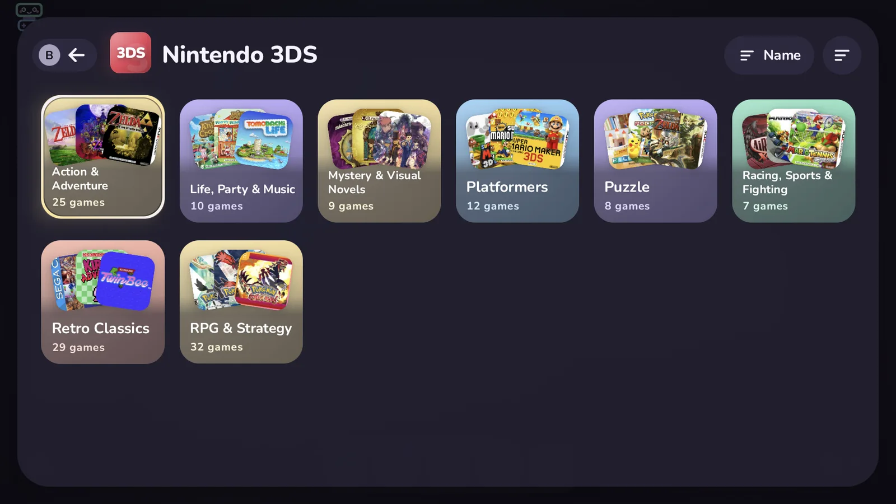
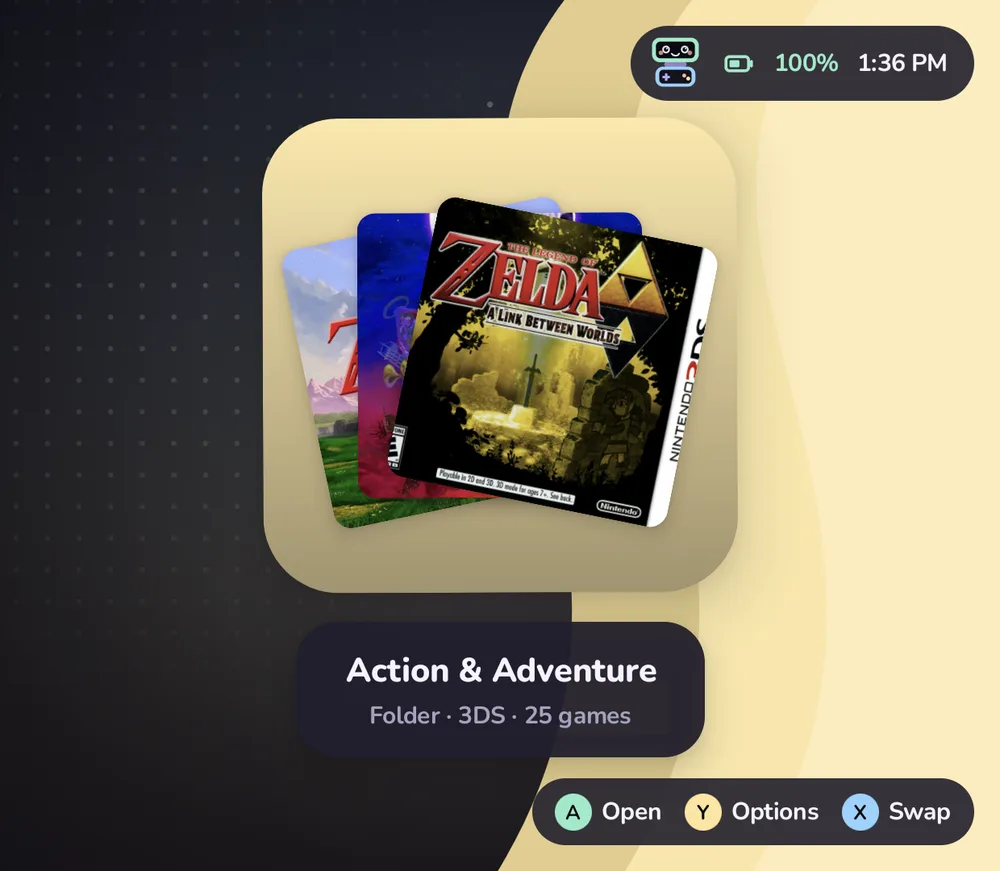

# Your library

How Tandem finds games, where it gets artwork, what the collections are made of, and where it keeps what it knows about each game.

## How games are found

On launch, and whenever you choose **Settings › Library › Rescan games**, Tandem looks through `ROMs/` in internal storage. For each system in [`platforms.json`](platforms.md) it checks that system's folders (for example `ROMs/n3ds` and `ROMs/3ds` for the 3DS) and picks up every file with one of the system's extensions.

- **Subfolders become folders.** `ROMs/n3ds/RPG/Some Game.3ds` appears inside an **RPG** folder on the 3DS screen. Tandem goes up to three folders deep.
- **Emulator data is skipped.** Some emulators keep their own folders next to the games, like Azahar's `nand` and `sdmc`. Each system can list folders to ignore (`skipDirs`).
- **Hidden files are skipped,** anything starting with a dot.
- **Titles are tidied.** `Mario Kart 7 (USA) (En,Fr,Es).3ds` is shown as **Mario Kart 7**. Region and version tags in brackets are dropped. If you import a title from a gamelist, that wins.

A game is identified by its system and file name, like `n3ds/Some Game.3ds`. That means you can move a game between subfolders and keep its favorites and play time; renaming the file starts it fresh.




## Artwork

Tandem uses the artwork you already have, in the layout ES-DE and similar frontends use:

```text
ROMs/downloaded_media/<system>/<kind>/<game file name>.png
```

A picture belongs to a game when its name is the game's file name without the extension, for example `Some Game.png` for `Some Game.3ds`. Anything after a double underscore is ignored, so `Some Game__2.png` matches too.

| Used for | Folders it reads, in order of preference |
| --- | --- |
| Cover (grid tiles) | `icon`, `covers`, `box2dfront`, `boxart` |
| Hero (bottom screen) | `hero`, `fanart`, `screenshot_title`, `titlescreens`, `screenshot_gameplay`, `screenshots` |
| Logo (bottom screen) | `logo`, `marquees`, `wheel` |

The `<system>` folder names come from each system's `art` list in `platforms.json`; for the 3DS that is `n3ds` and `3ds`. Artwork paths brought in by an [import](importing.md) take priority over these folders.

Tandem never changes or deletes artwork you put there. It can also download artwork for you: **Settings › Art & accounts › Scrape library**, or **Scrape this game** in a game's Y menu. Scraped pictures are saved in these same folders, and **Clear downloaded media** removes only what Tandem downloaded. See [Privacy and scraping](privacy.md#what-is-sent-and-to-whom) for what each source receives.

Once the LaunchBox database is downloaded (**Settings › Art & accounts › LaunchBox**), Tandem fills in missing descriptions, genres, year, developer and players after each library scan, from the copy on the device. It never goes online for this and never changes a field you edited or locked.

## Collections

Collections are lists Tandem builds from what it knows, without moving any files. They live in the bottom row of the home screen and appear as soon as they have something in them.

| Collection | What is in it |
| --- | --- |
| Continue playing | The 15 games you played most recently, newest first. Shown as its own row at the top of home. |
| Favorites | Games you marked with Y › **Add to favorites**. |
| Most played | Games with recorded play time, most first. |
| Recently added | The 30 newest games, by when Tandem first saw them. |
| Never played | Games you have never started from Tandem. |
| Genres | One folder per genre, built from imported metadata. Games without genres use the subfolder they are in, so a folder called `RPG` counts as a genre too. A genre needs at least two games. |

Hidden games are left out of everything unless **Show hidden games** is on.

## Home folders

On the icon grid you can make your own folders (Y › **Move to folder…** › **New folder…**, or **New folder…** on an empty spot).

- **Shortcuts.** A folder holds shortcuts: the same game, app or system can be in several folders and on the home grid at once. **Move to folder…** takes it from where it is; **Also add to folder…** leaves it there too. Removing a shortcut never touches the game.
- **Folders inside folders.** A folder can hold folders, two levels deep (Home › Games › RPGs). The header shows the way back, and B goes up one level. A folder can't be put inside itself or one of its own folders.
- **Sort inside…** orders a folder by Manual (the default), A–Z, Recently played, Most played, Date added or System; folders inside come first. Your manual order is kept, so going back to Manual restores it. Move works only in Manual.
- **Delete folder…** asks first: **Keep its contents** moves what was inside up a level, into the folder's place and the free spots after it; **Delete it and its subfolders** (hold A until its ring fills) removes the folder, the folders inside it and their shortcuts. Games and apps stay in your library either way, and Undo brings the folder back.
- Hiding a folder hides everything inside it, folders inside included.

Folders made before shortcuts keep their contents off the home grid, as they were.

## Smart folders

A smart folder is a folder on the icon grid that fills itself from rules, like "Unplayed 3DS RPGs" or "Pokémon". Its contents update when the library, a game's details or its play history change. The tile shows how many games are inside.

To make one, press Start › **New** › **Smart folder…**. The rules are rows like those in Settings; the other screen shows the matching games as you change them. Start or **Make the folder** saves; B leaves without saving.

| Rule | What it does |
| --- | --- |
| Systems | Only games from the systems you pick. None picked: every system. |
| Genres | Games with any of the genres you pick. Games without genres use their subfolder, as in Genres above. |
| Title has | Titles containing this text, in any case. With **Match as** set to **Regex**, the text is a regular expression searched anywhere in the title. A pattern that isn't valid matches nothing, and the form says so. |
| From year, To year | Release years, both included. Games without a year are left out once either is set. |
| Favorites only | Only games you marked as favorites. |
| Played | **Played** (any play history), **Unplayed** or **Any**. |
| How many | **All**, or a random 5, 10, 20 or 50 of the matches. The pick stays the same until Tandem next starts. |
| Emulator | Only games that start with this emulator, by their own choice or their system's default. |
| Sort | A–Z, Recently played, Most played, Date added or System. The folder keeps this order; the global **Sort by** doesn't apply. |
| Open games on | **Top**, **Bottom** or **Default**. Games opened from inside the folder start on that screen, unless the game has its own screen setting. |

Press Y on a smart folder for **Edit rules…**, **Open games on** and, under More, **Convert to manual folder**, which keeps the games it holds now as an ordinary folder (as shortcuts, so they stay wherever else they are too). On an ordinary folder, **Make this a smart folder** opens the same form, starting from the systems inside it; when saved, what was inside and isn't on the home grid yet goes back there. Smart folders hold no folders, and nothing can be moved into one. **Open games on** works for ordinary folders too.

Smart folders can be designed, renamed, hidden and deleted like any folder. Nothing can be put in one by hand. Hidden games appear in them only while hidden games are showing, and hiding a smart folder hides the folder, not its games. They are stored in `icon-grid.json` with the rest of the grid.

## Sorting and display

Press Y on a system or collection screen while a folder is highlighted for the **View** menu (also in **Settings › Library › Games** and **Settings › Home & layout › Games**).

- **Sort by**: Name, Recently played, Most played, Release year, Rating or Recently added. Continue playing, Most played and Recently added keep their own order.
- **Game titles**: show the name under each tile, or only the art.
- **Hidden games**: show or hide them.

## Editing a game

Y › **Edit details** on a game. A on a field types a new value and locks it, so scraping leaves it alone; X locks or unlocks it, and clearing a field hands it back to scraping. Below the fields, **Extras** hold a few things per game:

| Extra | What it does |
| --- | --- |
| Hover jingle | Plays when you rest on the game for 0.6 seconds, and fades out when you move on. Tandem looks for `ROMs/downloaded_media/<system>/jingles/<game file name>.ogg` (or `.mp3`, `.wav`). **Choose file** picks one in Tandem's Files and copies it there; **None** silences this game; **Automatic** goes back to the folder. Games without one keep the system jingles. |
| Companion app | An Android app (a guide, a map, a music player) started on the bottom screen with the game, in place of Tandem's companion. **Close after** closes it when you are back in Tandem (this needs Shizuku), or leaves it running. |
| Achievements | The RetroAchievements game this one is matched to. **Find match** lists the closest games from RetroAchievements when you are signed in, **Type ID** takes the number from the game's page address, and **No achievements** turns them off for this game. **Automatic** goes back to Tandem's own match by file and title. |
| Logo | The logo's size (50–150 %) and place (Auto, Left, Centre, Right, Top or Bottom, then nudged with the arrows) over the game's art. The other screen shows each change as you make it. |

Jingles follow the sound settings: they play only with UI sounds on, at the sound volume, and with **Settings › Sound & music › Play jingles** on. They never play during a game, the launch or the screensaver, and the music dips while one plays. A companion app starts only with two screens, when the game starts on the top screen and its system doesn't leave the bottom screen to the emulator.

All of this is kept in the game's details, so it moves with the game between subfolders and is part of every backup. The bottom screen shows a small badge for a game with its own jingle or a companion app.

## Play time

Tandem records a play session from the moment it starts a game until it is back on screen. A session shorter than ten seconds is treated as a false start and not counted, and a single session counts for at most six hours, in case the device went to sleep with a game open.

For each game you get the total time played, the number of times you started it, and when you last played. The bottom screen shows them, and folders show the total for everything inside. To clear a game's history, Y › **Reset play history**. The **Stats** app (on the home grid, or the Stats button in Settings) adds sessions, streaks, a 30-day chart and CSV export, and the **Journal** keeps a timeline of sessions with your own notes.

### Editing sessions

**Stats › Sessions** lists every session, newest first and grouped by day, with the game's cover, title, start time and length. Y on a game › **More…** › **Play sessions…** opens the same list with only that game's sessions; **Show all** goes back to all of them.

Press Y on a session (or hold it on the touch screen) for its menu:

| Option | What it does |
| --- | --- |
| Edit length | ◀▶ changes it by a minute, L1 / R1 by ten minutes. From one minute to 24 hours. |
| Change date and time | ◀▶ moves the day by one, or the time by a minute; L1 / R1 by a week or an hour. A session can't end in the future. |
| Merge with next | Shown when the next session is the same game and starts within 10 minutes of this one's end. The two become one session with both lengths added. |
| Only this game | Shows only this game's sessions. |
| Delete | Removes the session. Hold A until its ring fills. |

**Clear all sessions** at the top of the list removes every session shown (only the game's, when the list shows one game): hold **Clear** in the popup until its ring fills. None of these can be undone.

After any change, the game's play time, play count and last played are worked out again from its sessions, and the totals, streaks and chart in Stats follow. Play time imported from another frontend has no sessions, so it can't be edited here and stays as it was; **Reset play history** clears it. Journal notes move with their session, are joined when two sessions merge, and go when a session is deleted.

Sessions of a game you deleted with **Keep play stats** stay in the list under its old title, with its stored cover when there is one. Sessions of hidden games show only while hidden games are shown, and in private mode only while they are revealed.

## Deleting a game

Y on a game › **More…** › **Delete game…** removes it from your storage and from Tandem. Before anything goes, a popup lists exactly what will be removed, with sizes:

- **The game's files.** Multi-file games take their parts with them: a `.cue` its `.bin` tracks, a `.gdi` its tracks, an `.m3u` playlist its discs (and their tracks), a `.ccd` its `.img` and `.sub`, an `.mds` its `.mdf`, and a folder game (a PS3 `Game.ps3` folder, say) everything inside it. A part that another playlist or cue sheet in the same folder still uses stays, and the popup says so.
- **Its downloaded art** (on by default): every picture and clip named after the game in `ROMs/downloaded_media/<system>/<kind>/`. If another game of the same system has the same file name, it shows the same art, so the art stays.
- **Saves stay in the emulator.** Tandem doesn't know where each emulator keeps them, so it never touches them.
- **Tandem's own record**: its details, favourite, Up next entry, home grid tile, collections and hidden-folder memory. **Keep play stats** (off by default) keeps its play time, sessions and Journal notes for the Stats app.

Hold **Delete** (A, or a finger) until its ring fills; letting go sooner cancels. It can't be undone. A toast says how much space was freed.

Some games aren't really in your `ROMs` folder:

- **PC games** (`.pcgame`, `.desktop`, `.steam` and similar shortcuts for GameNative, Winlator or Steam through DroidDeck), **Vita** `.dpt` files and **PS3** `.ps3` title id files are only shortcuts. Deleting one removes the shortcut; the game itself stays installed in its app, so uninstall it there to free the space.
- **Android games** show **Uninstall app…** instead, which opens Android's own uninstall screen. Once the app is gone, Tandem forgets it.

Tandem only ever deletes inside the ROMs folder, the folders you added in Systems, and `downloaded_media`. It checks where every file really is, and refuses when a file or a link inside a game points somewhere else. It never deletes a whole system folder, or a folder that holds other games. A running game has to be closed first (the popup offers to close it). A hidden game can be deleted while hidden games are showing; in private mode its name never appears in a toast, and nothing about it is logged.

## Where your data lives

Tandem keeps its data as plain JSON in its private app storage. The main files:

- `library.json`, what it knows about each game: title, description, genres, developer, publisher, year, players, rating, favorite, hidden, chosen emulator, artwork paths and play history.
- `settings.json`, your settings, including the look and hidden folders.
- `icon-grid.json` (home grid and folders), `home.json` (dock and home settings), `widgets.json`, `sessions.json` (play sessions), `journal.json`, `extras.json`, `systems.json` (emulator choices and system folders), `app-prefs.json` (your choices for Android apps, see [Android apps](apps.md)), `controllers.json` and `scraping.json`.

Uninstalling Tandem deletes these files. Back up first to keep them.

## Back up and restore

**Settings › Data & about › Back up** saves a new backup in `ROMs/tandem/backup/<date_time>/`. Older backups stay. Each backup is a folder of the files above plus a `manifest.json` listing what is inside, the counts (games, tiles, folders, widgets, sessions) and Tandem's version.

You choose what goes in, in four parts:

| Part | Holds |
|---|---|
| Game data | Favourites, details, play time, play sessions, journal, hidden folders, RetroAchievements matches |
| Look | Theme, colours, wallpapers, sounds, motion |
| Layout & folders | Icon grid, folders, dock, widgets |
| Systems & emulators | Emulator choices, system folders, app choices (screen, name, icon), controllers, scraping settings |

Scraping keys and logins and your RetroAchievements key are left out unless you switch on **Account keys and logins**. The backup folder is on shared storage, where other apps with storage access can read it.

**Restore** lists the backups, newest first, with a summary such as "1,204 games · 38 tiles · 6 folders · 2 days ago", and whether each was made by hand or automatically. Pick one, choose the parts to put back, and confirm. Each part is restored on its own: if one can't be read, the others still go back, and the message says which. Screens update straight away. Restoring never switches private mode off, and keys already on the device stay when the backup has none. X deletes the highlighted backup.

Tandem also saves an automatic backup before a restore, before **Import my Cocoon setup**, before a Quick look is applied, and before **Reset appearance**. It keeps the last five automatic backups; backups you make yourself stay until you delete them.

A backup made by an older Tandem (`library.json` and `settings.json` directly in `ROMs/tandem/backup/`) shows at the end of the list as **Older backup**.
