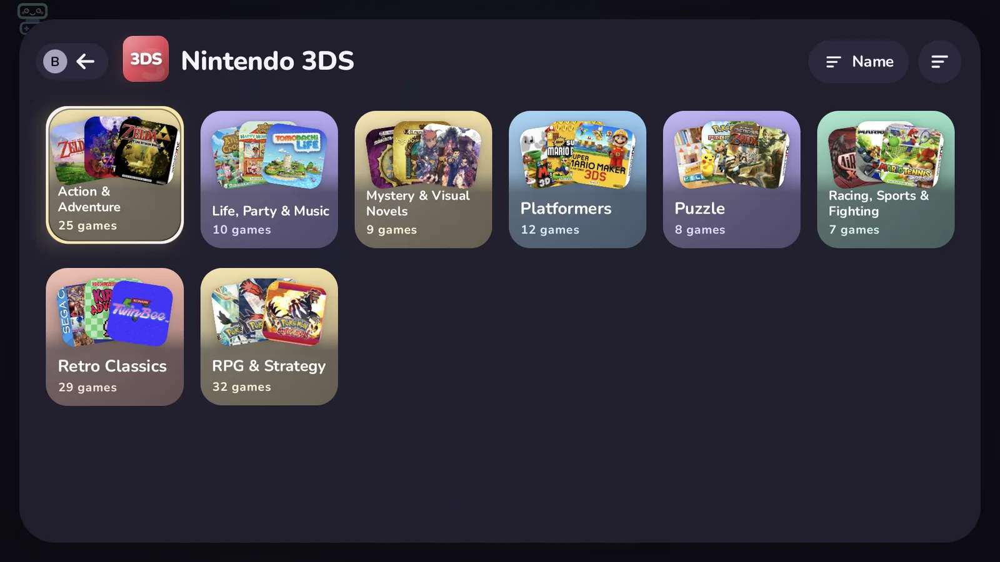

# Your library

How Tandem finds games, where it gets artwork, what the collections are made of, and where it keeps what it knows about each game.

## How games are found

On launch, and whenever you choose **Settings › Library & art › Rescan games**, Tandem looks through `ROMs/` in internal storage and every other game folder you added ([below](#where-games-live)). For each system in [`platforms.json`](platforms.md) it checks that system's folders (for example `ROMs/n3ds` and `ROMs/3ds` for the 3DS) and picks up every file with one of the system's extensions.

- **Subfolders become folders.** `ROMs/n3ds/RPG/Some Game.3ds` appears inside an **RPG** folder on the 3DS screen. Tandem goes up to three folders deep. On the icon grid, a system opening as a folder gets a folder inside for each subfolder, with a genre look and a cover wall on the other screen; games copied into a subfolder later join its folder there.
- **Emulator data is skipped.** Some emulators keep their own folders next to the games, like Azahar's `nand` and `sdmc`. Each system can list folders to ignore (`skipDirs`).
- **Hidden files are skipped,** anything starting with a dot.
- **Titles are tidied.** `Mario Kart 7 (USA) (En,Fr,Es).3ds` is shown as **Mario Kart 7**. Region and version tags in brackets are dropped. If you import a title from a gamelist, that wins.

A game is identified by its system and file name, like `n3ds/Some Game.3ds`. That means you can move a game between subfolders and keep its favorites and play time; renaming the file starts it fresh.




## Where games live

`ROMs` on internal storage is always read. Games can also live in other places: an SD card, or another folder on the
device. **Settings › Library & art › Games › More game folders** lists every folder Tandem reads from, with how many
games each holds right now; **Add a folder…** opens Android's folder picker, where you pick the folder and tap **Use
this folder**. A on a folder gives its options, and Y (or a long press) takes it out again, with Undo.

- **Same layout everywhere.** Each folder is read exactly like `ROMs`: a folder per system inside it
  (`/storage/1234-ABCD/Games/n3ds`, say), subfolders as folders, the same names and extensions, the same `skipDirs`.
  The folder itself can be called anything.
- **One library.** Games from every folder join the same systems. A game is still identified by its system and
  file name, so the same file in two folders counts once (the copy in `ROMs` wins), and moving a game to the SD card
  keeps its favorites, details and play time.
- **Artwork** is read from the game's own folder's `downloaded_media` first, then from `ROMs/downloaded_media`, where
  scrapes save. Scraped art always lands in `ROMs/downloaded_media`, so it works for every folder.
- **A card that is out** is skipped without fuss: its games are hidden until it is back, and come back by themselves
  (see below). Nothing is forgotten.
- **Taking a folder out** only removes its games from view. What Tandem knows about them stays in `library.json`
  under the same keys, so adding the folder back loses nothing.

Folders you pick are shared with emulators the way the `ROMs` folder is at setup, so emulators that only open
shared links (Eden, Cemu, melonDS) can start games from them too. A folder has to be on the device or an SD card;
cloud drives can't be read as files. The folder picker's grant and the list of folders are saved in `systems.json`,
and go into backups with the systems and emulators.

**Watching the folders.** While Tandem is on screen it watches every game folder (the folders you added, each
system's folder and every folder holding a game). A game copied over USB or MTP, or deleted or renamed, shows up or
goes a few seconds after the copy finishes, without a rescan; an SD card put back or taken out does the same.
Nothing runs while Tandem is in the background or a game is playing; coming back to Tandem checks the folders as
before. **Settings › Library & art › Games › Watch game folders** turns it off.

## Artwork

Tandem uses the artwork you already have, in the layout ES-DE and similar frontends use:

```text
ROMs/downloaded_media/<system>/<kind>/<game file name>.png
```

A picture belongs to a game when its name is the game's file name without the extension, for example `Some Game.png` for `Some Game.3ds`. Anything after a double underscore is ignored, so `Some Game__2.png` matches too.

| Used for | Folders it reads, in order of preference |
| --- | --- |
| Cover (grid tiles) | `icon`, `covers`, `box2dfront`, `boxart` |
| Hero (bottom screen) | `hero`, `fanart`, `screenshot_title`, `titlescreens`, `screenshot_gameplay`, `screenshots` |
| Logo (bottom screen) | `logo`, `marquees`, `wheel` |

The `<system>` folder names come from each system's `art` list in `platforms.json`; for the 3DS that is `n3ds` and `3ds`. A system without an `art` list uses its id, so Windows games read `ROMs/downloaded_media/windows/` whichever of `windows`, `pc` or `steam` they sit in. When a folder has several pictures for a game, the newest wins. Artwork paths brought in by an [import](importing.md) take priority over these folders.

For each of box art, hero and logo, Tandem shows the picture the game's details point at, if the file is there: one
you chose (Y › More › **Choose artwork**), a path from an import, or what a scrape or the Steam store pictures
([below](#windows-and-steam-games)) saved. Otherwise it takes the first match in the folders above. A logo that isn't
see-through (a title card saved as a logo) is skipped, and the title shows as text instead. Android games fall back to
their app icon.

Tandem never changes or deletes artwork you put there. It can also download artwork for you: **Settings › Library & art › Scrape library**, **Scrape these games** on a system, or **Scrape this game** in a game's Y menu. The sources (LaunchBox and libretro thumbnails with no account; ScreenScraper, IGDB and SteamGridDB with your own keys; HowLongToBeat for times) are set up in **Settings › Library & art › Set up sources**, and asked in the order shown under **Sources, in order**. **Choose artwork** (Y › More) shows what every source has for one game, with L1 and R1 switching between box art, hero and logo, and **From this device** takes a picture of your own. Scraped pictures are saved in these same folders, and **Clear downloaded media** removes only what Tandem downloaded. See [Privacy and scraping](privacy.md#what-is-sent-and-to-whom) for what each source receives.

Once the LaunchBox database is downloaded (**Settings › Library & art › Sources, in order › LaunchBox**), Tandem fills in missing descriptions, genres, year, developer and players after each library scan, from the copy on the device. It never goes online for this and never changes a field you edited or locked.

## Manuals and guides

A game can have a manual or a guide, read page by page on Tandem's screen (Y › **Manual** on the game) and on the
bottom screen while the game plays (the **Manual** button on the Game art and Tandem companion styles), where the last
page you were on is remembered per game.

Put them in `ROMs/manuals/<system>/`, with the same `<system>` folder names as the artwork (`gb`, `n3ds`, `windows`...),
named like the game's file without its extension, the way artwork is matched:

```text
ROMs/manuals/gb/Pokemon Red.pdf        for ROMs/gb/Pokemon Red.gb
ROMs/manuals/snes/Chrono Trigger.cbz
ROMs/manuals/nes/Zelda/                 a folder of pictures, one per page
ROMs/manuals/psx/Final Fantasy VII.md
```

| Format | What it is | Pages |
| --- | --- | --- |
| `.pdf` | A scanned or digital manual | Each page, drawn at the size of the screen as it is reached |
| `.cbz`, `.zip` | A zip of pictures (comic-book archives are zips) | One per picture, in natural order (`page2` before `page10`) |
| A folder | Pictures in a folder named like the game | As above |
| `.png`, `.jpg`, `.webp`... | One picture: a map, a reference card | One |
| `.txt`, `.md` | A guide, a walkthrough, a FAQ | One per chapter (`#` headings, or lines underlined with `===`/`---`); a long chapter is cut into parts. Headings, paragraphs, lists, quotes and preformatted text (indented or fenced, so maps drawn in text keep their columns) are laid out to read |

When several files match one game, a PDF is read before a zip, before text, before a single picture, before a folder.
Anything after a double underscore in the name is ignored (`Pokemon Red__scan.pdf`), like artwork. A rescan
(**Settings › Library & art › Games › Rescan games**, or coming back to Tandem) picks up new manuals; the **Manuals**
row there says how many were found.

To use a file from anywhere else, Y › **Edit details** › **Manual** › **Choose file** picks it with Android's file
picker; Tandem copies it into the game's manuals folder, named after the game, and remembers it as that game's manual
even if a differently named file turns up there later. **Use the found one** goes back to matching by name. Tandem
never deletes a manual.

Reading: ◀ ▶ (or L1 / R1) turn pages, ▲ ▼ scroll a zoomed page, A switches between the whole page and its width
(larger type, in a text guide), Start goes to a page by number, B goes back. By touch, on either screen: tap the
left or right third of the page to turn, the middle to zoom, and the slim bar under the page to jump; a zoomed page
scrolls by finger. On the bottom screen the controller stays with the game, so it is all touch there.

## Windows and Steam games

PC games live in `ROMs/windows` (or `ROMs/pc`, `ROMs/steam`) as small shortcut files, not the games themselves. The
games stay installed in the app that runs them.

| Shortcut | What it is |
| --- | --- |
| `.steam` | A Steam game, by its app id: what GameNative's **Export for frontend** writes for a Steam game (`.steamappid` works too) |
| `.epic` | An Epic game, from **Export for frontend** (`.epicgame` works too; `.gog` and `.amazon` for those stores) |
| `.pcgame` | A GameNative custom game (a game you added to GameNative from a folder), from **Export for frontend** (`.customgame` works too) |
| `.desktop`, `.lnk` | A Winlator shortcut |

A shortcut's first line holds the id the app needs: a bare number (`123456`), `app_id=123456` or a
`[name] value` line all work. GameNative is the system's first emulator, and is told the id and the store the
file's extension stands for. Winlator gets the shortcut's path; pick it per game (Y › More › **Emulator**) or as the
system's emulator in **Systems and emulators** for Winlator shortcuts.

**DroidDeck for Steam games.** [DroidDeck](https://github.com/Droid-Deck/DroidDeck/releases) 0.7 or newer runs a
Steam game in the real Steam client. Once it is installed, Y › More › **Emulator** on a `.steam` or `.steamappid`
game offers it alongside GameNative (and Winlator, if installed), for that game only; other PC games never offer it,
and GameNative stays the system's default. Tandem hands DroidDeck the app id with its
`com.droiddeck.launcher.LAUNCH_GAME` intent. In `platforms.json` DroidDeck is a player with an `extensions` list
(see [Systems and emulators](platforms.md#emulator-fields)).

**Games streamed from your PC.** A `.moonlight` file in the same folder is a game that runs on your own PC and
streams to the handheld through Moonlight; it sits with the other PC games and always opens in Moonlight. See
[Streaming from a home PC](streaming.md#a-tile-for-each-streamed-game) for what goes in the file.

**Art for Steam shortcuts.** After every scan, a `.steam` game missing its box art, hero or logo gets them from
Steam's public store pictures by its app id, with no account or key, and saved in `ROMs/downloaded_media/windows/`
like scraped art. That never happens for hidden games or in private mode. To add the pictures by hand instead (in
private mode, say, or for a `.steamappid` or `.epic` game), download them on any computer from Steam's CDN and
copy them in, named like the shortcut:

| Picture | From `https://cdn.cloudflare.steamstatic.com/steam/apps/<app id>/` | Save as |
| --- | --- | --- |
| Box art | `library_600x900_2x.jpg` (or `library_600x900.jpg`) | `ROMs/downloaded_media/windows/icon/<shortcut name>.jpg` |
| Hero | `library_hero.jpg` | `ROMs/downloaded_media/windows/hero/<shortcut name>.jpg` |
| Logo | `logo.png` | `ROMs/downloaded_media/windows/logo/<shortcut name>.png` |

For `ROMs/windows/Some Game.steam`, that is `icon/Some Game.jpg`, `hero/Some Game.jpg` and `logo/Some Game.png`. Then
**Settings › Library & art › Rescan games**. Choose artwork › **From this device** works too, one picture at a time.

**Steam achievements.** With your own Steam Web API key and account, Tandem shows a Steam game's achievements and
tells you what you unlocked when you come back from playing. See [Steam achievements](#steam-achievements).

## Collections

Collections are lists Tandem builds from what it knows, without moving any files. They live in the bottom row of the home screen and appear as soon as they have something in them.

| Collection | What is in it |
| --- | --- |
| Continue playing | The 15 games you played most recently, newest first. Shown as its own row at the top of home. |
| Favorites | Games you marked with Y › **Add to favorites**. |
| Most played | Games with recorded play time, most first. |
| Recently added | The 30 newest games, by when Tandem first saw them. |
| Never played | Games you have never started from Tandem. |
| Playing, Backlog, Finished | Games by [status](#game-status), to add to the icon grid (Add here › Collection or genre…) or a smart folder. Finished includes Completed. |
| Genres | One folder per genre, built from imported metadata. Games without genres use the subfolder they are in, so a folder called `RPG` counts as a genre too. A genre needs at least two games. |

Hidden games are left out of everything unless **Show hidden games** is on.

## Home folders

On the icon grid you can make your own folders (Y › **Move to folder…** › **New folder…**, or **New folder…** on an empty spot).

- **Shortcuts.** A folder holds shortcuts: the same game, app or system can be in several folders and on the home grid at once. **Move to folder…** takes it from where it is; **Also add to folder…** leaves it there too. Removing a shortcut never touches the game.
- **Folders inside folders.** A folder can hold folders, two levels deep (Home › Games › RPGs). The header shows the way back, and B goes up one level. A folder can't be put inside itself or one of its own folders.
- **Sort inside…** orders a folder by Manual (the default), A–Z, Recently played, Most played, Date added or System; folders inside come first. Your manual order is kept, so going back to Manual restores it. Move works only in Manual.
- **Delete folder…** asks first: **Keep its contents** moves what was inside up a level, into the folder's place and the free spots after it; **Delete it and its subfolders** (hold A until its ring fills) removes the folder, the folders inside it and their shortcuts. Games and apps stay in your library either way, and Undo brings the folder back.
- **Views.** Inside a folder, X switches how it shows its games (also Y › **View as…**): **Grid** (tiles, as on the home grid), **Shelf** (spines on shelves, each in its cover's colour with the game's logo and status, the highlighted one swinging round to show its cover in the cover's own proportions; folders inside get shelves of their own; **Settings › Home & layout › Shelf look** picks a wood, matte or open bookcase), **Case** (each game as the real thing for its system, a Switch card, a cartridge or a disc in a sleeve, in a foam-lined case, lifting out when highlighted) or **Carousel** (one cover at a time, the others turning away, with the name, status and play time under it). Moving and selecting tiles always happen in the grid.
- Hiding a folder hides everything inside it, folders inside included.

Folders made before shortcuts keep their contents off the home grid, as they were.

## Smart folders

A smart folder is a folder on the icon grid that fills itself from rules, like "Unplayed 3DS RPGs" or "Pokémon". Its contents update when the library, a game's details or its play history change. The tile shows how many games are inside.

To make one, press Start › **New** › **Smart folder…**. The rules are rows like those in Settings; the other screen shows the matching games as you change them. Start or **Make the folder** saves; B leaves without saving.

| Rule | What it does |
| --- | --- |
| Systems | Only games from the systems you pick. None picked: every system. |
| Genres | Games with any of the genres you pick. Games without genres use their subfolder, as in Genres above. |
| Title has | Titles containing this text, in any case. With **Match as** set to **Regex**, the text is a regular expression searched anywhere in the title. A pattern that isn't valid matches nothing, and the form says so. |
| From year, To year | Release years, both included. Games without a year are left out once either is set. |
| Favorites only | Only games you marked as favorites. |
| Played | **Played** (any play history), **Unplayed** or **Any**. |
| Status | Games with any of the [statuses](#game-status) you pick; **None** is games without one, and Finished takes Completed games too. |
| How many | **All**, or a random 5, 10, 20 or 50 of the matches. The pick stays the same until Tandem next starts. |
| Emulator | Only games that start with this emulator, by their own choice or their system's default. |
| Sort | A–Z, Recently played, Most played, Date added or System. The folder keeps this order; the global **Sort by** doesn't apply. |
| Open games on | **Top**, **Bottom** or **Default**. Games opened from inside the folder start on that screen, unless the game has its own screen setting. |

Press Y on a smart folder for **Edit rules…**, **Open games on** and, under More, **Convert to manual folder**, which keeps the games it holds now as an ordinary folder (as shortcuts, so they stay wherever else they are too). On an ordinary folder, **Make this a smart folder** opens the same form, starting from the systems inside it; when saved, what was inside and isn't on the home grid yet goes back there. Smart folders hold no folders, and nothing can be moved into one. **Open games on** works for ordinary folders too.

Smart folders can be designed, renamed, hidden and deleted like any folder. Nothing can be put in one by hand. Hidden games appear in them only while hidden games are showing, and hiding a smart folder hides the folder, not its games. They are stored in `icon-grid.json` with the rest of the grid.

## Sorting and display

Press Y on a system or collection screen while a folder is highlighted for the **View** menu (also in **Settings › Library & art › Games** and **Settings › Home & layout › Games**).

- **Sort by**: Name, Recently played, Most played, Release year, Rating or Recently added. Continue playing, Most played and Recently added keep their own order.
- **Game titles**: show the name under each tile, or only the art.
- **Hidden games**: show or hide them.

## Editing a game

Y › **Edit details** on a game. A on a field types a new value and locks it, so scraping leaves it alone; X locks or unlocks it, and clearing a field hands it back to scraping. Below the fields, **Extras** hold a few things per game:

| Extra | What it does |
| --- | --- |
| Companion app | An Android app (a guide, a map, a music player) started on the bottom screen with the game, in place of Tandem's companion. **Close after** closes it when you are back in Tandem (this needs Shizuku), or leaves it running. |
| Achievements | The RetroAchievements game this one is matched to. **Find match** lists the closest games from RetroAchievements when you are signed in, **Type ID** takes the number from the game's page address, and **No achievements** turns them off for this game. **Automatic** goes back to Tandem's own match by file and title. |
| Manual | The game's manual or guide: the one found by name in `ROMs/manuals`, or a file you pick (**Choose file**), which is copied in and remembered for this game. **Read** opens it. See [Manuals and guides](#manuals-and-guides). |
| Logo | The logo's size (50–150 %) and place (Auto, Left, Centre, Right, Top or Bottom, then nudged with the arrows) over the game's art. The other screen shows each change as you make it. |

A companion app starts only with two screens, when the game starts on the top screen and its system doesn't leave the bottom screen to the emulator.

All of this is kept in the game's details, so it moves with the game between subfolders and is part of every backup. The bottom screen shows a small badge for a game with a companion app.

## Game status

Every game can have a status: **Backlog** (to play some day), **Playing**, **Finished** (saw the credits),
**Completed** (everything done, 100%), **Shelved** (set aside for now) or **Endless** (no ending, played for fun).
Set it with Y › **Status** on a game, or clear it with **No status**. A game in the backlog, or with no status,
becomes **Playing** by itself after a session of ten minutes or more; nothing else changes on its own. The first time
a game is finished is remembered, even if you go back to Playing for a second run.

The status shows on the other screen with the game, beside its play time against HowLongToBeat's estimate (when a
scrape fetched one) and its RetroAchievements progress. **Playing**, **Backlog** and **Finished** are collections you
can put on the icon grid, and smart folders can pick by status.

### Trophies

Tandem gives its own trophies, earned from your play and your games' statuses on every system, Switch and PC games
included: 25 of them in bronze, silver and gold (play an hour, finish five games, play seven days in a row, start a game
before 7 in the morning...) and a platinum **Tandem master** for earning all the others. Each one is celebrated as you
earn it. They are worked out from your play history each time, so they never disagree with it; only the day each was
first earned is kept.

### Steam achievements

A Steam game (a `.steam` shortcut, see [Windows and Steam games](#windows-and-steam-games)) can show its Steam
achievements, the way RetroAchievements show for console games. Set it up in **Settings › Library & art › Steam**:

1. **Steam Web API key**: your own key from [steamcommunity.com/dev/apikey](https://steamcommunity.com/dev/apikey)
   (any domain name will do). It is kept on this device, out of Android's backups, and goes only to Steam.
2. **Steam account**: your SteamID64, your profile address (`steamcommunity.com/profiles/…` or `…/id/name`) or your
   profile name, which Tandem resolves through Steam. Your **Game details** must be **Public** in Steam's profile
   privacy settings, or Steam refuses to say what you unlocked. Signing in looks every Steam game up once.
3. **Look up achievements** asks Steam about every Steam game again; otherwise a game is looked up when you highlight
   it (at most every ten minutes) and when you come back from playing it (right away, or once two minutes have passed
   since it was last looked up). **Sign out** forgets the key, the account and everything fetched for them.

Then:

- **The bottom screen** shows a **Steam** pill, how many you have unlocked, and the latest unlocks with the next few
  to get in grey, under the game's play time, where RetroAchievements progress shows for console games.
- **Y › Achievements** on the game lists every one: its icon (grey while locked), name, description (a hidden one
  says so until you unlock it), when you unlocked it, and how rare it is as the share of players who have it. **A**
  says the description; **X** asks Steam again.
- **Stats › Achievements** has your Steam account beside your RetroAchievements profile, puts both services' unlocks
  from the last 30 days in one list (Steam's with a **Steam** pill), and lists every Steam game with achievements
  under them. **A** on a game opens its list.
- **When you come back** from a Steam game, Tandem looks it up in the background and Pip tells you what you unlocked:
  one message per achievement, with its icon and how rare it is, for the first three, then one for the rest. Nothing
  is said the first time a game is looked up, so signing in with a hundred achievements already earned stays quiet.

A streamed Steam game ([a `.moonlight` file](streaming.md#a-tile-for-each-streamed-game)) joins in once its file has
a `[steam] <app id>` line. Hidden games are never looked up, and nothing is sent in private mode. What Steam receives
is in [Privacy](privacy.md#what-is-sent-and-to-whom).

## Play time

Tandem records a play session from the moment it starts a game until it is back on screen. A session shorter than ten seconds is treated as a false start and not counted, and a single session counts for at most six hours, in case the device went to sleep with a game open.

For each game you get the total time played, the number of times you started it, and when you last played. The bottom screen shows them, and folders show the total for everything inside. To clear a game's history, Y › **Reset play history**. The **Journal** keeps a timeline of sessions with your own notes.

### Stats

The **Stats** screen opens from Start › **Stats & trophies**, the **Stats** or **Trophies** app on the icon grid, Quick settings › **Stats**, or **Settings › Play & system › Stats**. L1 and R1 switch its tabs:

| Tab | What it shows |
| --- | --- |
| Overview | Total play time, sessions and streaks, a 30-day chart, your most played games, and play time by system as a mosaic (a box per system, sized by its share). A on a system lists the games you have played on it, most played first |
| Library | Your played games by status: Playing, Backlog, Finished and completed, Shelved, Endless. **Sort your played games** goes through the ones without a status one at a time, most played first |
| Trophies | The cabinet of games you finished, and every trophy, the ones still locked with a ring showing how far along you are |
| Sessions | Every play session (below) |
| Achievements | Your RetroAchievements, when signed in |

**Export play stats** (under More options in **Settings › Play & system › Stats**) writes each game's play time, play count and last played to `ROMs/tandem/play-stats.csv`.

### Editing sessions

**Stats › Sessions** lists every session, newest first and grouped by day, with the game's cover, title, start time and length. Y on a game › **More…** › **Play sessions…** opens the same list with only that game's sessions; **Show all** goes back to all of them.

Press Y on a session (or hold it on the touch screen) for its menu:

| Option | What it does |
| --- | --- |
| Edit length | ◀▶ changes it by a minute, L1 / R1 by ten minutes. From one minute to 24 hours. |
| Change date and time | ◀▶ moves the day by one, or the time by a minute; L1 / R1 by a week or an hour. A session can't end in the future. |
| Merge with next | Shown when the next session is the same game and starts within 10 minutes of this one's end. The two become one session with both lengths added. |
| Only this game | Shows only this game's sessions. |
| Delete | Removes the session. Hold A until its ring fills. |

**Clear all sessions** at the top of the list removes every session shown (only the game's, when the list shows one game): hold **Clear** in the popup until its ring fills. None of these can be undone.

After any change, the game's play time, play count and last played are worked out again from its sessions, and the totals, streaks and chart in Stats follow. Play time imported from another frontend has no sessions, so it can't be edited here and stays as it was; **Reset play history** clears it. Journal notes move with their session, are joined when two sessions merge, and go when a session is deleted.

Sessions of a game you deleted with **Keep play stats** stay in the list under its old title, with its stored cover when there is one. Sessions of hidden games show only while hidden games are shown, and in private mode only while they are revealed.

## Deleting a game

Y on a game › **More…** › **Delete game…** removes it from your storage and from Tandem. Before anything goes, a popup lists exactly what will be removed, with sizes:

- **The game's files.** Multi-file games take their parts with them: a `.cue` its `.bin` tracks, a `.gdi` its tracks, an `.m3u` playlist its discs (and their tracks), a `.ccd` its `.img` and `.sub`, an `.mds` its `.mdf`, and a folder game (a PS3 `Game.ps3` folder, say) everything inside it. A part that another playlist or cue sheet in the same folder still uses stays, and the popup says so.
- **Its downloaded art** (on by default): every picture and clip named after the game in `ROMs/downloaded_media/<system>/<kind>/`. If another game of the same system has the same file name, it shows the same art, so the art stays.
- **Saves stay in the emulator.** Tandem doesn't know where each emulator keeps them, so it never touches them.
- **Tandem's own record**: its details, favourite, Up next entry, home grid tile, collections and hidden-folder memory. **Keep play stats** (off by default) keeps its play time, sessions and Journal notes for the Stats app.

Hold **Delete** (A, or a finger) until its ring fills; letting go sooner cancels. It can't be undone. A toast says how much space was freed.

Some games aren't really in your `ROMs` folder:

- **PC games** (`.pcgame`, `.desktop`, `.steam` and similar shortcuts for GameNative, Winlator or Steam through DroidDeck), **Vita** `.dpt` files and **PS3** `.ps3` title id files are only shortcuts. Deleting one removes the shortcut; the game itself stays installed in its app, so uninstall it there to free the space.
- **Android games** show **Uninstall app…** instead, which opens Android's own uninstall screen. Once the app is gone, Tandem forgets it.

Tandem only ever deletes inside the ROMs folder, the folders you added in Systems, and `downloaded_media`. It checks where every file really is, and refuses when a file or a link inside a game points somewhere else. It never deletes a whole system folder, or a folder that holds other games. A running game has to be closed first (the popup offers to close it). A hidden game can be deleted while hidden games are showing; in private mode its name never appears in a toast, and nothing about it is logged.

## Where your data lives

Tandem keeps its data as plain JSON in its private app storage. The main files:

- `library.json`, what it knows about each game: title, description, genres, developer, publisher, year, players, rating, favorite, hidden, chosen emulator, artwork paths and play history.
- `settings.json`, your settings, including the look, hidden folders and folder watching.
- `icon-grid.json` (home grid and folders), `home.json` (dock and home settings), `widgets.json`, `sessions.json` (play sessions), `journal.json`, `extras.json`, `trophies.json` (the day each trophy was earned; not in backups, since trophies are worked out again from your play), `systems.json` (emulator choices, system folders and the game folders you added), `app-prefs.json` (your choices for Android apps, see [Android apps](apps.md)), `controllers.json` and `scraping.json`.
- `settings.json`, your settings, including the look and hidden folders.
- `icon-grid.json` (home grid and folders), `home.json` (dock and home settings), `widgets.json`, `sessions.json` (play sessions), `journal.json`, `extras.json`, `trophies.json` (the day each trophy was earned; not in backups, since trophies are worked out again from your play), `systems.json` (emulator choices and system folders), `app-prefs.json` (your choices for Android apps, see [Android apps](apps.md)), `controllers.json`, `scraping.json` and `manual-pages.json` (the page each manual was left at).

Uninstalling Tandem deletes these files. Back up first to keep them.

## Back up and restore

**Settings › Play & system › Back up** saves a new backup in `ROMs/tandem/backup/<date_time>/`. Older backups stay. Each backup is a folder of the files above plus a `manifest.json` listing what is inside, the counts (games, tiles, folders, widgets, sessions) and Tandem's version.

You choose what goes in, in four parts:

| Part | Holds |
|---|---|
| Game data | Favourites, details, play time, play sessions, journal, hidden folders, RetroAchievements matches |
| Look | Theme, colours, wallpapers, sounds, motion |
| Layout & folders | Icon grid, folders, dock, widgets |
| Systems & emulators | Emulator choices, system folders, app choices (screen, name, icon), controllers, scraping settings |

Scraping keys and logins and your RetroAchievements key are left out unless you switch on **Account keys and logins**. The backup folder is on shared storage, where other apps with storage access can read it.

**Restore** lists the backups, newest first, with a summary such as "1,204 games · 38 tiles · 6 folders · 2 days ago", and whether each was made by hand or automatically. Pick one, choose the parts to put back, and confirm. Each part is restored on its own: if one can't be read, the others still go back, and the message says which. Screens update straight away. Restoring never switches private mode off, and keys already on the device stay when the backup has none. X deletes the highlighted backup.

Tandem also saves an automatic backup before a restore, before **Import my Cocoon setup**, and before **Reset look**. It keeps the last five automatic backups; backups you make yourself stay until you delete them.

A backup made by an older Tandem (`library.json` and `settings.json` directly in `ROMs/tandem/backup/`) shows at the end of the list as **Older backup**.
