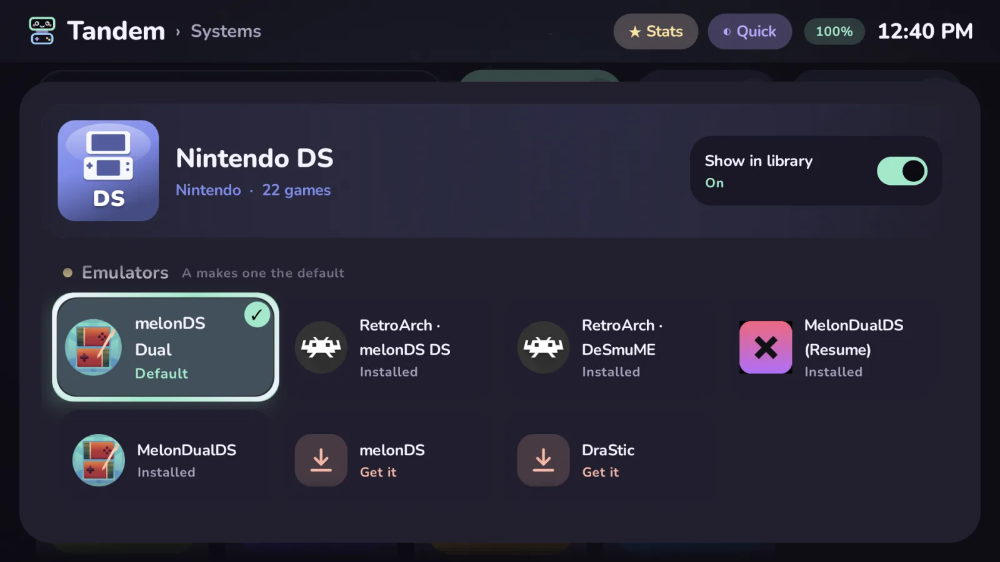

# Systems and emulators

Which systems Tandem knows, which emulators it starts, and how to add your own by editing `platforms.json`: no rebuild or app update, just change a file and rescan.

## What comes built in

Tandem knows 104 systems out of the box, and offers each installed emulator that fits. The common ones:

| System | Folder names | Main file types | Emulators |
| --- | --- | --- | --- |
| Nintendo 3DS | `n3ds`, `3ds` | `.3ds` `.cia` `.cci` `.cxi` `.3dsx` `.zcci` | Azahar, RetroArch (Citra) |
| Nintendo DS | `nds` | `.nds` `.dsi` `.zip` `.7z` | melonDS Dual, melonDS, DraStic, RetroArch |
| Nintendo Switch | `switch` | `.nsp` `.xci` `.nca` `.nro` | Eden Duo, Eden, Peanuts Native (games it has built; see [Switch games](switch.md)) |
| Nintendo Wii U | `wiiu` | `.wux` `.wud` `.wua` `.rpx` `.wuhb` | Cemu |
| Wii, GameCube | `wii`, `gc` | `.iso` `.rvz` `.wbfs` `.gcz` | Dolphin, RetroArch |
| Nintendo 64 | `n64` | `.n64` `.z64` `.v64` `.zip` | RetroArch (Mupen64Plus-Next, ParaLLEl), Mupen64Plus FZ |
| NES, SNES | `nes`, `snes` | `.nes` `.sfc` `.smc` `.zip` | RetroArch (FCEUmm, Nestopia, Mesen, Snes9x, bsnes) |
| Game Boy, Color, Advance | `gb`, `gbc`, `gba` | `.gb` `.gbc` `.gba` `.zip` `.7z` | RetroArch (Gambatte, SameBoy, mGBA, gpSP) |
| PlayStation | `psx`, `ps1` | `.cue` `.chd` `.pbp` `.m3u` `.iso` | DuckStation, RetroArch, ARMSX1 |
| PlayStation 2 | `ps2` | `.iso` `.chd` `.cso` | ARMSX2, NetherSX2 |
| PSP | `psp` | `.iso` `.cso` `.chd` `.pbp` | PPSSPP |
| PS Vita | `psvita`, `vita` | `.dpt` `.psvita` | Vita3K |
| Genesis, Master System, Game Gear | `genesis`, `megadrive`, `mastersystem`, `gamegear` | `.md` `.gen` `.sms` `.gg` `.zip` | RetroArch (Genesis Plus GX, PicoDrive) |
| Saturn, Dreamcast | `saturn`, `dreamcast` | `.chd` `.cue` `.gdi` `.cdi` | Yaba Sanshiro, Flycast, Redream, RetroArch |
| Arcade, Neo Geo | `arcade`, `mame`, `fbneo`, `neogeo` | `.zip` `.7z` `.chd` | RetroArch (FinalBurn Neo, MAME), MAME4droid |
| Windows | `windows`, `pc`, `steam` | `.steam` `.epic` `.pcgame` `.desktop` and other shortcuts; `.moonlight` for [streamed games](streaming.md) | GameNative, DroidDeck (Steam games only), Winlator, Moonlight (streamed games only) |
| DOS, ScummVM | `dos`, `scummvm` | `.zip` `.dosz` `.exe` `.scummvm` | DOSBox Pure, ScummVM |

A system appears only when its folder has at least one game. The built-in [`platforms.json`](../../app/src/main/assets/platforms.json) lists every system, folder name and file type. PC games are shortcut files; [Windows and Steam games](library.md#windows-and-steam-games) explains them.

## The Systems and emulators screen

This is where you pick each system's emulator, turn systems on or off and add folders, all without touching a file.

**Settings › Library & art › Systems and emulators** shows every system Tandem knows as a grid of tiles, each with the system's picture (your icon pack's, as on the home screen, or Tandem's drawing of the device), its name and how many games it has, with the app icon of the emulator that plays it beside the count. Its corner says **No emulator**, **Off** or **Bottom** when that applies.

- **Tabs.** Three tabs at the top sort them, each with a count: **In your library** (systems with games), **Turned off**, and **More systems** (none of their games found yet; add a folder to start). <kbd>L1</kbd> / <kbd>R1</kbd> move between the tabs.
- **Order.** Systems with the most games come first; ones with as many go by maker, so a maker's systems sit together.
- **Search.** <kbd>X</kbd> (or the search field) searches by name, short name or maker: "sega", "gba", "Sony".


<kbd>A</kbd> on a system opens its page, with its picture over its hero art:

| Part | What it does |
| --- | --- |
| Show in library | A switch: on (the default) or off. A system turned off disappears from the library, games and all, and waits under **Turned off** until you turn it back on |
| Emulators | Every emulator that can run the system, as cards with their app icons, installed ones first: **Default** (ticked) on the one in use, **Installed** on another one (<kbd>A</kbd> makes it the default), **Get it** on one that isn't installed (opens Obtainium for a GitHub release when you have it, else the Play Store) |
| Start games on | **Top screen** (the default) or **Bottom screen**, two cards with a little drawing of the screens, for this system's games. A game's own **Start on** (<kbd>Y</kbd> › **More…**) wins |
| Bottom screen while playing | What the bottom screen shows while this system's games play, one card per choice: Game art, Tandem companion, Screen off, Leave to emulator (and the Deck for PC games). Follows **Settings › Two screens › While playing** until you choose; 3DS and DS default to Leave to emulator |
| Folders | The system's folders that are there as cards: **Built in** for the usual names, **Added** on one you added (<kbd>A</kbd> takes it out, with Undo). The usual names that aren't there yet share one **Also looks in** card |
| Add a folder… | Picks one more folder that holds only this system's games, anywhere on the device or SD card |

<kbd>B</kbd> goes back to the tile you opened (on its new tab, if you just turned the system off). With only one screen, Start games on and Bottom screen while playing are left out.

A game can still use another emulator than its system's: <kbd>Y</kbd> on it › **More…** › **Emulator**.



## Using your own platforms.json

For anything the Systems and emulators screen can't do (a new system, an emulator Tandem doesn't know yet, other file types), you can give Tandem your own list. No rebuild or app update needed. The built-in list is [`app/src/main/assets/platforms.json`](../../app/src/main/assets/platforms.json). To change it:

1. Copy that file to `ROMs/tandem/platforms.json` on your device.
2. Edit it: add a system, add an emulator, change a folder name.
3. In Tandem, **Settings › Library & art › Rescan games**.

> [!IMPORTANT]
> When `ROMs/tandem/platforms.json` exists, Tandem uses it instead of the built-in list, entirely. Start from a copy of the built-in file, so you keep the systems you didn't mean to change.

> [!TIP]
> If Tandem shows no systems after an edit, the file probably has a JSON syntax error, like a missing comma. Paste it into any JSON validator to find the line.

## The format

The file is one object with a `platforms` list. Each entry is a system, with the emulators that play it:

<details>
<summary>A complete example entry (the GBA with RetroArch)</summary>

```json
{
  "platforms": [
    {
      "id": "gba",
      "name": "Game Boy Advance",
      "short": "GBA",
      "folders": ["gba"],
      "extensions": ["gba", "zip", "7z"],
      "skipDirs": [],
      "art": ["gba"],
      "players": [
        {
          "name": "RetroArch",
          "component": "com.retroarch.aarch64/com.retroarch.browser.retroactivity.RetroActivityFuture",
          "action": "android.intent.action.MAIN",
          "game": "extra-path:ROM",
          "extras": {
            "LIBRETRO": "/data/data/com.retroarch.aarch64/cores/mgba_libretro_android.so",
            "CONFIGFILE": "/storage/emulated/0/Android/data/com.retroarch.aarch64/files/retroarch.cfg"
          }
        }
      ]
    }
  ]
}
```

</details>

### System fields

| Field | Required | Meaning |
| --- | --- | --- |
| `id` | Yes | A short, unique, lowercase name. It is part of each game's identity (`gba/Some Game.gba`), so changing it later makes Tandem forget favorites and play time for that system. |
| `name` | Yes | The full name, shown on system cards and the bottom screen. |
| `short` | No | A few letters for tiles and pills, like `GBA`. Defaults to `name`. |
| `folders` | No | Folder names that mean this system in any game folder (matched loosely, see [How games are found](library.md#how-games-are-found)). Defaults to the `id`. A full path is one more folder of its own. |
| `extensions` | Yes | File extensions that count as games, without the dot. Case doesn't matter. |
| `skipDirs` | No | Subfolder names to ignore, for emulator data kept next to the games. |
| `art` | No | Folder names under `ROMs/downloaded_media/` to take artwork from. Defaults to the `id`. Scrapes save into the first. |
| `aliases` | No | Other names for the system, used to match Cocoon and Daijisho platform files and theme pack art (`3ds` for `n3ds`). |
| `players` | Yes | The emulators that can run this system. The first one is the default. |

### Emulator fields

Each entry in `players` describes how to start one emulator.

| Field | Required | Meaning |
| --- | --- | --- |
| `name` | No | Shown in the game menu. Defaults to the package name. |
| `component` | Yes | The emulator's activity, as `package/full.activity.Name`. |
| `action` | No | The intent action. Defaults to `android.intent.action.VIEW`. |
| `game` | No | How the game is handed over; see below. Defaults to `data`. |
| `extras` | No | Extra values to send with the intent. They keep their JSON type: a string, a list (sent as a string array), `true`/`false`, or a number. A templated number is written `{"int": "{file.id}"}` (also `long`, `float`, `bool`, `uri`, `string`). |
| `extensions` | No | The file extensions this player opens. Other files of the system go to its other players, and the game menu offers it only for these. DroidDeck lists `steam` and `steamappid`. |
| `own` | No | `true`: the files in `extensions` are this player's alone. No other player of the system is used or offered for them, whichever is the system's default. Moonlight owns `moonlight`. |
| `data`, `type` | No | Templates for the intent's data and MIME type, for players that want something other than the game file (`gamenative://run?appid={file.id}`, say). |
| `categories` | No | Intent categories to add. |
| `byExtension` | No | Changes for one kind of file: an object per extension (or `dir` for games that are folders) with its own `action`, `game`, `data` or `extras`. GameNative uses it to send `game_source` by extension. |
| `store` | No | Where to get the emulator. A GitHub releases page opens in Obtainium when it is installed; without it, the Play Store. |
| `note` | No | A remark for people editing the file; Tandem ignores it. |

> [!TIP]
> `{"core": "mgba"}` is short for RetroArch (`com.retroarch.aarch64`) with that core; add `"package"` for another RetroArch build. A single `"launch"` object in place of `players` is accepted too.

The `game` field takes one of these forms:

| Value | What the emulator receives |
| --- | --- |
| `data` | A content link to the game as the intent's data. Most standalone emulators. |
| `extra-uri:<key>` | The same content link, in the extra named `<key>`. |
| `extra-path:<key>` | The plain file path, in the extra named `<key>`. RetroArch works this way. |
| `data-file` | A `file://` link as the intent's data. |
| `none` | Nothing: the game goes in `extras` or `data` through templates instead (Vita3K, GameNative, DroidDeck). |

<details>
<summary>Templates you can use in extras, data and type</summary>

`{file.path}`, `{file.uri}` (a shared link), `{file.fileuri}`, `{file.name}`, `{file.stem}`, `{file.ext}`, `{file.dir}`, `{file.mime}`, `{file.id}` (the id inside a small shortcut file, such as a Vita `.dpt` or a PC `.steam`), `{file.text}` (its first line), `{tags.<name>}` (a `[name] value` line in it), `{storage}`, `{roms}` and `{package}`.

</details>

<details>
<summary>Why content links need a picked games folder</summary>

A content link points into the games folder you picked (on first launch, or in **Settings › Library & art › Game folders**), and Tandem grants the emulator access to that one file. That is why the second setup step matters for emulators that use `data` or `extra-uri`.

</details>

## Finding an emulator's component and action

Most emulator projects document how frontends should launch them; look for "frontend", "intent" or "ES-DE" in their docs. ES-DE's own configuration (its `es_find_rules.xml` and `es_systems.xml` for Android) lists the activity and action for many emulators, and translates directly:

| In ES-DE | In `platforms.json` |
| --- | --- |
| The emulator's `package/activity` entry in `es_find_rules.xml` | `component` |
| `%ACTION%=…` | `action` |
| `%DATA%=%ROMSAF%` | `"game": "data"` |
| `%EXTRA_key%=%ROM%` (a file path) | `"game": "extra-path:key"` |
| `%EXTRA_key%=%ROMSAF%` (a content link) | `"game": "extra-uri:key"` |
| Any other `%EXTRA_key%=value` | an entry in `extras` |

<details>
<summary>Listing an app's activities from a computer with adb</summary>

```sh
adb shell cmd package resolve-activity --brief -a android.intent.action.VIEW <package>
adb shell dumpsys package <package> | grep -i activity
```

</details>

## Several emulators for one system

Add more entries to `players`. The first is the default, and any game can use another from its game menu (<kbd>Y</kbd> › **More…** › **Emulator**). For example, to offer a standalone mGBA alongside RetroArch for the GBA, add it as a second player.

## Sharing what works

If you get an emulator working, please share it: open a [new emulator request](https://github.com/ZahakJ/tandem/issues/new?template=new_emulator.yml) with your entry, or a pull request that adds it to the built-in file.