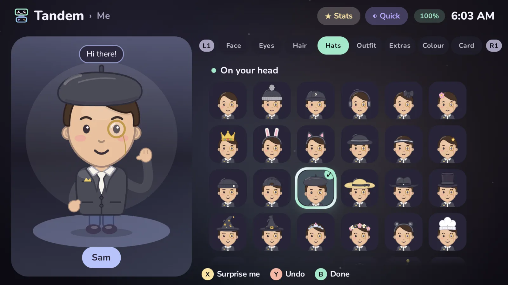
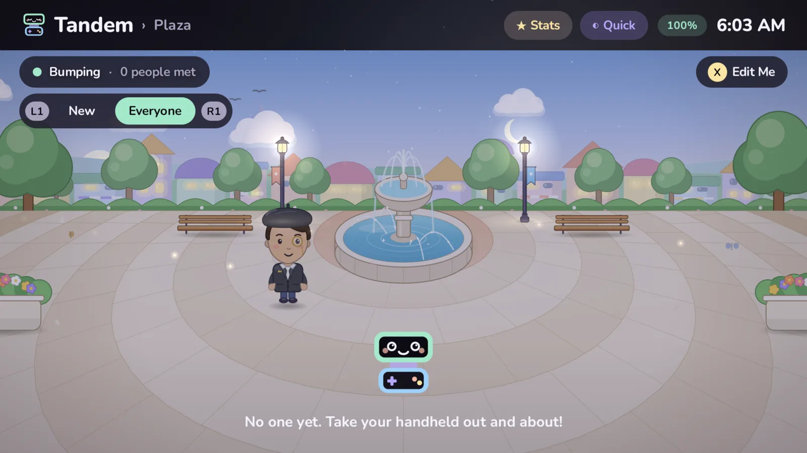
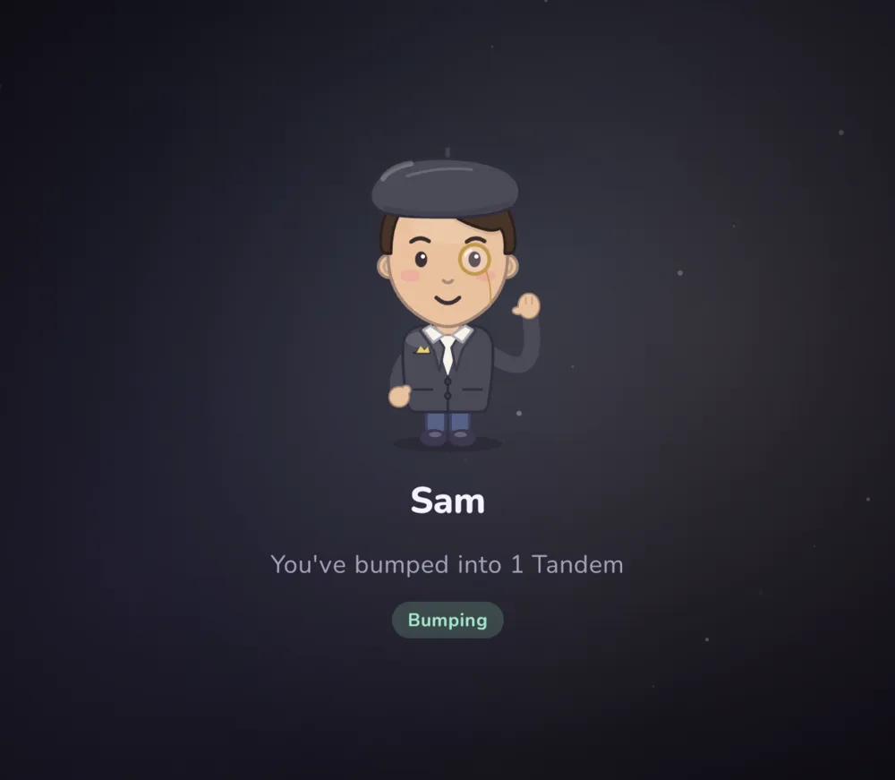

# Bump and the Plaza

Make a little character of yourself, carry your handheld about, and meet other Tandems just by bumping into them. Each one
you bump into leaves their card on your **Plaza**: a cozy square where everyone you met strolls about, waves, and shows
their name, a greeting and a favourite game. No account, no internet: two Tandems in Bluetooth reach swap a small
signed card, and that is all that ever leaves your handheld.

Bump is **off until you turn it on**. Nothing is sent, nothing is listened for, and no permission is asked
before then.

## Getting started

1. Open the **Plaza**: its tile on the icon grid (a pair of friends), <kbd>Start</kbd> › **Plaza**, or **Settings ›
   Play & system › Bump › Open the Plaza**. The first time it opens **Me**, the character maker.
2. Make yourself (below). Pip walks you through it in three short steps.
3. Switch on **Settings › Play & system › Bump › Bump**. Tandem first says what Bluetooth is used for,
   then Android asks for **Nearby devices**. That is the only permission Bump needs; it never asks for your
   location.
4. Take your handheld out. When another Tandem with Bump on comes within reach, you swap cards, hear the
   **Passby** jingle and see "You bumped into …!".

Bump needs Android 12 or newer (Android 11 would need the location permission just to look for Bluetooth
devices, which Tandem won't ask for) and Bluetooth LE. Any such device running Tandem can bump, a phone as well as a
handheld.

## Me: your character

**Me** is Tandem's own character maker: big soft heads, small bodies, pastel colours, drawn by Tandem, not anyone
else's characters. The big preview on the left blinks, bobs and hops each time you change something; the choices on
the right are little drawings of you wearing each one.

| Button | Does |
| --- | --- |
| <kbd>L1</kbd> / <kbd>R1</kbd> | The tabs: Face, Eyes, Hair, Hats, Outfit, Extras, Colour, Card |
| D-pad, <kbd>A</kbd> | Move, and pick a choice (a tap picks it too) |
| <kbd>X</kbd> | Surprise me: a random look (your name, greeting and game stay) |
| <kbd>Y</kbd> | Undo one step |
| <kbd>B</kbd> | Done. Every change is saved as you make it |

The parts: face shape (6), skin tone (10 everyday tones and 4 storybook ones), eyes (20, from big sparkly ones to
almond, monolid, heart pupils or peacefully closed), eye colour (16), brows (6), mouth (8), cheeks (blush, freckles), a
beard or moustache (4), hairstyle (34, bald among them: locs, cornrows, box braids, waves, a mohawk, a hime cut, space buns…)
and hair colour (12), something on your head (36: caps, beanies, a beret, sun, cowboy and top hats, a hijab, a hood,
animal ears, a chef's toque, a space helmet, a halo…), an outfit (38: everyday wear, a suit, a thobe, a kaftan, a
hanbok-inspired jacket and skirt, a wrap jacket, dresses, and a few costumes like a cape, a knight's tunic or a space
suit) and its colour (12; some outfits take a second colour from it), glasses (14), earrings (9), face details (7:
freckles across the nose, face paint, a plaster, a sweat drop…), and your card's own colour (10).

A hat sits on your hair the way a real one would: a cap or a beanie hides the hair above its brim (a bun or a top-knot
too), a hijab or a space helmet all of it. Tall hats are never cut off: the preview steps back a little to fit them.

The **Card** tab holds what people see besides your character:

- **Name**: up to 12 characters, typed on the controller keyboard.
- **Greeting**: one of sixteen preset lines ("Nice to meet you!", "Snack break?"…). There is no free text, so nobody can
  put words of their own on a stranger's screen; each Tandem shows the greeting in its own language.
- **Favourite game**: one from your library (favourites first). Only its title goes on the card.
- **Share what I played last**: off unless you turn it on; again the title only.

Hidden games never go on a card, even if you picked one as your favourite before hiding it.

## The Plaza

Everyone you've bumped into, newest first, out in a little town square on the top screen, with their cards in a strip
along the bottom.

The square has a fountain in the middle, benches, lamps and planters, and a town and hills behind. The sky follows
your clock: morning, day, evening, and night with stars, lit windows and fireflies. People walk round the fountain and
each other, stop to look about, chat in pairs with little picture bubbles, sit on the benches and wave at you.
Someone new hops, and someone who just arrived walks in from the side. With **Reduce motion** everyone stands still.

The one you highlight stops, turns to you and waves, on a soft ring with a marker above. The bottom screen shows their whole card: their
greeting, name, favourite and recent game (with its art, if you have the game too), "Bumped 3 times · last at 18:40",
how many Tandems they have bumped into and when you first met.

| Button | Does |
| --- | --- |
| <kbd>L1</kbd> / <kbd>R1</kbd> | **New** (people you haven't looked at yet) or **Everyone** |
| <kbd>A</kbd> or <kbd>Y</kbd> on someone | Their options: **Wave back**, **Hide from the Plaza**, **Block** (hold <kbd>A</kbd>) |
| <kbd>X</kbd> | Edit Me |

- **Wave back**: the next time you bump into them, your card tells them, and they see "Waved at you!". Their waves show the
  same way on yours.
- **Hide**: they leave the Plaza until you bump into them again (Undo is offered for a few seconds).
- **Block**: they are gone for good. Their cards are refused from then on, and your Tandem never sends them yours: it learns who is on the other side before saying anything. A new
  name doesn't get round it: a block is by their key, not their name. **Blocked people** in Settings unblocks everyone.

The Plaza tile shows a badge with how many people are new, and so does <kbd>Start</kbd> › **Plaza**. Opening the
Plaza with someone new plays the Passby jingle. Bumping into the same person again counts once every six hours (a family on
one sofa doesn't count all day).

## How bumping works

Two Tandems find each other over Bluetooth LE and swap cards in about a second:

- **Advertising.** While Bump is on, your Tandem sends a tiny Bluetooth advertisement: Bump's service and a random
  8-byte code. The code is new about every 15 minutes (13 to 17, so the rhythm isn't a fingerprint either) and has
  nothing to do with who you are, so nobody can follow your handheld around by it. No name and no number that stays
  the same goes out.
- **Looking.** It listens in short windows: 8 seconds every half minute while Tandem is on screen.
- **Swapping.** When two Tandems hear each other, the one with the smaller code connects (the other waits 40 seconds
  in case it wasn't heard) and they swap cards: each side sends a fresh random number, and each card is signed over the
  other side's number with that person's own key. A card someone recorded can't be played to anyone again, and a card
  can't be faked or changed. Then they let go.
- **Limits.** At most twelve swaps an hour, however crowded it gets, and a code already met isn't connected to again.

**Bump while playing** (Settings › Play & system › Bump) keeps bumping while a game is in front, with a
notification ("Bump is on"), and listens less often then: 6 seconds every minute and a half. Off (the default),
Bump pauses whenever Tandem isn't in front: in games and in other apps. With the screen off it always pauses, Bump while playing or not, so the random code never goes stale while the handheld sleeps.

## Battery

Advertising at Bluetooth LE's lowest pace costs very little; the short listening windows are most of it, and a swap is
a second or two of radio. With Bump on and Tandem in front, expect a small extra drain, similar to a smartwatch
connection; with Bump while playing on, a little more during games. Leave Bump while playing off, or Bump
off, when the battery matters.

## Privacy and safety

- **What goes out**: your card, only to Tandems in Bluetooth reach, only while Bump is on: your character, name,
  greeting, favourite game's title (if you picked one), the title you played last (only if you share it), how many
  Tandems you have bumped into, and the public key that signs it. **Settings › Play & system › Bump › What others
  see** shows exactly that.
- **What never goes out**: your location (Tandem doesn't ask for it), accounts, anything you typed, your library, play
  time, files, hidden games. Nothing at all goes online.
- **Private mode** pauses Bump and closes the Plaza.
- **Children**: Bump is off until someone turns it on, greetings are presets, names are cleaned of control
  characters, and Block is one hold away.
- **Your key** is made on the handheld the first time Bump runs, and kept sealed by the Android keystore in
  Tandem's no-backup storage: never in a backup or anywhere else.
- **Clear Plaza** forgets everyone you've met (your card, blocks and bump count stay).

More in [Privacy and scraping](privacy.md#bump).

For the curious: the identity, and chat later

Your Bump identity is an Ed25519 keypair made from 32 random bytes. It is laid out exactly as a
[Concord](https://github.com/ZahakJ/concord) account: the same 32-byte account seed gives the same key in both, the
safety number under **Bump ID** is Concord's (base32 of the first 20 bytes of the key's SHA-256, in groups of four),
and the key's libp2p PeerID (starting `12D3KooW`) is the address Concord would dial. Meeting someone on the Plaza is
meant to become the way to start a chat with them later, through Concord, without anyone moving to a new key. Cards
carry room for that (typed extensions, signed with the rest) so it can come without changing anything you have.

## Troubleshooting

- **The Plaza says "Needs Bluetooth permission"**: switch Bump off and on again for the explanation and
  Android's question, or allow **Nearby devices** for Tandem in Android's settings.
- **"Bumping (can find, can't be found)"**: this handheld's Bluetooth can't advertise. It still finds Tandems that can.
- **Nobody ever shows up**: both handhelds need Bump on, Tandem in front (or Bump while playing), Bluetooth on
  and private mode off. Stand within a few metres for half a minute.
- **The same person shows twice**: they reinstalled Tandem or cleared its data, which makes a new key; hide the old one.
