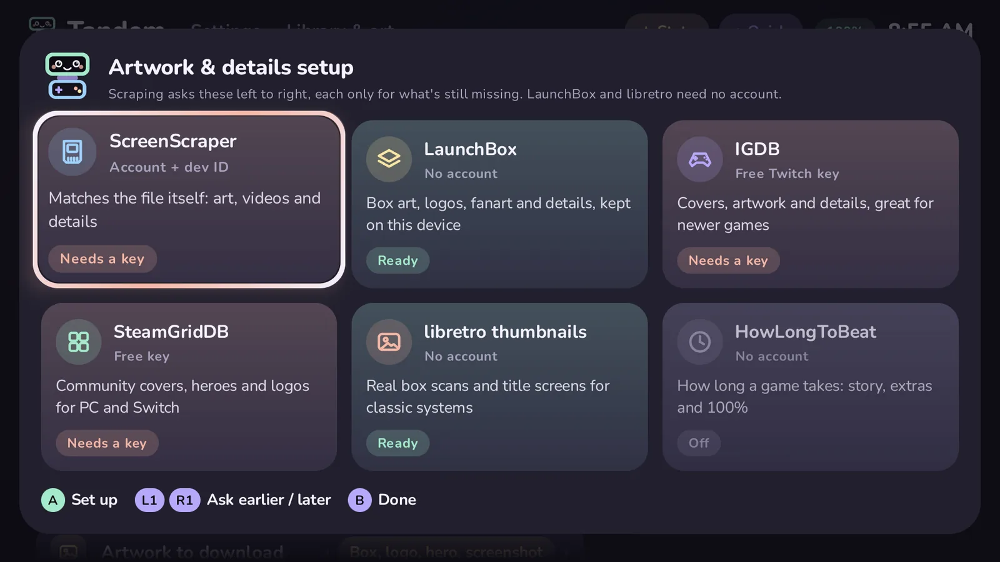
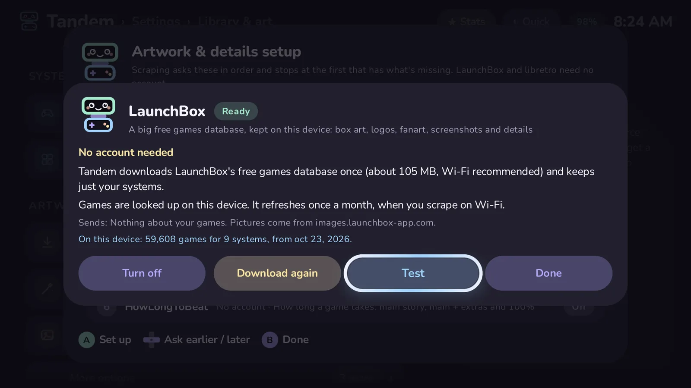
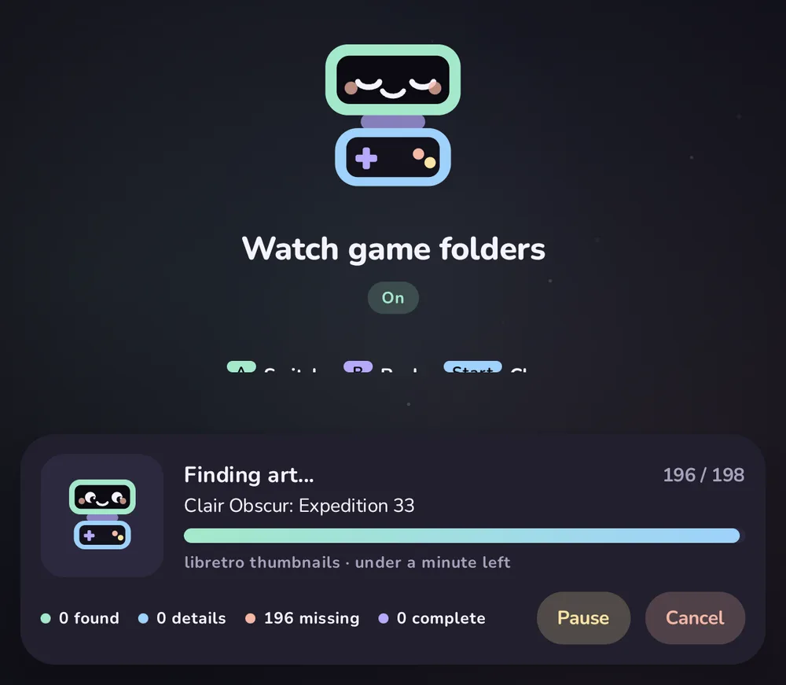
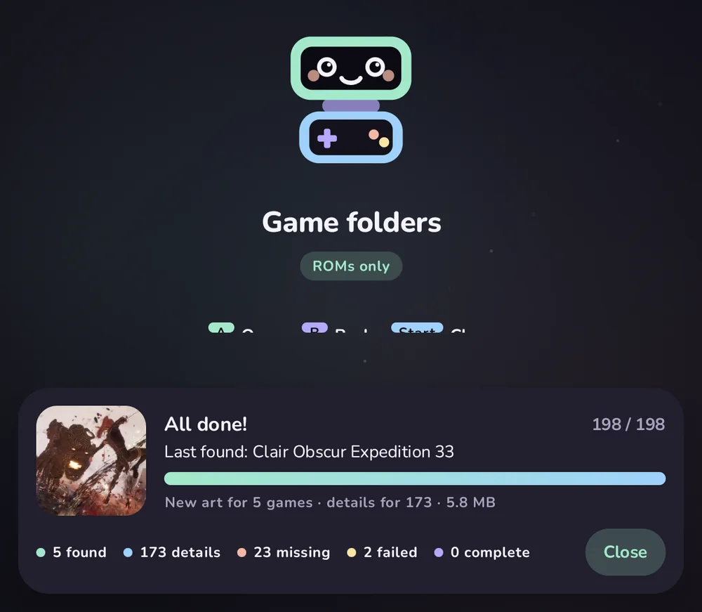
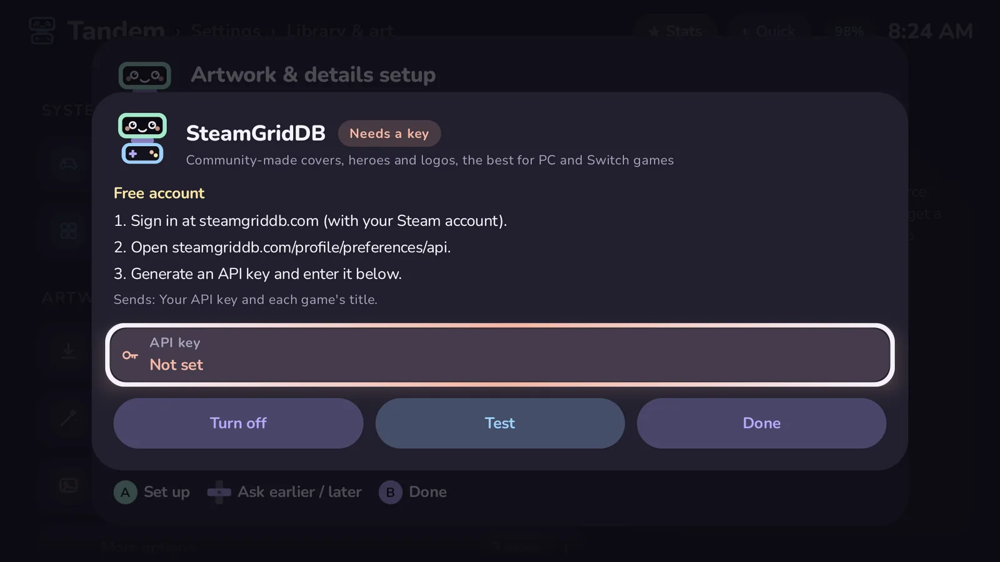

# Artwork and scraping

Tandem can download box art, logos, hero art, screenshots and game details for your library. It's optional, it's
only ever started by you, and the easiest way needs no account at all.

> [!TIP]
> **Art with no account:** **Settings › Library & art › Set up sources › LaunchBox › Download** (a one-time download
> of LaunchBox's games index, about 105 MB), then **Settings › Library & art › Scrape library** › **Start scraping**.

## Art with no account

If you come from Cocoon, whose scraper works with no setup, LaunchBox is Tandem's closest equivalent: a big free
games database with box art, logos, fanart, screenshots and details, strong for modern systems (Switch, Wii U, Vita,
PC) as well as classic ones. Tandem downloads its index once and looks your games up on the handheld itself, so
nothing about your games is sent anywhere. **libretro thumbnails** also needs no account and is always ready; it is
great for classic systems and has nothing for Switch, Wii U or PC games.

1. Open **Settings › Library & art** (Start › Settings ▸ › Library & art) and press A on **Set up sources**. The
   **Artwork & details setup** popup shows every source as a tile, in the order they are asked (left to right), with what
   it needs and its state.
2. Highlight **LaunchBox** (its state says **Not downloaded**) and press A. Its card explains what it gives.
3. Press A on **Download (105 MB)**, then **Download** in the question. Wi-Fi is better; on a metered connection the
   question says so. Pip says "LaunchBox is ready: … games ✨" when it's done. Only your systems are kept.
4. Optional: **Test** looks up one well-known game on the device and shows ✓ with what it found.
5. **Done**, then <kbd>B</kbd> to close the list. Back on Library & art, press A on **Scrape library**, and on the
   scrape screen press A on **Start scraping**.

You can also skip step 3: when you start a scrape and LaunchBox hasn't been downloaded, Tandem asks **Download
LaunchBox's games database?** with **Download & scrape** (download it, then scrape) or **Skip LaunchBox** (scrape
with the other sources).

LaunchBox's index refreshes by itself when it is a month old and you start a scrape on Wi-Fi. Once it is on the
device, Tandem also fills in missing descriptions, genres, year, developer and players after every library scan,
from the copy on the handheld, without going online.

**Already have art?** Tandem uses what is already in `ROMs/downloaded_media/` (the folders ES-DE and similar
frontends write), and the first scan brings over the art and details in your ES-DE gamelists and newest Cocoon
backup: see [Importing](importing.md). A scrape in **Missing selected** mode (the default) counts that art and only
fetches what is still missing.

### Example: box art for a Switch library, no account

You have 40 Switch games, some with no box art, and you never set up any source.

1. **Settings › Library & art › Set up sources**, A on **LaunchBox**, A on **Download (105 MB)**, **Download**.
   Wait for "LaunchBox is ready".
2. **Done**, <kbd>B</kbd>, then A on **Scrape library**.
3. On the scrape screen, **Games** says **All systems**: press ◀▶ until it says **Nintendo Switch**. The right side
   says something like "40 games to check · 12 without box art yet", and under it the sources that will be asked
   (with no keys, `LaunchBox › libretro`).
4. Leave **Mode** on **Missing selected** and press A on **Start scraping**. With two screens, Tandem goes back to
   the library and the progress card shows on the bottom screen ("Scraping in the background"); the top bar shows
   **✦ Scraping 5/40**. You can keep browsing; the scrape pauses while a game plays.
   The card counts games **found**, given **details**, **missing** and already **complete**, with **Pause**,
   **Cancel** and **Close** to tap.
5. When it's done the card sums it up ("New art for 12 games · details for 30") for half a minute. **Scrape
   library** again shows the finished run: **All done!**, the new covers, and **Missed**, the games no source knew,
   to pick art for by hand (Y › More › **Choose artwork**).

## Better coverage with free keys (optional)

Three sources need a free key of your own. None is needed; each adds art the others may not have.

**Why Tandem can't come with keys built in.** These services hand out keys to a person or a project, and their terms
don't allow publishing them. Tandem is open source, so a key built into it would be readable by anyone, shared by
every user (one quota for all of them) and soon revoked. So each person registers their own free key, which also
gives them their own quota. LaunchBox, libretro thumbnails and HowLongToBeat need none.

### SteamGridDB (free key, best for PC and Switch)

Community-made covers, hero art and logos, matched by title. Great for PC and Switch games.

1. On any computer or phone, sign in at [steamgriddb.com](https://www.steamgriddb.com) (with a Steam account).
2. Open [steamgriddb.com/profile/preferences/api](https://www.steamgriddb.com/profile/preferences/api) and generate
   an API key.
3. On the handheld: **Settings › Library & art › Set up sources**, A on **SteamGridDB**, A on **API key**, type the
   key on the on-screen keyboard and press **Done**.
4. **Test**: it should say "Found Super Mario Odyssey with … heroes".

### ScreenScraper (optional, needs developer credentials)

ScreenScraper matches the game file itself by checksum, and has box art, fanart, logos, screenshots, video snaps and
details for almost every system. It is the one source that needs more than a quick key:

1. Make a free account at [screenscraper.fr](https://www.screenscraper.fr).
2. Ask for API access in its forum ("Demande d'accès à l'API") to get a **developer ID and password**. ScreenScraper
   gives these to software developers, and publishing them in open-source code would break its rules, so Tandem
   can't ship one.
3. On the ScreenScraper card, enter **Developer ID** and **Dev password**. Optionally also **Your login** and **Your
   password** (your own account): that gives you your account's daily quota and up to 4 requests at once instead of
   the shared anonymous quota.
4. **Test**.

### IGDB (free Twitch application)

Twitch's games database: covers, artwork, screenshots and details, good for newer games.

1. Sign in at [dev.twitch.tv/console/apps](https://dev.twitch.tv/console/apps) (Twitch asks for two-factor sign-in).
2. **Register Your Application**: any name, OAuth redirect URL `http://localhost`, category "Application
   Integration", client type "Confidential".
3. Copy the **Client ID**, press **New Secret**, copy the **Client Secret**.
4. On the IGDB card, enter **Client ID** and **Client secret**, then **Test**.

### HowLongToBeat (no account, off until you turn it on)

How long a game takes: main story, main + extras and 100 %, shown on the bottom screen beside your play time. It uses
the website's own search rather than an official API, so it is off until you press **Turn on** on its card; if the
site changes, scrapes just skip it with a note.

## Setting up sources

**Settings › Library & art › Set up sources** opens the **Artwork & details setup** popup (the first-run welcome has
the same sources as its Artwork & details step). The same sources are also rows of their own under **Sources, in
order** on the Library & art page, and in the scrape screen.

| In the list | What it does |
| --- | --- |
| The D-pad | Moves between the tiles |
| <kbd>A</kbd> on a source | Opens its card: what it gives, whether it needs an account, exactly where to get a key, and what it sends |
| <kbd>L1</kbd> / <kbd>R1</kbd> on a source | Asks it earlier or later: the tile moves one place, and the highlight with it |
| <kbd>B</kbd> | Done |

A source's state: **Ready**, **Needs a key** (it will be skipped), **Not downloaded** (LaunchBox), **✓ Works** or
**✗ Test failed** after a Test, **Downloading …%**, or **Off**.

On a card: the steps, what it gives and sends, the key fields (each says **Not set**, **Optional** or **Saved ✓**, or
shows what you typed; A edits it), then **Turn off** / **Turn on**, **Download** (LaunchBox), **Test** and **Done**. The
filled button is the obvious next step: **Turn on**, **Download**, **Test** once the keys are in, or **Done** while
they aren't. **Test** does one real lookup of a well-known game (never one of yours) and shows ✓ with what
it found, or ✗ with the reason: "Needs an API key", "Couldn't reach it. Check the Wi-Fi and try again", "It answered
with an error (401)" and so on.

**The order.** A scrape asks the first source for everything, then each next one only for what is still missing.
The default order is ScreenScraper, LaunchBox, IGDB, SteamGridDB, libretro thumbnails, HowLongToBeat; a source
without its keys is simply skipped, so with no keys the order is in effect LaunchBox, then libretro.

## Starting a scrape

| From | Scrapes |
| --- | --- |
| **Settings › Library & art › Scrape library** | The scrape screen, for all systems or one (◀▶ on **Games**) |
| <kbd>Y</kbd> on a system or one of its folders › **Scrape these games** | The scrape screen, for that system or folder |
| <kbd>Y</kbd> on a game › **More…** › **Scrape this game** | That game alone, at once, with your settings in Force all mode (never replacing locked fields). Pip says "Looking for …" |
| <kbd>Y</kbd> on a game › **More…** › **Choose artwork** | Shows what every source has for that game; L1 / R1 switch between box art, hero and logo; **From this device** uses a picture of your own |

The scrape screen's options:

| Option | Default | What it does |
| --- | --- | --- |
| Games, Folder | All systems | Which games: all systems, one system, or one of its folders |
| Mode | Missing selected | **Missing basics**: only games without box art or a description, and only those two. **Missing selected**: what you picked that a game doesn't have yet. **Force all**: fetch everything you picked again and replace it |
| Replace locked fields | Off | Anything you edited or picked by hand is locked; on, a scrape may replace it too |
| Artwork | Box art, Hero, Logo, Gameplay screenshot | Each kind on or off: Box art, Hero / fanart, Logo, Title screen, Gameplay screenshot, Video snap (about 3 MB a game), and **Physical boxes and spines** (real box scans for the Shelf view, kept apart from your box art) |
| Game details | On | Name, Description, Genres, Developer & publisher, Release year, Players, Rating and Time to beat (HowLongToBeat), each on or off |
| Region & language | from your device | Which box art and description to prefer |
| Sources, in order | | Each source's state; A opens its card, ◀▶ moves it earlier or later |

**Start scraping** runs it in the background: with two screens the progress card is on the other screen and you can
keep browsing; the top bar shows **✦ Scraping 12/40** wherever you are. A scrape pauses while a game is in front and
carries on when you're back. On the progress screen: **Stop**, **Pause** / **Resume**, **Keep browsing**; at the end
**Done**, **New scrape** and **Missed**.

Scraped pictures are saved in `ROMs/downloaded_media/<system>/<kind>/`, named like the game file, the layout ES-DE
reads, and **Clear downloaded media** removes only what Tandem downloaded. More detail on files, matching and each
source is in the [scraping reference](../SCRAPING.md); what each source receives is in
[Privacy](privacy.md#what-is-sent-and-to-whom).

## When a scrape finds nothing

| What you see | Why, and what to do |
| --- | --- |
| "Private mode keeps Tandem offline: no scraping or art lookups" | Private mode is on, and it keeps Tandem offline. Turn it off in **Settings › Play & system › Privacy & hidden › Private mode** (it asks for your PIN), scrape, and turn it back on |
| **Start scraping** greyed, "Turn on at least one source below" | Every source is off or missing its key. Turn on LaunchBox or libretro, or add a key |
| Switch, Wii U or PC games get nothing | With no keys, only LaunchBox and libretro are asked, and libretro has nothing for those systems. If you chose **Skip LaunchBox**, or its download failed, nothing was left to ask: download LaunchBox (above) and scrape again, or add a SteamGridDB key |
| A source never seems to be asked | It has no key (**Needs a key**), so it is skipped. Add the key on its card and **Test** |
| "LaunchBox needs its database" | You skipped the download. Settings › Library & art › Set up sources › LaunchBox › **Download** |
| "Some systems aren't in the LaunchBox download yet; download it again to add them" | You added a system after downloading. Press **Download again** on LaunchBox's card |
| "ScreenScraper's daily limit for your account is used up" or "ScreenScraper paused lookups" | ScreenScraper's quota. The scrape carries on with the other sources; try ScreenScraper again tomorrow, or add your own login for a bigger quota |
| "Couldn't reach …, using the other sources", "No internet connection" | No network, or the service is down. Check Wi-Fi and start again |
| "Details need LaunchBox, ScreenScraper or IGDB turned on" | libretro, SteamGridDB and HowLongToBeat give no descriptions |
| "Nothing new this time" | In the Missing modes a game that already has what you picked is skipped. Use **Force all**, or **Scrape this game** for one |
| A game you edited keeps its old art or name | You locked it by editing it. **Replace locked fields**, or X on the field in Edit details to unlock it |
| Some games are skipped | Hidden games are never sent anywhere. Unhide the game to scrape it |
| **Not found** for a game | No source knew the title. Rename it in Edit details to its proper name and **Scrape this game**, or **Choose artwork** › **From this device** |
