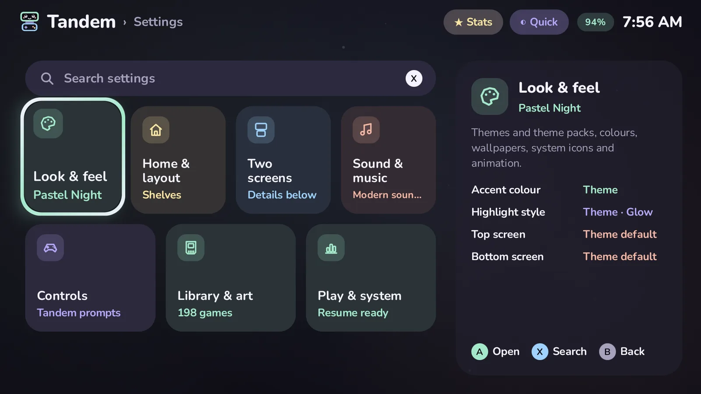
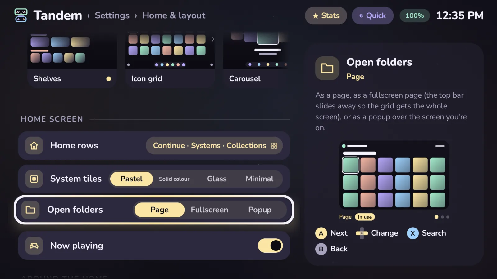
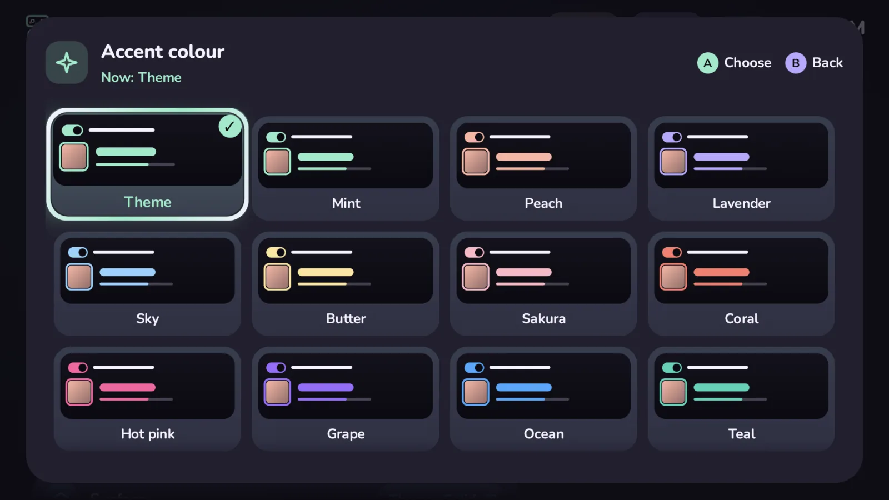
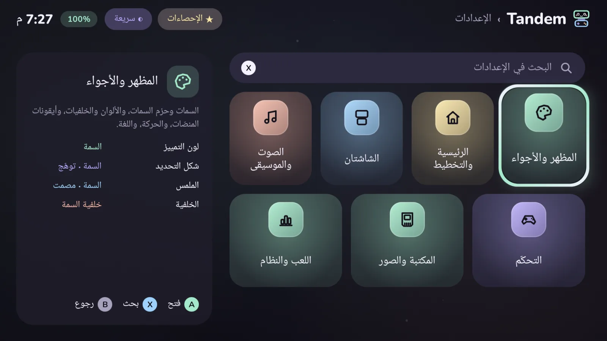
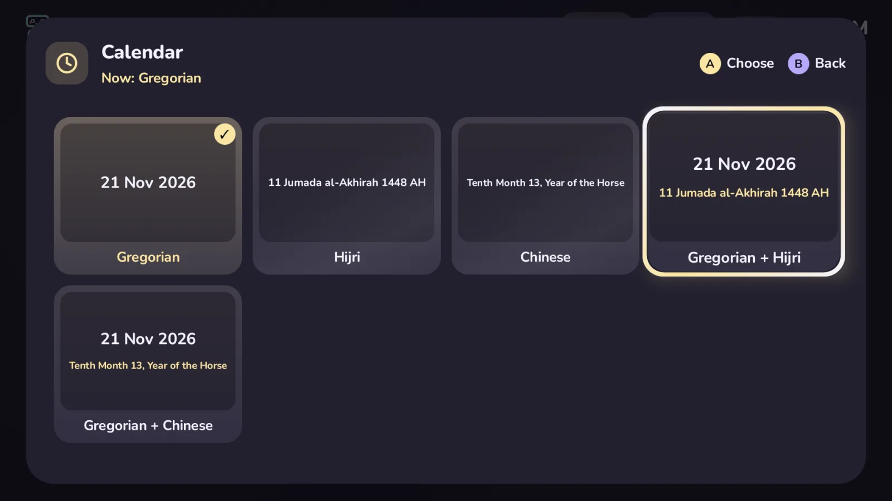
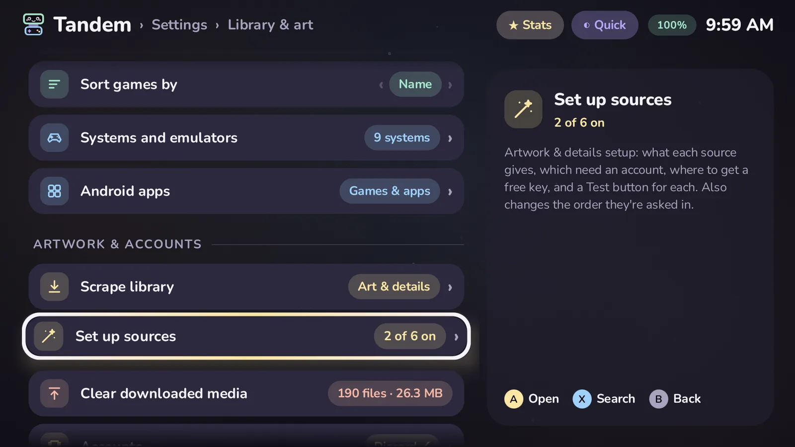

# Every setting

Every row in Tandem's Settings, page by page: what it does in plain words, and what it is set to until you change it. Open Settings with <kbd>Start</kbd> › **Settings**.

**Finding a setting.** Settings opens on seven tiles, one per page. A page is a few short groups, the settings people change most first, and nothing is folded away.

- <kbd>X</kbd> searches every row on every page by its name or by what it does ("nintendo", "bigger", "quiet"); <kbd>A</kbd> on a result takes you to it.
- A row with **›** that names a group of settings (**Wallpaper ›**, **Dock & widgets ›**, **Accounts ›**) opens a short page of its own; <kbd>B</kbd> goes back to the page it came from.
- <kbd>L1</kbd> / <kbd>R1</kbd> flip pages, <kbd>B</kbd> goes back to the tiles, <kbd>Start</kbd> closes Settings.

Each row's help shows beside it and on the other screen. See [Controls › Settings](controls.md#settings) for every button.

**Every choice shows its options.** A few short ones sit on the row itself, the one in use filled: <kbd>◀</kbd> / <kbd>▶</kbd> move along them. Longer ones open as cards with <kbd>A</kbd> (each with a little picture when the setting changes how something looks), starting on the one in use. A number is a slider.

**You see what a look setting does.** For a setting that changes how anything looks, the panel beside the rows plays it: a switch shows its Off and On looks in turn, a choice each of its options, with a chip naming what is on screen and **In use** on yours. With Reduce motion they stand side by side, still.

> [!NOTE]
> A default of "the theme's" means the row follows the theme you wear until you pick something of your own. Some rows only show with the home layout they belong to (the icon grid's rows only with the icon grid, Orbit's only with Orbit, and so on), and a few only when they can do something (Discord only in builds that include it, the Theme pack group only when your theme pack brings music or sounds).

## Look & feel

Colours, wallpaper, icons, motion, the language and the calendar: how Tandem looks and reads, whatever layout you use. The page opens with the gallery of themes and the gallery of theme packs; see [Themes](themes.md).

| Group | Setting | Default | What it does |
| --- | --- | --- | --- |
| Colour | Accent colour | the theme's | Your own colour for toggles and the highlight. <kbd>◀</kbd> / <kbd>▶</kbd> tries the swatches; <kbd>A</kbd> shows them all as cards, and **Type a colour…** takes any, like `#FF7AB6`. |
| Colour | Highlight style | the theme's | How the highlighted item is marked: Glow, Outline, Lift or Pulse. |
| Colour | Surface | the theme's | What cards are made of: Solid, Frosted glass or Outlined. |
| Wallpaper, icons & motion | Wallpaper › | | Opens **Wallpaper** (below). |
| Wallpaper, icons & motion | Icon style | the theme's | How Tandem draws system icons when no pack has art for them: pixel, neon, LCD, chrome, plastic, sticker and more. |
| Wallpaper, icons & motion | Icons from | Auto | Where system icons, heroes and logos come from: the theme pack's own (Auto), another pack's, or always drawn by Tandem. |
| Wallpaper, icons & motion | Motion › | | Opens **Motion** (below). |
| Language | Language | System default | The language Tandem speaks: System default (Android's), English, العربية, 日本語, 简体中文 or Français, each named in itself. Both screens switch at once. In العربية every screen mirrors and reads from the right: Start slides in from the right, the side panel (R2) from the left, and Left on the D-pad moves towards the next option, cover or page (the way the arrow points on screen). Text not translated yet shows in English. On Android 13 and later it is the same setting as Android's own Settings › Apps › Tandem › Language. |
| Language | Calendar | Gregorian | The calendar dates are shown in: Gregorian, Hijri (Umm al-Qura), Chinese (the lunar calendar), Gregorian + Hijri or Gregorian + Chinese. Each card shows today in it. Every date follows, on both screens at once: the clocks and the clock widget, the side panel (R2), the bottom screen, the screensaver, Stats, trophies, play sessions, the journal, backups, Steam's unlock dates. With two calendars the second date sits beside the Gregorian one, or on a smaller line under it where room is short (the clock widget, the side panel, the bottom screen); a trophy card and the cabinet's plaques have room for the main calendar only. "5 minutes ago" stays as it is. Dates are only shown this way: what Tandem saves, file names and exported play stats stay Gregorian. Search finds it as calendar, hijri, islamic, lunar or chinese. |
| Start over | Reset look | | Back to Tandem's original look (Pastel Night): theme, layout, wallpapers, icons and motion. Your buttons, screens, sounds, music and library stay. Hold <kbd>A</kbd> to confirm; an automatic backup is made first. |

**Look & feel › Wallpaper**

| Setting | Default | What it does |
| --- | --- | --- |
| Top screen, Bottom screen | the theme's | The wallpaper for each screen: Tandem's animated backdrops, **Game art (blurred)**, or your pictures and videos from `ROMs/tandem/wallpapers/`. |
| Picture dimming | 35 % | Darkens picture and video wallpapers so text on them stays readable. |

**Look & feel › Motion**

| Setting | Default | What it does |
| --- | --- | --- |
| Animation style | the theme's | Bouncy, Smooth, Minimal, or Off (changes happen instantly). |
| Reduce motion | Off | Stills moving wallpapers, panning art and bouncy animations everywhere. |
| Floating titles | On | Logos, icons and titles float gently and rise in when they change. |
| Motion intensity | Normal | How far things float and bounce: Subtle, Normal or Lively. |
| Swap animation | Scatter | How the screens trade places: Scatter, Push, Flip, Depth, Fade or Instant. |

## Home & layout

What the home screen is made of, and how games show inside a system. The page opens with the gallery of the seven home layouts: Shelves, Icon grid, Carousel, List, Console, Orbit and Spotlight (see [Home layouts](themes.md#home-layouts)). The Home screen group shows only the rows for the layout you use.

| Group | Setting | Default | What it does |
| --- | --- | --- | --- |
| Home screen (icon grid) | Icon size | 7 across | How many icons fit across, 5 to 9. <kbd>L1</kbd> / <kbd>R1</kbd> on the grid change it too. |
| Home screen (icon grid) | Scrolling | Sideways | Sideways, Pages (a page at a time, like the 3DS) or Up and down. |
| Home screen (icon grid) | Icon names | Highlighted | Names under the icons: Always, Highlighted (only the highlighted icon's), or Off. |
| Home screen (icon grid) | Folders open | Over the grid | A folder opens as a panel over the grid, or as a Full page. |
| Home screen (icon grid) | Recently played strip | On L2 | A bar of your last games along the top of the grid: shown with <kbd>L2</kbd> (On L2), Always, or Off. |
| Home screen (icon grid) | Resume page | Opens first | A game still running gets a Resume page left of the grid. **Opens first**: coming back to Tandem while it runs brings you to that page; **On**: the page is there but Home goes to the grid; **Off**: no Resume page. |
| Home screen (icon grid) | Grid shape › | | Opens **Grid shape** (below). |
| Home screen (Orbit) | Orbit holds | Systems, collections, apps | What rides the orbit: all three, Systems and collections, or Systems only. |
| Home screen (Orbit) | Continue card | On | The game running now, else the last game you played, as a card beside the covers. |
| Home screen (Spotlight) | Spotlight rail | Left | Which side the rail of covers runs down; the whole layout mirrors. |
| Home screen (Spotlight) | Spotlight backdrop | Art | Behind the game: its Art, its Blurred cover, or Dim (the theme's colour). |
| Home screen (Spotlight) | Spotlight motion | On | The art drifts and zooms in very slowly (never with Reduce motion). |
| Home screen (Shelves, Carousel, List, Console) | Home rows | Continue · Systems · Collections | Which rows the home shows, and in what order. |
| Home screen (Shelves, Carousel, List, Console) | System tiles | Pastel | The look of the system tiles: Pastel, Solid colour, Glass or Minimal. |
| Home screen (every layout but the icon grid and Spotlight) | Open folders | Page | A system or collection opens as a Page, a Fullscreen page (the top bar slides away), or a Popup. |
| Home screen (every layout but the icon grid) | Now playing | On | A game still open in the background shows at the top of the home screen. |
| Around the home | How games show › | | Opens **How games show** (below). |
| Around the home | Dock & widgets › | | Opens **Dock & widgets** (below). |
| Around the home | Clock | System | 12-hour, 24-hour, like the system (System), or Hidden. |
| Around the home | Battery | On | The battery percentage beside the clock. |
| Around the home | Screensaver | Off | After 2, 5, 10, 15 or 30 minutes without a button press, your covers drift across a night sky while Pip naps, so nothing burns into the screen. Any button or touch wakes it, and that press does nothing else. **Screensaver** in Quick settings (hold <kbd>Start</kbd>) starts it at once. |

**Home & layout › Grid shape** (icon grid)

| Setting | Default | What it does |
| --- | --- | --- |
| Rows of icons | Auto | Fix the rows at 1 to 5 and the icons grow to fill the screen; Auto follows Icon size. |
| Icon roundness, Space between icons | 20 %, 26 % | Square corners to circles; the gap between icons. |
| Hero split | No split | Art of the highlighted icon above the grid, taking up to half the screen. |

**Home & layout › How games show**

| Setting | Default | What it does |
| --- | --- | --- |
| Games view | Grid | How games show inside a system or collection: Grid, List, Carousel, Shelf (spines on a bookcase) or Case (cartridges in a case). The view chip in the top bar steps through them too. |
| Grid size | Medium | Small, Medium, Large, Huge, or a fixed 4 to 8 columns. |
| Card shape | Rounded | Rounded, Square, Circle, Box art (tall) or Wide. |
| Shelf look | Wood | The bookcase behind the Shelf view: Wood, Matte (the theme's colours) or Open (only a thin shelf line). |
| Game titles | Off | Each game's name under its card. |

**Home & layout › Dock & widgets**

| Group | Setting | Default | What it does |
| --- | --- | --- | --- |
| Dock | Apps dock | On | Your favourite Android apps along the home screen. |
| Dock | Choose dock apps | | Which apps sit on the dock, and their order (opens the apps drawer). |
| Dock | Dock style | Floating bar | Floating bar, Shelf (full width) or Icons only. Every layout but Shelves. |
| Dock | Dock on top, Auto-hide dock | Off, Off | The dock above the tiles; the dock small and faded until you move into it. |
| Widgets | Customize widgets | | The widget editor: add, move, resize and remove widgets. See [Widgets](widgets.md). |
| Widgets | Widgets on the home screen | On | The widget row on the home screen. |
| Widgets | Widgets on the grid (icon grid) | In cells | Where Add here › Widget… on the icon grid puts a new widget: In cells, or As a row. |

## Two screens

Which screen shows what, while you browse and while you play.

| Group | Setting | Default | What it does |
| --- | --- | --- | --- |
| Screens | Single screen | Off | Use only the top screen; games always start there too. On by itself when there is one screen. |
| Screens | Swap screens | Off | The library moves to the bottom (touch) screen and the details go on top. <kbd>X</kbd> does it on the icon grid and Orbit. Games still open on the top screen. |
| Screens | Apps open on | Auto | Where an Android app opens unless it has its own screen: Auto (the screen you start it from), Top or Bottom. See [Android apps](apps.md#choosing-a-screen-for-apps). |
| Screens | Hold Back to move | Apps | Hold Back for a moment in an app to move it to the other screen: **Apps**, **Apps + games** (a game in front moves too), or **Off**. Needs Shizuku and the Controller Home button service; the row says which is missing. |
| Screens | Keep auto-rotate off | On | The Thor turns auto-rotate on by itself now and then; Tandem turns it off again whenever you come back. |
| Other screen | Other screen (icon grid) | Spotlight | What the other screen shows for the highlighted tile: Spotlight (the icon big, a game's art full screen) or Classic (Tandem's details). |
| Other screen | Style (other layouts but Spotlight) | Details | Details (the art fading into the game's info), Art + info, Animated art, or Clock. |
| Other screen | Bottom screen when idle | Greeting | What the bottom screen shows when nothing is highlighted: Pip's greeting, or widgets you pick. |
| Other screen | Art & video › | | Opens **Art & video** (below). |
| While playing | Bottom screen while playing | Game art | What the bottom screen shows while a game plays: Game art, Tandem companion, Screen off or Leave to emulator. 3DS and DS emulators keep their screen. A system or a game can choose its own. See [While you play](ayn-thor.md#while-you-play). |
| While playing | Off after | Never | Minutes (1, 2, 5, 10) without a touch before the bottom screen goes dark while a game plays. |
| While playing | Voice in clips | On | The companion's 15-second clips record your microphone as well as the game's sound. |

**Two screens › Art & video**

| Setting | Default | What it does |
| --- | --- | --- |
| Video snaps | Balanced | Plays a game's video from `ROMs/downloaded_media/<system>/videos` after you rest on it: Off, Fast, Balanced or Saver (waits longest). Always muted, stopped while you play. |
| Moving art | On | Game art slowly pans and zooms. |
| Logo size, Art fade | 70 %, Soft fade | The logo's size over the art; how the art blends into the background (Soft fade, Strong fade, Vignette, None). |

## Sound & music

Clicks, chimes, Pip's voice and the music while you browse.

| Group | Setting | Default | What it does |
| --- | --- | --- | --- |
| Theme pack (only when your theme pack has music or sounds) | Theme pack music, Theme pack sounds | On | Play the pack's own music and recorded sounds instead of the choices below. |
| Sounds | UI sounds | Modern | Clicks, chimes and the launch sound as you move around: **Off**, one of Tandem's eight packs (Modern, Playful, Chiptune, Bubbly, Minimal, Studio, Glass, Air), or **Custom** when you have recorded packs. |
| Sounds | Custom sounds | | Shown with Custom: which recorded pack plays (Cocoon's from `ROMs/assets/sounds`, or a theme pack's own). |
| Sounds | Sound volume | 50 % | How loud UI sounds are, compared with the system volume. |
| Sounds | Pip's voice | On | Pip hums a few soft notes when it has something to tell you. |
| Music | Music | My music | Music while you browse, and where it comes from: **Off**, **My music** (your songs from `ROMs/tandem/music`: MP3, OGG, Opus, FLAC, M4A, WAV), or a built-in soundtrack: **Calm** (slow, soft piano, harp and celesta) or **Meadow Tales** (a small orchestra). An empty folder plays the built-in soundtrack, Calm unless you pick Meadow Tales (a setup from before Calm keeps Meadow Tales). It fades out while a game runs and stays quiet while another app plays. |
| Music | Music volume | 40 % | How loud the music plays. |
| Music | Shuffle my music | On | Plays your music folder in a random order. |
| Music | Next song | | Skips to another song. |

> [!TIP]
> If the page says your handheld's bottom-screen volume is at zero, raise it in the handheld's own dual-screen settings: it mutes Tandem too.

## Controls

How buttons are drawn and mapped, and which controller plays in your games.

| Group | Setting | Default | What it does |
| --- | --- | --- | --- |
| Buttons | Button prompts | Tandem | How buttons are drawn in hints: Tandem, Xbox, PlayStation or Nintendo (+ and − for Start and Select). |
| Buttons | Swap A and B | Off | Confirm with <kbd>B</kbd> and go back with <kbd>A</kbd>, like a Nintendo console. |
| Buttons | Swap X and Y | Off | Search with <kbd>Y</kbd>, options with <kbd>X</kbd>. |
| Buttons | X button | Swap on grid and Orbit | What <kbd>X</kbd> does: swap the screens on the icon grid and Orbit homes (search everywhere else), Swap everywhere, or Search. |
| Buttons | Rebind buttons | Defaults | Put any of Tandem's commands on another button, a chord or a hold. See [Rebinding buttons](controls.md#rebinding-buttons). |
| Buttons | Corner hints | Off | A small reminder of the buttons in a corner of the top screen. |
| Controllers | Controller in games | Built-in | Which controller plays as the built-in one in every emulator. Needs Shizuku or root. See [Play with a controller](controls.md#play-with-a-controller-passthrough). |
| Controllers | Always use a connected pad | Off | A controller that connects plays as the built-in one at once, without asking. |
| Controllers | Connected controllers › | | Opens **Connected controllers** (below). |
| Controllers | Deck › | | Opens **Deck** (below). |

**Controls › Connected controllers**

| Group | Setting | Default | What it does |
| --- | --- | --- | --- |
| Game controllers | one row per connected controller | Off | **Nintendo button labels**: swaps A/B and X/Y for that controller only. |
| Controller Home button | Controller Home button | Off | Makes a Bluetooth or USB controller's Home (guide) button work outside Tandem; <kbd>A</kbd> opens Android's Accessibility settings. See [The controller's Home button](controls.md#the-controllers-home-guide-button). |
| Controller Home button | Hold the Home button | Game switcher | What holding a controller's Home button does: Tandem's game switcher, or Android's recent apps. |

**Controls › Deck** (the keyboard and trackpad on the bottom screen for PC games and streams)

| Setting | Default | What it does |
| --- | --- | --- |
| Trackpad sensitivity | 1.5× | How far the pointer goes for a finger's movement on the Deck's trackpad (0.5× to 3×). |
| Default layout | Full keyboard | The keyboard the Deck opens with: Full keyboard or Game keys. |
| Key sounds, Key haptics | On, On | A click and a tiny buzz for each key. |

## Library & art

Where your games are, how they're sorted, and where their art and achievements come from.

| Group | Setting | Default | What it does |
| --- | --- | --- | --- |
| Games & systems | Game folders | ROMs only | The folders your games are in, on the device or an SD card. See [Your own games folder](library.md#your-own-games-folder). |
| Games & systems | Rescan games | | Looks through every game folder again, for new games and manuals; the row shows how many of each. See [Manuals and guides](library.md#manuals-and-guides). |
| Games & systems | Watch game folders | On | Games copied in over USB, or an SD card put back, show up a few seconds later without a rescan, while Tandem is on screen. |
| Games & systems | Sort games by | Name | The order games appear in inside each system and collection: Name, Recently played, Most played, Release year, Rating or Recently added. |
| Games & systems | Systems and emulators | | Every system as a tile with its picture, in tabs with a search: shown or not, its emulator, its screen, its folders. See [The Systems and emulators screen](platforms.md#the-systems-and-emulators-screen). |
| Games & systems | Android apps | | Every app on the device, with a search and All apps / Games tabs; mark which are games (<kbd>Y</kbd> › **Treat as game**) for the Android Games system. See [Android apps](apps.md). |
| Artwork & accounts | Scrape library | | The scrape screen: what to fetch (which pictures, details), for which games, the region and language, and the sources. See [Artwork and scraping](scraping.md). |
| Artwork & accounts | Set up sources | | The art sources as tiles in the order they are asked (<kbd>L1</kbd> / <kbd>R1</kbd> change it), each with its card of keys and a Test button. See [Setting up sources](scraping.md#setting-up-sources). |
| Artwork & accounts | Clear downloaded media | | Deletes what scraping downloaded (never your own art), for one system or all. Hold <kbd>A</kbd> to confirm. |
| Artwork & accounts | Accounts › | | Opens **Accounts** (below). |

**Library & art › Accounts**

| Group | Setting | Default | What it does |
| --- | --- | --- | --- |
| RetroAchievements | Account | Sign in | Your RetroAchievements username and Web API key (on retroachievements.org: **Settings › Keys**). |
| RetroAchievements | Show achievements | On once signed in | Off, Tandem doesn't talk to RetroAchievements at all. |
| RetroAchievements | Look up games again, Sign out | | Match your games again (after replacing ROM files); forget the account. Shown once signed in. |
| Steam | Steam Web API key, Steam account, Look up achievements, Sign out | | See [Steam achievements](library.md#steam-achievements). |
| Discord (only in builds with it) | Discord status | Connect | Shows the game you play as your Discord status. See [Discord status](privacy.md#discord-status). |
| Discord | Disconnect Discord | | Clears your status and forgets the connection. Shown once connected. |

## Play & system

What happens when you start a game, plus privacy, your data and updates.

| Group | Setting | Default | What it does |
| --- | --- | --- | --- |
| Playing | Resume running games | | Shows **Ready** once Shizuku lets Tandem see running games; <kbd>A</kbd> asks Shizuku. See [Resume and Shizuku](resume.md). |
| Playing | Close previous game | On | Starting a different game closes the one still running first. Needs Shizuku. |
| Playing | Ask before closing a game | On | Before that closes a game Tandem started, it asks: resume it, or close it and start the new one. Needs Shizuku. |
| Playing | Immersion mode | On | Do Not Disturb while a game plays, put back as it was when you return. Needs Do Not Disturb access; <kbd>A</kbd> allows it. |
| Playing | Launch animation | On | The game's art zooms up while its emulator starts. |
| Playing | Performance & sleep › | | Opens **Performance & sleep** (below). |
| Tandem | Privacy & hidden › | | Opens **Privacy & hidden** (below). |
| Tandem | Your data › | | Opens **Your data** (below). |
| Tandem | Use Tandem as the Home screen | Off | Asks Android to make Tandem your Home app. |
| Tandem | Updates | | This version, and where an update stands: *Up to date*, *0.6.1 available* (<kbd>A</kbd> opens the notes and Update), the download's progress, or what went wrong. <kbd>A</kbd> asks GitHub at once. See [Software updates](getting-started.md#software-updates). Builds without the updater (F-Droid) show **About Tandem** (the version and licence) instead. |
| Tandem | Check automatically | On | Look for a new Tandem once a day while it is open, say so once and show it in the Start panel. Off, only <kbd>A</kbd> on **Updates** looks. |
| Tandem | For tinkerers › | | Opens **For tinkerers** (below). |

**Play & system › Performance & sleep**

| Setting | Default | What it does |
| --- | --- | --- |
| Performance mode, Fan mode, Refresh rate | Keep | AYN handhelds: the modes while any game plays; Keep leaves them alone. Needs Shizuku. Elsewhere a single **Performance profiles** row says why they're missing. See [Performance profiles](ayn-thor.md#performance-profiles). |
| Pause games in sleep | On | A minute after the screen goes off, games left open are paused so the handheld really sleeps. Needs Shizuku running as root. |

**Play & system › Privacy & hidden**

| Setting | Default | What it does |
| --- | --- | --- |
| Private mode | Off | Hidden games stay hidden until your PIN brings them out, and Tandem stays offline. See [Private mode](privacy.md#private-mode). |
| Show hidden games | Off | Hidden games, folders and systems show, dimmed. In private mode this needs your PIN. <kbd>Start</kbd> › **Hidden** lists everything hidden, each with Unhide. |
| Offline for hidden games | Off | In private mode, airplane mode goes on while a hidden game plays: **While playing** (back online when you return to Tandem), **Until closed** (offline until the game's app has closed), or **Off**. Needs Shizuku. |
| Private mode PIN | | Changes the 4 to 6 digit PIN. |

**Play & system › Your data**

| Setting | Default | What it does |
| --- | --- | --- |
| Back up, Restore | | See [Back up and restore](library.md#back-up-and-restore). |
| Import my Cocoon setup | | Brings your Cocoon home grid, folders, theme pack and look over from your newest Cocoon backup. See [Importing](importing.md). |
| Undo Cocoon import | | Puts back the grid, look and dock you had before importing. Shown after an import. |
| Import details | | Fills in names, descriptions and artwork links from `gamelist.xml` files (ES-DE, Cocoon backups). Only blanks are filled. |
| Export play stats | | Writes `ROMs/tandem/play-stats.csv`. Your stats themselves are under <kbd>Start</kbd> › **Stats & trophies**. |

**Play & system › For tinkerers**

| Setting | Default | What it does |
| --- | --- | --- |
| Frame timing overlay, Tour every theme | Off | Tools for measuring smoothness and checking themes. You won't need them. |

## Found elsewhere

A few settings live on the screen they belong to, and Settings search (<kbd>X</kbd>) takes you there:

- What a scrape fetches (which pictures and details), Region and Language: **Settings › Library & art › Scrape library**.
- Each art source and the order they are asked in: **Settings › Library & art › Set up sources**.
- Your hidden folders and games, each with Unhide: <kbd>Start</kbd> › **Hidden**.
- Play stats: <kbd>Start</kbd> › **Stats & trophies** (or the Stats chip in the top bar).

## Quick settings

The quick panel holds the switches for the device; the Start panel has the places to go. Open it by holding <kbd>Start</kbd>, or with the **◐ Quick** chip in the top bar, <kbd>A</kbd> on the Battery widget, or the top of the <kbd>R2</kbd> side panel.

- **Brightness and volume** sliders: <kbd>◀</kbd> / <kbd>▶</kbd> change them, <kbd>A</kbd> switches auto brightness or mutes. Changing brightness needs Shizuku, or Android's **Modify system settings** permission for Tandem.
- **Wi-Fi**, **Bluetooth** and **Airplane**: switched in place with Shizuku, otherwise they open Android's page and say so.
- **Controller** (only where controller passthrough can work) and **Discord** (once connected).
- **Battery saver**: turns on Reduce motion and the Minimal animation style, and turns off video snaps, moving art and music, in one go. Off again, it puts back exactly those five and nothing else.
- **Private mode**, **Screensaver** (rests the screens now) and **Android** (Android's own settings).

A tile's round icon fills with colour while it is on.
