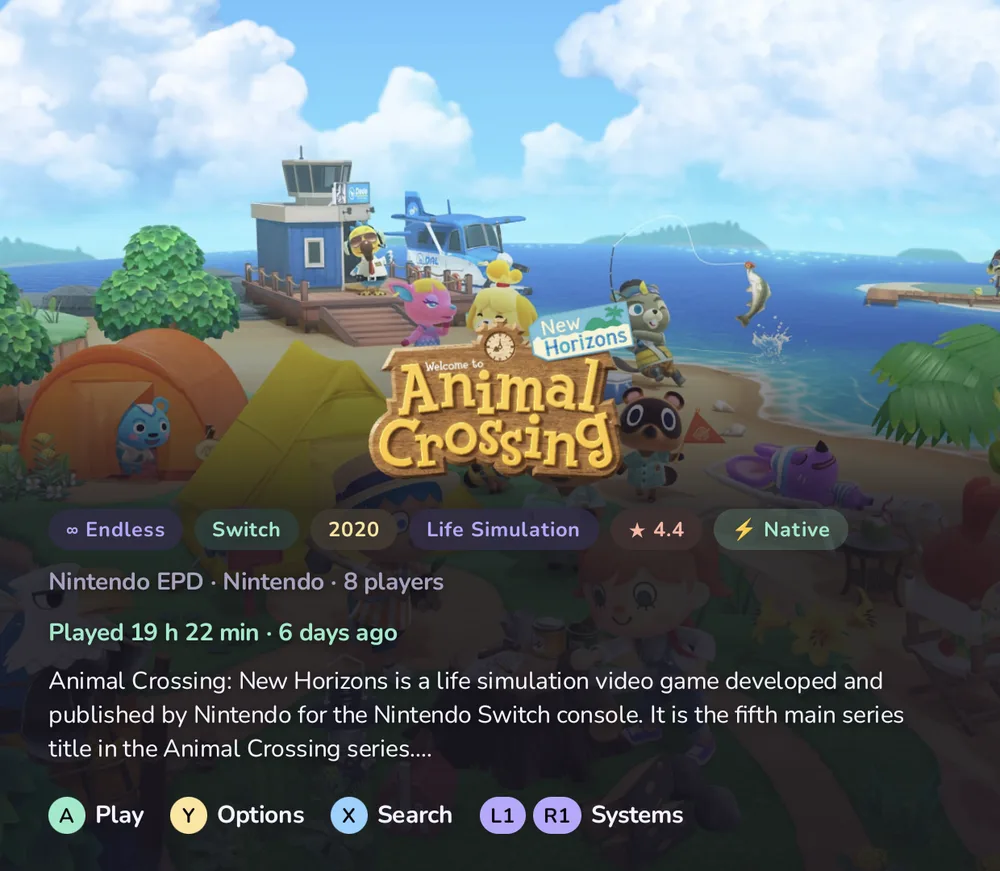

# Switch games: Eden Duo and Peanuts Native

Switch games can play in three apps that Tandem knows: **Eden Duo** (Eden with game companions on the second
screen), plain **Eden**, and **Peanuts Native**, which rebuilds a game you own to run without an emulator. This page
covers how Tandem picks between them, building a game natively, and keeping one save for a game across Eden Duo and
Peanuts Native.

Everything here is optional. With only Eden installed, Switch games simply start in Eden.

## Which app a Switch game plays in

| App | Package | When Tandem uses it |
| --- | --- | --- |
| [Eden Duo](https://github.com/ZahakJ/eden-duo) | `io.github.zahakj.edenduo` | The Switch's first emulator: the default for every Switch game while it is installed |
| Eden | `dev.eden.eden_emulator` | When Eden Duo isn't installed, or when you pick it for a game |
| [Peanuts Native](https://github.com/igawa6/peanuts-native/releases) | `dev.nxnative.android.peanuts` | Only for games it has built (below) |
| Peanuts Native+ | `dev.nxnative.android.peanuts.plus` | A second build of Peanuts Native with more game profiles, installed beside the release under its own package. Tandem treats it like the release |

For one game, Tandem decides like this:

1. **A game Peanuts Native has built plays there**, unless you picked another emulator for that game. If both
   Peanuts apps have built it, it plays in the fuller one (Peanuts Native+).
2. Otherwise it plays in the emulator you picked for it (Y › More › **Emulator**), or else the system's emulator
   (Eden Duo, then Eden; **Settings › Library & art › Systems and emulators** changes the system's).
3. A game Peanuts Native hasn't built never goes to Peanuts, even if you pick it.

To go back to the automatic choice after picking an emulator, press A on **Emulator** and pick the one marked
**The system's choice**, the game's default (Peanuts Native for a built game, else the system's first emulator).

## Eden Duo's game screen

With Eden Duo, a game opens as usual on the top screen with Tandem below. When Eden Duo has a companion for that
exact game version, a **Game screen** button on the bottom screen puts the game's own second screen there (a map, an
inventory). **Hide**, top right, gives the screen back to Tandem. Tandem gives itself Eden Duo's control permission
through Shizuku the first time. See [While you play](ayn-thor.md#while-you-play).

## Peanuts Native

Peanuts Native builds a Switch game from your own copy of it, once, on the handheld (5 to 40 minutes on the Thor),
and then plays it natively. Set it up in its own app first; Tandem only asks it what it has.

**It needs [Shizuku](resume.md).** Tandem reads Peanuts' library and starts builds through Peanuts' control command,
which only the shell may use. Without Shizuku, Tandem knows nothing about Peanuts and every Switch game plays in Eden
Duo or Eden as before.

Tandem asks Peanuts what it has built when it comes to the front, and again when you open a Switch game's Y menu (at
most every 30 seconds). A game is matched to Peanuts' library by its file, by the folder Peanuts imported it into
(`switch/Some Game.nsp` becomes `switch/Some Game/Some Game.nup`), or by its name.

| What you see | Where | What it means |
| --- | --- | --- |
| **⚡ Native** badge | On the bottom screen with the game, and in Spotlight's panel | Peanuts has built it: A plays it natively |
| **Build native version** | Y on the game | Peanuts has a profile for this game and version and can build it. A starts the build in the fullest Peanuts app that can. Pip says "Building … natively. This takes 5 to 40 minutes; you can keep playing meanwhile" |
| **Building natively** · `Importing · 31 %` | Y on the game, while it builds | The build's step and how far along it is. A asks Peanuts again |
| "Peanuts Native can't build this copy: …" | A message after Build | Peanuts refused, and says why (usually a game version it has no profile for) |

No row shows for a game Peanuts has no profile for. Its progress also shows in Peanuts' own app.



**The bottom screen.** Peanuts Native draws a game's second screen itself when it ships a companion for that game, so
Tandem leaves the bottom screen to it (the **Leave to emulator** style). For a built game without a companion, the
bottom screen shows Tandem's Game art, as for any other game. Y › More › **Bottom screen while playing** changes it per
game.

## One save across Eden Duo and Peanuts Native

A game built by Peanuts Native keeps a save of its own, apart from Eden Duo's. Tandem keeps the two in step: right
before either app starts a game the other also has, it copies the **newer** save over the one about to be played.
Play an hour in Eden Duo, start the game from Tandem in Peanuts, and you carry on from the Eden Duo save; go back to
Eden Duo and you carry on from the native one.

When it copies, Pip says **Carried on from your Eden Duo save** or **Carried on from your native save**. When the two
saves are the same age, nothing is copied and nothing is said.


### What it needs

- **Eden Duo** (not plain Eden) and the Peanuts app that has built the game, both installed.
- **Shizuku, on a rooted handheld.** Both saves are in other apps' private folders, and a save has to keep its owner
  and SELinux label or the game calls it damaged, so the copy runs as root (`su`) through Shizuku. Without root, Pip
  says "Couldn't bring the save across: root isn't available. Both saves are as they were".
- **The game started from Tandem.** A game started from Eden Duo's or Peanuts' own menu is not synced; the next start
  from Tandem catches up.

A game that is still open is never synced (the save in memory is the real one): close it first, or it is just brought
back as it is.

### Backups

Before overwriting a save, Tandem copies it whole to:

```text
ROMs/tandem/save-sync/backups/<title ID>/eden/<date-time>/       an Eden Duo save that was replaced
ROMs/tandem/save-sync/backups/<title ID>/peanuts/<date-time>/    a Peanuts save that was replaced
```

`<title ID>` is the game's 16-digit Switch title ID, and `<date-time>` reads like `20261116-213005`. The newest 20
backups per game and app are kept; older ones are deleted. Tandem never restores one by itself: to go back, copy a
backup's files over the save with a root file manager, with neither app running.

### Animal Crossing: New Horizons

Animal Crossing keeps the island owner's account inside its save, and Eden Duo and Peanuts Native have different
accounts, so a plain copy would say the resident is "not linked to any user account". Tandem puts the other app's
account into the copy as it goes: it decrypts the save, swaps the account, fixes the save's checksums and encrypts it
again. It only does this for version 3.0.x saves whose checksums are good and that hold the account exactly once;
otherwise it copies nothing, both saves stay as they were, and Pip says why.

### When something goes wrong

Every part of a save is prepared before anything is written, so a refusal changes nothing. The save being replaced
is first copied to the backups above, and the new one is swapped in whole: the save is either the old one or the
new one, never half of each. If a copy fails, Pip says "Couldn't bring the save across: …" with the reason, and both
saves are as they were.
