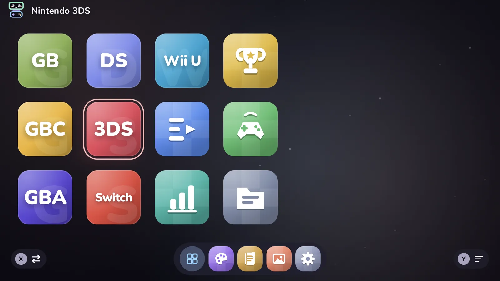

# Themes

How to change Tandem's look: themes, home layouts, the icon grid, theme packs, wallpapers, and sounds and music. Everything here is in the **Themes** app on the home grid and in **Settings › Look & feel**, **Home & layout** and **Sound & music**, and applies instantly with a short cross-fade. For a quick switch, the Start panel has **Theme ▸** and **Sounds & music ▸** pages.

## Built-in themes

Tandem has three themes of its own: **Pastel Night** (the default), **Paper** (light) and **OLED Black**. Everything else comes from [theme packs](#theme-packs). Tandem's animated backdrops (pixels, an LCD, cubes, a marquee, a road into the sun, a farm, torchlight and more) are all there as wallpapers, and its drawn system icon styles (pixel, neon, LCD, chrome, plastic, sticker, rune...) under **Icon style**, so any theme can wear them. With a built-in theme, system tiles show Tandem's own drawn icons, unless **Look & feel › Icons from** picks a pack's art.

Anything a theme sets can be changed on top of it in **Settings › Look & feel**: the accent colour (which the highlight glows in too; Tandem nudges it towards the theme's text colour when it would be hard to see, so a pale accent still shows on Paper), the highlight style (glow, outline, lift or pulse), the surface (solid, frosted or outlined), the wallpaper for each screen, the system icon style, and the animation style. **Reduce motion** calms everything down, and **Reset look** goes back to the theme as it came, keeping your buttons, screens, sounds and music.

## Home layouts

The layout gallery at the top of **Settings › Home & layout** picks one of seven: **Shelves**, **Icon grid**, **Carousel**, **List**, **Console**, **Orbit** and **Spotlight**. The icon grid holds systems, folders, Android apps and Tandem's own apps as big tiles, with a dock along the bottom; Orbit is Tandem's own (see [Orbit](#orbit) below); Spotlight puts one game's art across the whole screen (see [Spotlight](#spotlight)); the others show Continue playing, your systems and collections in their own way. Try them: switching back is one press.

Inside a system or collection, games show as a grid, a list, a carousel, spines on a bookshelf (**Shelf**) or cartridges in a case (**Case**) (**Games view**, or the view button at the top of the system, next to Stats, or next to Sort when folders open as popups; it steps through them), with a choice of grid size, card shape (rounded, square, circle, tall box art or wide) and whether titles show.

### The icon grid

- **Icon size** (5 to 9 across), or **Rows of icons** fixed at 1 to 5 (1 to 3 on the bottom screen). L1 and R1 change the size on the grid itself.
- **Scrolling** sideways, by pages, or up and down; icon roundness, the space between icons, and names under icons.
- **Folders** of your own: Y on a tile › Put in a folder. Folders open as a popup or a full page.
- **Designing a folder:** see [Folder design](#folder-design) below.
- **Empty spots** after the last icon and wherever one was taken away: A on one makes a folder or adds something right there, and moved icons can be dropped into them. Start › **Tidy up** closes the gaps. See [Controls](controls.md#empty-spots).
- **Other screen:** while the grid is on top, the bottom screen shows a spotlight of the highlighted tile, or the classic details. A highlighted game gets a title card: its art covers the whole screen (key art if it has some, else a title screen or gameplay shot, else the box, cropped on the busy part of the picture), its logo pops in and sways with a shine now and then, like the 3DS menu's banners, and a few chips and lines from its description introduce it in the lower left.
- **X swaps the screens** on the grid, and on Orbit (you can make X always search instead, or always swap, in **Settings › Controls**).

### Orbit

Orbit is Tandem's own home. Your systems, then your collections, then Tandem's apps ride an orbit of round icons in
the lower part of the top screen, along an arc that bows downward like planets seen from a little above. The
highlighted one sits at the front, lowest and biggest, with its name and a line about it underneath ("132 games ·
3 playing"); the others shrink and fade as they go round. A faint line shows the orbit's path.

Above the orbit, the **spotlight** fans out the highlighted system's or collection's games like cards in a hand: the
one you played last in the middle and a little larger, then the most recently and most played. The **All apps** orb
fans out your dock apps, and Tandem's own apps (Gallery, Journal...) show what they are. Over the fan, the
**Continue** ribbon holds the last game you played anywhere, and a small round **dock** of your apps sits under the
orbit.

| Press | On the orbit | In the fan, the ribbon or the dock |
| --- | --- | --- |
| Left / Right (or the left stick) | Spin the orbit; hold to skim through it | Move along |
| Up / Down | Up into the fan (or the ribbon), Down to the dock | Back towards the orbit; Up from the fan reaches the ribbon |
| A | Open the system, collection or app | Play the game, open the app |
| B | Back round to the first orb | Back to the orbit |
| Y | The system's or collection's view menu | The game menu, or the app's options |
| L1 / R1 | Jump to the first system, collection or app | The same, and back to the orbit |
| X | Swap the two screens (as on the icon grid; **Settings › Controls › X button** changes it) | |

By touch, drag the orbit to spin it (a quick flick carries it further), tap an orb to bring it to the front, and tap
the front orb to open it; a long press is Y. Start, the quick panel (hold Start) and the side panel (R2) work as on
every home. The other screen shows the highlighted system, collection or game as usual (**Settings › Two screens ›
Other screen**).

Two rows in **Settings › Home & layout › Home screen** shape it while Orbit is in use: **Orbit holds** (systems,
collections and apps; systems and collections; or systems only) and **Continue ribbon**. Hidden games and systems
stay out of the orbit and the fan unless hidden games are showing, and with **Reduce motion** the orbit moves straight
to each orb without spinning.

### Spotlight

Spotlight is the quiet, game-first home. The highlighted game's art fills the screen: its key art, else a
screenshot, else its cover blurred. A narrow **rail** of covers runs down one side with the highlighted game in the
middle, a little bigger and ringed, and the name of the group over it (a system, a collection, or Apps). The other
side is the game's: its logo (or its name), a line of chips (system, year, developer, genres, players), the first
lines of its story, and what you've played of it: time played, when you last played, how many sessions, its status
and achievements, whichever there are. The art fades into the theme's background towards the rail and the bottom, and
most of the way where the words sit, so they read over any picture on dark and light themes.

A story longer than its few lines scrolls by itself: rest on the game a couple of seconds and it slides slowly to its
end, waits, and comes back to the top. Any button stops it; with **Reduce motion** it stays put (X still opens it all).
The bottom screen's details belong to the game too: its art fills the whole screen, fading into the theme's background
where its logo, chips, play time and description sit.

L1 and R1 go through the groups: each system with games, then the collections (Recently played, with the last game
you played at the top, Favourites, Most played and your own), then Apps, Tandem's and your dock's. A game that is
still open has a mint dot on its cover and says Resume.

| Press | Does |
| --- | --- |
| Up / Down | Move along the rail; hold to skim (it speeds up the longer you hold). With the story open, scroll it |
| A | Play the game (or Resume it), open the app |
| Y | The game menu, or the app's options |
| X | The whole story, scrolling; X again (or B) closes it |
| Right (Left with the rail on the right) | Only the art: the rail and the panel fade away; any button brings them back |
| L1 / R1 | The group before or after, from its top |
| B | Back to the top of the rail; from the top, back to Recently played |

By touch, tap a cover to highlight it and tap it again to play; drag the rail to scroll it (a flick carries it
further); a long press is Y. Tap the game's name or story to open or close the story, and tap the art to see only the
art. If you set **Settings › Controls › X button** to swap everywhere or to search, X does that here too and the story
opens by touch.

Three rows in **Settings › Home & layout › Home screen** shape it while Spotlight is in use: **Spotlight rail** (left or
right; the whole layout mirrors), **Spotlight backdrop** (the art, the cover blurred, or just the theme's colour) and
**Spotlight motion** (the art drifts and zooms in very slowly; never with **Reduce motion**).

### Folder design

On the icon grid, Y on a folder, system, collection or genre › **Design folder…** changes how it looks. The rows on
the left open a page of choices. Highlighting a choice previews it beside the rows and on the other screen; A keeps
it, B goes back, L1 and R1 move between pages. Each choice is saved as you make it.

| Part | Choices |
| --- | --- |
| Icon | **Theme** (the pack's art, else Tandem's drawn art), a game's cover or an app's icon from inside, a cover **Mosaic** of four, a **Fan** of three, a **Genre** look (its glyph on a badge over a fan of covers), one of Tandem's glyphs or an emoji on the folder colour, or a picture |
| Colour | **Theme**, **From the art** (the main colour of the icon's picture), or a swatch. It colours the tile, its highlight ring and the sweep on the other screen |
| Hero | **Theme** (the pack's hero; a folder of games uses the hero of its favourite or most played game), a game's hero, a picture, a **Colour sweep**, or a **Cover wall** (rows of the covers inside drifting past) |
| Title | **Theme** (the pack's logo, else the icon), the name as text in three weights and three sizes, a game's logo, or a picture |
| Shape | The theme's, a rounded square or a circle |
| Cover frame | Whether a game cover used as the icon wears the theme's cover frame (when the theme has frames) |

**Reset to theme** puts everything back (Undo in the message takes it back). Pictures come from `ROMs/tandem/art/` (and one folder below
it), or **From this device…** opens the system picker and copies the picture to `ROMs/tandem/art/folders/`. Covers,
mosaics and pictures always show whole inside the tile, on the folder colour, and a circle leaves room so nothing is
cut off.

The look is kept with the folder in Tandem's icon grid settings, so it stays when you rename the folder; deleting a
folder deletes its look. A new folder made from a game starts with that game's cover (a favourite or the most played, if you made it
from a system) and the cover's colour.

Without a design, folders follow the theme. When the theme pack has no art for the built-in folders (**Apps**,
**Android Games**, **Emulators**, or any folder that holds only apps), Tandem draws them itself in the theme's
colours: a glyph on a two-tone tile, and on the other screen a colour sweep with the glyph and the name card. A pack's
own art for them always comes first. Switching themes repaints them at once.

## Theme packs

A theme pack is a folder with a `theme.json` and, if it likes, wallpapers and art for each system (icon, hero image and logo). Tandem reads packs from `ROMs/tandem/themes/`, and also understands the packs made for some other Android launchers, read in place without changing them.

**Manage packs** in the Themes app lists every pack with a preview and its author. On a pack you can:

- **Use this theme:** its colours, wallpapers, icons, heroes and logos, and its music and sounds if it has any. A Cocoon theme brings the music and sound packs it links to in `ROMs/assets/music` and `ROMs/assets/sounds` (its `asset_refs`), so those play with it too.
- **Use its icons with my theme:** keep your theme and borrow the pack's art.
- Switch its **colours**, **wallpaper**, **system icons**, **heroes and logos**, **cover frames**, **music** and **sounds** on or off one by one.
- **Import a folder** or **Import a .zip** to add a pack; it is copied into `ROMs/tandem/themes/<name>/`.

Tandem never downloads packs. Packs belong to their authors: keep their names and credits, and share them the way the author asks.

Making your own pack? [The theme format](../THEMES.md) documents every key in `theme.json` and the folder layout.

## Wallpapers

Copy pictures or videos to `ROMs/tandem/wallpapers/` and they appear in **Look & feel › Wallpaper** for either screen, next to the animated backdrops and **Game art (blurred)**. Videos play muted and looping, and stop whenever Tandem isn't on screen, so they never run while you play.

## Sounds and music

**Settings › Sound & music** starts with the theme pack, then the rest:

- **Theme pack:** when your theme pack brings music or recorded sounds of its own (Cocoon themes link theirs from `ROMs/assets/music` and `ROMs/assets/sounds`), **Theme pack music** and **Theme pack sounds** switch them on or off. The same switches are on the pack in **Manage packs**. While they're on, they play instead of the choices below.
- **Sounds:** **Sound pack** picks one of Tandem's eight packs (Modern, Playful, Chiptune, Bubbly, Minimal, Studio, Glass and Air, made by Tandem as it starts, so there are no sound files), or **Custom**, which picks among every recorded pack you have (Cocoon's in `ROMs/assets/sounds`, or a theme pack's own); sounds a recorded pack doesn't have come from Tandem's pack. With **Pip's voice** on (and UI sounds on), Pip hums a few soft notes when it has something to tell you.
- **Music:** **Music**, **Music volume** and **Next song**; **Music from** plays your own files (MP3, OGG, Opus, FLAC, M4A, WAV) from `ROMs/tandem/music/`, or one of Tandem's own soundtracks: **Calm** (the default), two slow, soft pieces for piano, harp and celesta, or **Meadow Tales**, six original pieces for a small orchestra. A soundtrack plays through its pieces in turn (**Shuffle my music** mixes up your own). Music fades out when a game starts and back in when you return.

There are no system or game jingles any more: a game starts with the launch sound of the sound pack that's playing.

To save battery, **Battery saver** in Quick settings (hold Start) stills the screens and turns the music off in one go, and puts back exactly what it changed when you turn it off.
