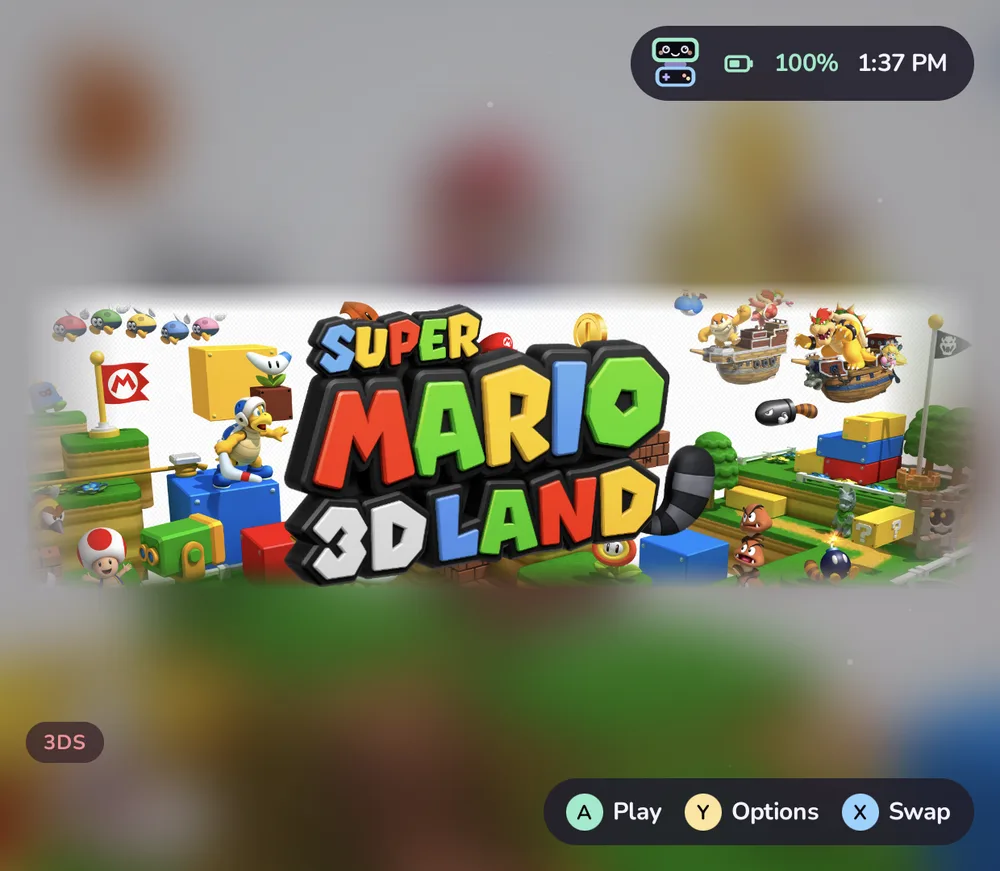

# Themes

How to change Tandem's look: themes, home layouts, the icon grid, theme packs, wallpapers, and sounds and music. Everything here is in the **Themes** app on the home grid and in **Settings › Look & feel** and **Settings › Home & layout**, and applies instantly with a short cross-fade.

## Built-in themes

Tandem has 24 themes. Pastel Night is the default.

- **Calm:** Pastel Night, OLED Black, Sakura, Mint Soda, Ocean, Forest, Lavender Dream, Paper (light), Cotton Candy and High Contrast.
- **Game-flavoured,** each with its own animated backdrop, card style and system icon style: Cartridge, Handheld Green, Indigo Cube, Neon Arcade, Pocket Atomic, Midnight Disc, Blue Console Boot, Crimson Visor, Sunset Racer, Starfield Shooter, Cozy Farm, Monster Catcher, Dungeon and Kart Rainbow. All their art is original and drawn by Tandem.

Anything a theme sets can be changed on top of it in **Settings › Look & feel**: accent and highlight colour, highlight style (glow, outline, lift or pulse) and thickness, focus zoom, card corners, surface (solid, frosted or outlined), wallpaper for each screen, system icon style, and animation style. **Reduce motion** calms everything down, and **Reset appearance** goes back to the theme as it came.

## Home layouts

**Settings › Home & layout › Home layout** picks one of five: **Shelves**, **Icon grid**, **Carousel**, **List** and **Console**. The icon grid holds systems, folders, Android apps and Tandem's own apps as big tiles, with a dock along the bottom; the others show Continue playing, your systems and collections in their own way. Try them: switching back is one press.

Inside a system, games show as a grid, a list or a carousel (**Games view**), with a choice of grid size, card shape (rounded, square, circle, tall box art or wide) and whether titles show.

### The icon grid

- **Icon size** (5 to 9 across), or **Rows of icons** fixed at 1 to 5 (1 to 3 on the bottom screen). L1 and R1 change the size on the grid itself.
- **Scrolling** sideways, by pages, or up and down; icon roundness, the space between icons, and names under icons.
- **Folders** of your own: Y on a tile › Put in a folder. Folders open as a popup or a full page.
- **Designing a folder:** see [Folder design](#folder-design) below.
- **Empty spots** after the last icon and wherever one was taken away: A on one makes a folder or adds something right there, and moved icons can be dropped into them. Start › **Tidy up** closes the gaps. See [Controls](controls.md#empty-spots).
- **Other screen:** while the grid is on top, the bottom screen shows a spotlight of the highlighted tile, or the classic details. A highlighted game gets a title card: its art covers the whole screen (key art if it has some, else a title screen or gameplay shot, else the box, cropped on the busy part of the picture), its logo pops in and sways with a shine now and then, like the 3DS menu's banners, and a few chips and lines from its description introduce it in the lower left.
- **X swaps the screens** on the grid (you can make X always search instead, or always swap, in **Settings › Controls**).

### Folder design

On the icon grid, Y on a folder, system, collection or genre › **Design folder…** changes how it looks. The rows on
the left open a page of choices. Highlighting a choice previews it beside the rows and on the other screen; A keeps
it, B goes back, L1 and R1 move between pages. Each choice is saved as you make it.

| Part | Choices |
| --- | --- |
| Icon | **Theme** (the pack's art, else Tandem's drawn art), a game's cover or an app's icon from inside, a cover **Mosaic** of four or a **Fan** of three, one of Tandem's glyphs or an emoji on the folder colour, or a picture |
| Colour | **Theme**, **From the art** (the main colour of the icon's picture), or a swatch. It colours the tile, its highlight ring and the sweep on the other screen |
| Hero | **Theme** (the pack's hero; a folder of games uses the hero of its favourite or most played game), a game's hero, a picture, or a **Colour sweep** |
| Title | **Theme** (the pack's logo, else the icon), the name as text in three weights and three sizes, a game's logo, or a picture |
| Shape | The theme's, a rounded square or a circle |
| Cover frame | Whether a game cover used as the icon wears the theme's cover frame (when the theme has frames) |

**Reset to theme** puts everything back (Undo in the message takes it back). Pictures come from `ROMs/tandem/art/` (and one folder below
it), or **From this device…** opens the system picker and copies the picture to `ROMs/tandem/art/folders/`. Covers,
mosaics and pictures always show whole inside the tile, on the folder colour, and a circle leaves room so nothing is
cut off.

The look is kept with the folder in Tandem's icon grid settings, so it stays when you rename the folder; deleting a
folder deletes its look. A new folder made from a game starts with that game's cover (a favourite or the most played, if you made it
from a system) and the cover's colour.

Without a design, folders follow the theme. When the theme pack has no art for the built-in folders (**Apps**,
**Android Games**, **Emulators**, or any folder that holds only apps), Tandem draws them itself in the theme's
colours: a glyph on a two-tone tile, and on the other screen a colour sweep with the glyph and the name card. A pack's
own art for them always comes first. Switching themes repaints them at once.

## Theme packs

A theme pack is a folder with a `theme.json` and, if it likes, wallpapers and art for each system (icon, hero image and logo). Tandem reads packs from `ROMs/tandem/themes/`, and also understands the packs made for some other Android launchers, read in place without changing them.

**Manage packs** in the Themes app lists every pack with a preview and its author. On a pack you can:

- **Use this theme:** its colours, wallpapers, icons, heroes and logos.
- **Use its icons with my theme:** keep your theme and borrow the pack's art.
- Switch its **colours**, **wallpaper**, **system icons**, **heroes and logos** and **cover frames** on or off one by one.
- **Import a folder** or **Import a .zip** to add a pack; it is copied into `ROMs/tandem/themes/<name>/`.

Tandem never downloads packs. Packs belong to their authors: keep their names and credits, and share them the way the author asks.

Making your own pack? [The theme format](../THEMES.md) documents every key in `theme.json` and the folder layout.

## Wallpapers

Copy pictures or videos to `ROMs/tandem/wallpapers/` and they appear in **Look & feel › Wallpaper** for either screen, next to the animated backdrops and **Game art (blurred)**. Videos play muted and looping, and stop whenever Tandem isn't on screen, so they never run while you play.

## Sounds and music

**Settings › Sound & music:**

- **UI sounds:** five packs (Modern, Playful, Chiptune, Bubbly and Minimal), made by Tandem as it starts, so there are no sound files. **System jingles** play a tiny original tune per family of systems when a game starts (or when you open a system too). **Play jingles** plays a game's own jingle when you rest on it ([Editing a game](library.md#editing-a-game)). With **Pip's voice** on, Pip babbles a little when it has something to tell you.
- **Background music:** two soundtracks of original music, **Meadow Tales** and **Pastel Arcade**, six pieces each. Or put your own files (MP3, OGG, Opus, FLAC, M4A, WAV) in `ROMs/tandem/music/`. Music fades out when a game starts and back in when you return.
