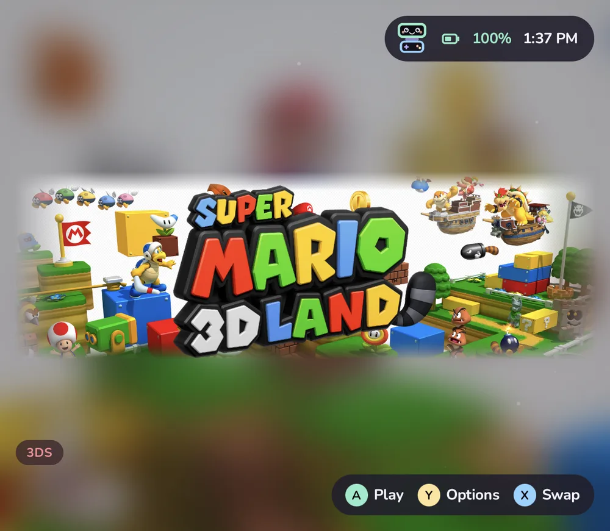

# Themes

How to change Tandem's look: themes, home layouts, the icon grid, theme packs, sharing looks, wallpapers, and sounds and music. You'll find it all in the **Themes** app on the home grid and in **Settings › Look & feel**, **Settings › Home & layout** and **Settings › Sound & music**. Every change applies at once, with a short cross-fade.

## Built-in themes

Tandem comes with three themes of its own; everything else comes from [theme packs](#theme-packs).

- **Pastel Night**, the default
- **Paper**, a light theme
- **OLED Black**

Any theme can wear Tandem's extras: its animated backdrops (pixels, an LCD, cubes, a marquee, a road into the sun, a farm, torchlight and more) are all there as wallpapers, and its drawn system icon styles (pixel, neon, LCD, chrome, plastic, sticker, rune…) are under **Icon style**. With a built-in theme, system tiles show Tandem's own drawn icons, unless **Settings › Look & feel › Icons from** picks a pack's art, or an [art set](#art-sets) dresses every system.

**Adjusting a theme.** Anything a theme sets can be changed on top of it in **Settings › Look & feel**:

- the **accent colour**, which the highlight glows in too
- the **highlight style**: glow, outline, lift or pulse
- the **surface**: solid, frosted or outlined
- the **wallpaper** for each screen
- the system **icon style** and the **animation style**

**Reduce motion** calms everything down, and **Reset look** goes back to the theme as it came, keeping your buttons, screens, sounds and music.

Why a pale accent still shows on Paper

When the accent you pick would be hard to see on the theme, Tandem nudges it towards the theme's text colour, so a pale accent still shows on a light theme like Paper.

## Art sets

No pack needed for good-looking systems: Tandem draws a matching **icon**, **hero** (the big picture on the other screen) and **logo** (the title over the hero) for every system it knows, in one of four styles. Pick one in **Settings › Look & feel › System icons › Art set**; the picker shows each set on your own systems, hero and logo above, icons below.

<!-- Screenshot to add: site/assets/screenshots/guide/art-sets-picker.webp, the Art set picker with the four sets on the handheld's own systems. -->
<!-- Screenshot to add: site/assets/screenshots/guide/art-sets-bottom.webp, the bottom screen with a Neon Arcade hero and logo for a highlighted system. -->

| Set | Looks like |
| --- | --- |
| **Pastel Pop** | A soft colour block with confetti and the device as a white sticker; the name as a fat outlined sticker. Softer on a light theme, deeper on a dark one |
| **Neon Arcade** | An arcade night: scanlines, a striped sunset over a glowing grid floor, the device in light tubes and the name in neon |
| **Paper Cartridge** | A cartridge with a paper label in the system's colours; the hero is a printed box with stripes, halftone and an ink stamp, the name on a paper plate |
| **Minimal Mono** | A thin outline of the device in your accent colour on the theme's own background, the name spaced out in capitals. It follows the theme and the accent |

Every picture is Tandem's own drawing: a silhouette of the *kind* of device (a clamshell, a console, a disc, a cabinet…), colours from the system's family, and its plain name. No logos, box art or console photos are copied, so the sets are safe in screenshots you share.

- **One system, another set.** <kbd>Y</kbd> on a system › **Edit** › **Look** › **Artwork**: the studio lists **Tandem sets** for that system on its Icon, Hero and Title pages. A system's own set wins over the one for every system, and **Pack art** keeps the pack's art (or Tandem's drawn icon) for just that system. **Theme** follows the set for every system again.
- **Your own pictures come first.** A picture you upload as a system's icon, hero or logo shows instead of any set, for that part only.
- **Everywhere.** The grid, Spotlight, the bottom screen, the Systems page, search and the other menus all show the set.
- **Or real art.** For real console photos, logos and backdrops instead of drawings, fetch them with **Fetch system art** and pick a style in **Settings › Look & feel › System icons › Real art** (or one picture per system under **From the web** in its studio). Real art comes before the set for every system where a system has a fitting picture; a system's own set still wins. It stays on the handheld and never goes in a shared look. See [System art](scraping.md#system-art).

Where it is kept, and what travels

- The set for every system is a look setting, so it is in **Backup › Look** and in a shared look. Each system's own choice and your uploads are kept with the icon grid (**Backup › Layout & folders**); the uploaded pictures themselves live in `ROMs/tandem/art/folders/`.
- A shared look carries only the set names, for every system and for systems with their own. Your uploaded pictures never leave the handheld.
- The pictures are drawn on the handheld the first time they are needed (a moment per system) and kept in Tandem's cache, redrawn after a theme change from light to dark (and for Minimal Mono, after an accent change). Clearing the cache only means they are drawn again. Rescans and **Icons from** don't touch any of it.

## Home layouts

The layout gallery at the top of **Settings › Home & layout** picks how your home screen looks. Try them all: switching back is one press. Quicker still, <kbd>Start</kbd> › **Layout** tries each one live over your home, with its size beside it, and <kbd>B</kbd> puts back the one you had (see [Switching layouts](controls.md#switching-layouts)).

| Layout | What it is |
| --- | --- |
| **Shelves**, **Carousel**, **List**, **Console** | Continue playing, your systems and collections, each in its own way |
| **Icon grid** | Systems, folders, Android apps and Tandem's own apps as big tiles, with a dock along the bottom ([more](#the-icon-grid)) |
| **Orbit** | Tandem's own home: a ring of round icons with a fan of games above ([more](#orbit)) |
| **Spotlight** | One game's art across the whole screen, with a rail of covers ([more](#spotlight)) |
| **Stage** | A page for each group, a row of covers on each, the highlighted game's art behind; <kbd>L1</kbd> / <kbd>R1</kbd> slide the pages ([more](#stage)) |

**Inside a system or collection**, games show as a grid, a list, a carousel, spines on a bookshelf (**Shelf**) or cartridges in a case (**Case**). Pick one with **Games view**, or step through them with the view button at the top of the system (next to Stats, or next to Sort when folders open as popups). You also choose the grid size, the card shape (rounded, square, circle, tall box art or wide) and whether titles show.

### The icon grid

The icon grid is the home most like a console menu: big tiles you arrange yourself.

- **Size:** **Icon size** (5 to 9 across), or **Rows of icons** fixed at 1 to 5 (1 to 3 on the bottom screen). <kbd>L1</kbd> / <kbd>R1</kbd> change the size on the grid itself.
- **Scrolling** sideways, by pages, or up and down; plus icon roundness (from Sharp to Circle, shown live; one tile can keep its own, see [Corners](controls.md#corners)), the space between icons, and names under icons.
- **Folders** of your own: <kbd>Y</kbd> on a tile › **Edit** › **Organize** › **Move to folder…**. Folders open as a popup or a full page, and you can [design each one](#folder-design). <kbd>Y</kbd> lifts a tile where it sits with **Open** and **Edit** beside it; holding <kbd>Y</kbd> picks it up to move it (see [the lift](controls.md#y-on-the-icon-grid-the-lift)).
- **Empty spots** sit after the last icon and wherever one was taken away. <kbd>A</kbd> or <kbd>Y</kbd> on one opens a small card with Pip (New ›, Sort ›, Search, Edit grid ›, Settings) to make a folder or add something right there, and moved icons can be dropped into them. <kbd>Start</kbd> › **Sort** › **Home: close the gaps** (or <kbd>Y</kbd> on an empty spot › **Sort ›** › **Tidy up**) closes them. See [Controls](controls.md#empty-spots).
- **The other screen** shows a spotlight of the highlighted tile, or the classic details. A highlighted game gets a title card, like the 3DS menu's banners.
- <kbd>X</kbd> **swaps the screens** here, on Orbit and on Stage. To make <kbd>X</kbd> always search, or always swap, use **Settings › Controls**.

What's on a game's title card

The game's art covers the whole screen: key art if it has some, else a title screen or gameplay shot, else the box, cropped on the busy part of the picture. Its logo pops in and sways with a shine now and then, and a few chips and lines from its description introduce it in the lower left.

### Orbit

Orbit is Tandem's own home: your systems, then your collections, then Tandem's apps ride a ring of round icons in the lower part of the top screen, like planets seen from a little above.

- **The orbit.** The orbs ride a softly glowing ring seen in perspective. The highlighted orb sits at the front, lowest and biggest, with its name and a line about it underneath ("132 games · 3 playing"); the others get smaller and darker as they go round towards the back, and the ring takes the highlighted orb's colour. Holding <kbd>◀</kbd> or <kbd>▶</kbd> spins it in one smooth glide.
- **The covers.** Inside the ring, the highlighted system's or collection's games stand as a row of covers on a lit floor: the one you played last in the middle and biggest, then the most recently and most played, smaller and turned slightly away. The name under the orbit follows the highlight, so on a cover it names that game. The **All apps** orb shows your dock apps, and Tandem's own apps (Gallery, Journal…) show what they are.
- **The Continue card**, apart to the left of the covers, holds the game running right now, labelled **Resume** (it changes as soon as a game starts or closes), or else the last game you played anywhere.
- **The dock**, a quiet row of round app icons under the orbit, lights up when you go down to it; the highlighted icon shows its name.

| Press | On the orbit | On the covers, the Continue card or the dock |
| --- | --- | --- |
| <kbd>◀</kbd> / <kbd>▶</kbd> (or the left stick) | Spin the orbit; hold to skim through it | Move along (<kbd>◀</kbd> from the leftmost cover reaches the Continue card) |
| <kbd>▲</kbd> / <kbd>▼</kbd> | <kbd>▲</kbd> to the covers (or the Continue card), <kbd>▼</kbd> to the dock | Back to the orbit |
| <kbd>A</kbd> | Open the system, collection or app | Play the game (a running one comes back where it is), open the app |
| <kbd>B</kbd> | Back round to the first orb | Back to the orbit |
| <kbd>Y</kbd> | The system's or collection's view menu | The game menu, or the app's options. On a game still running, press it twice to close the game (a long press on the Continue card opens the game menu) |
| <kbd>L1</kbd> / <kbd>R1</kbd> | Turn the ring one orb | The same, and back to the orbit |
| <kbd>L2</kbd> / <kbd>R2</kbd> | Jump to the first system, collection or app before or after | <kbd>L2</kbd> a page up, <kbd>R2</kbd> the side panel |
| <kbd>X</kbd> | Swap the two screens (as on the icon grid; **Settings › Controls › X button** changes it) | |

<kbd>Start</kbd>, the quick panel (hold <kbd>Start</kbd>) and the side panel (<kbd>R2</kbd> off the ring) work as on every home. The other screen shows the highlighted system, collection or game as usual (**Settings › Two screens › Other screen**).

**Settings for Orbit.** Two rows in **Settings › Home & layout › Home screen** shape it while Orbit is in use: **Orbit holds** (systems, collections and apps; systems and collections; or systems only) and **Continue card**.

Touch, hidden games and Reduce motion

- **By touch:** drag the orbit to spin it (a quick flick carries it further), tap an orb to bring it to the front, and tap the front orb to open it. A long press does what <kbd>Y</kbd> does.
- **Hidden games and systems** stay out of the orbit and the fan unless hidden games are showing.
- **With Reduce motion** the orbit moves straight to each orb without spinning.

### Spotlight

Spotlight is the quiet, game-first home: the highlighted game's art fills the screen, and a rail of covers lets you pick the next one.

- **The art** is the game's key art, else a screenshot, else its cover blurred. It fades into the theme's background towards the rail, the bottom and where the words sit, so they read over any picture on dark and light themes.
- **The rail** of covers runs down one side, with the highlighted game in the middle, a little bigger and ringed, and the name of its group over it (a system, a collection, or Apps).
- **The game's side** has its logo (or name), a line of chips (system, year, developer, genres, players), the first lines of its story, and what you've played of it: time, last played, sessions, status and achievements, whichever there are.
- **The bottom screen** belongs to the game too: its art fills the screen, with its logo, chips, play time and description.

<kbd>L1</kbd> / <kbd>R1</kbd> go through the groups: each system with games, then the collections (Recently played, with the last game you played at the top, Favourites, Most played and your own), then Apps, Tandem's and your dock's. A game that is still open has a mint dot on its cover and says Resume.

| Press | Does |
| --- | --- |
| <kbd>▲</kbd> / <kbd>▼</kbd> | Move along the rail; hold to skim (it speeds up the longer you hold). With the story open, scroll it |
| <kbd>A</kbd> | Play the game (or Resume it), open the app |
| <kbd>Y</kbd> | The game menu, or the app's options |
| <kbd>X</kbd> | The whole story, scrolling; <kbd>X</kbd> again (or <kbd>B</kbd>) closes it |
| <kbd>▶</kbd> (<kbd>◀</kbd> with the rail on the right) | Only the art: the rail and the panel fade away; any button brings them back |
| <kbd>L1</kbd> / <kbd>R1</kbd> | The group before or after, from its top |
| <kbd>B</kbd> | Back to the top of the rail; from the top, back to Recently played |

**Settings for Spotlight.** Three rows in **Settings › Home & layout › Home screen** shape it while Spotlight is in use:

- **Spotlight rail:** left or right; the whole layout mirrors.
- **Spotlight backdrop:** the art, the cover blurred, or just the theme's colour.
- **Spotlight motion:** the art drifts and zooms in very slowly (never with **Reduce motion**).

The scrolling story, touch, and the X button

- **A long story scrolls by itself:** rest on the game a couple of seconds and it slides slowly to its end, waits, and comes back to the top. Any button stops it; with **Reduce motion** it stays put (<kbd>X</kbd> still opens it all).
- **By touch:** tap a cover to highlight it and tap it again to play; drag the rail to scroll it (a flick carries it further); a long press does what <kbd>Y</kbd> does. Tap the game's name or story to open or close the story, and tap the art to see only the art.
- **The X button setting:** if you set **Settings › Controls › X button** to swap everywhere or to search, <kbd>X</kbd> does that here too, and the story opens by touch.

### Stage

Stage is horizontal both ways: each group is a page of its own, and each page is a row of covers.

- **The pages:** Continue (the game running now and the last ones you played) first, then each system with games, each collection, and the apps. <kbd>L1</kbd> / <kbd>R1</kbd> slide the whole page out the way you pressed and the next one in, landing on the game you last had there (else the one you played last, else the first).
- **The row** of covers runs along the bottom: the highlighted one is bigger and ringed in the highlight's colour, a running game carries a mint dot, and once you're a third of the way along the row scrolls so the highlight stays put. A system's or collection's row ends with **See all**, which opens it.
- **The game** takes over the backdrop (its key art, slowly moving if **Moving art** is on), with its logo, a line of facts, two lines of its story and its play time above the row.
- **The strip** of short names along the top shows where you are among the pages; the group's name and size sit bottom left, what <kbd>A</kbd> and <kbd>Y</kbd> do bottom right.
- **The bottom screen** shows the game as on every layout; on a page turn it shows the group's own card for a moment first.

| Press | Does |
| --- | --- |
| <kbd>◀</kbd> / <kbd>▶</kbd> | Move along the row; hold to skim (faster the longer you hold). It stops at the ends |
| <kbd>L1</kbd> / <kbd>R1</kbd> | The page before or after, wrapping round, from anywhere on the home |
| <kbd>L2</kbd> / <kbd>R2</kbd> | The letter before or after in the row (in a short row, its first or last cover) |
| <kbd>▲</kbd> | Onto the strip: <kbd>◀</kbd> / <kbd>▶</kbd> flip pages there, <kbd>A</kbd> or <kbd>▼</kbd> comes back down; <kbd>▲</kbd> again reaches the top bar |
| <kbd>▼</kbd> | The dock |
| <kbd>A</kbd> | Play (or Resume), open **See all** or the app |
| <kbd>Y</kbd> | The game menu; on a running game, press it twice to close it |
| <kbd>B</kbd> | Back to the first cover; from there, to Continue |
| <kbd>Select</kbd> | Surprise me: slides to the game's page and lands on it |
| <kbd>X</kbd> | Swap the screens (as on the icon grid; **Settings › Controls › X button** changes it) |

**Settings for Stage.** Three rows in **Settings › Home & layout › Home screen** shape it while Stage is in use: **Stage holds** (systems, collections and apps; systems and collections; or systems only), **Cover size** (small, medium, large; <kbd>L2</kbd> / <kbd>R2</kbd> while trying layouts from <kbd>Start</kbd>) and **Stage backdrop** (the art, the cover blurred, or the theme's colour). By touch, drag sideways to turn the page, tap a cover to highlight it and again to play, tap a name on the strip to go there. With **Reduce motion** pages cross-fade instead of sliding.

### Folder design

Give any folder, system, collection or genre on the icon grid a look of its own: <kbd>Y</kbd> on it › **Edit** › **Look**, then **Artwork**, **Colour**, **Hero** or **Logo**. Each opens the artwork studio straight on that page; **Shape**, **Corners** and **Cover frame** change right there on the edit screen (see [Controls](controls.md#the-edit-screen)).

1. The studio's pages (**Icon**, **Colour**, **Hero**, **Title**) sit as tabs at the top; <kbd>L1</kbd> / <kbd>R1</kbd> slide from one to the next.
2. **Upload your own** comes first, a card across the page with every kind of picture it takes and how big; then the choices in groups: what's made from the folder's own contents, covers and icons (or game art), Tandem's glyphs, emoji and your pictures.
3. Highlight a choice to preview it beside the grid and on the other screen; <kbd>A</kbd> keeps it and takes you back to the edit screen, <kbd>B</kbd> goes back without changing anything. Each choice is saved as you make it.

| Part | Choices |
| --- | --- |
| Icon | **Theme** (the pack's art, else Tandem's drawn art), for a system one of the [Tandem sets](#art-sets), a picture fetched **From the web** ([System art](scraping.md#system-art)), a game's cover or an app's icon from inside, a cover **Mosaic** of four, a **Fan** of three, a **Genre** look (its glyph on a badge over a fan of covers), one of Tandem's glyphs or an emoji on the folder colour, or a picture |
| Colour | **Theme**, **From the art** (the main colour of the icon's picture), or a swatch. It colours the tile, its highlight ring and the sweep on the other screen |
| Hero | **Theme** (the pack's hero; a folder of games uses the hero of its favourite or most played game), for a system a Tandem set's hero or a fetched backdrop or photo, a game's hero, a picture, a **Colour sweep**, or a **Cover wall** (rows of the covers inside drifting past) |
| Title | **Theme** (the pack's logo, else the icon), for a system a Tandem set's logo or a fetched logo, the name as text in three weights and three sizes, a game's logo, or a picture |
| Shape | The grid's, a rounded square or a circle |
| Corners | **Grid** (Icon roundness), or this tile's own, from square to round. See [Corners](controls.md#corners) |
| Cover frame | Whether a game cover used as the icon wears the theme's cover frame (when the theme has frames) |

**Reset look** puts everything back, and Undo in the message takes that back. Apps, games and Tandem's own apps get **Shape** and **Corners** too.

**Your own pictures** come from `ROMs/tandem/art/` (and one folder below it), or **Upload your own** opens the system picker and copies the picture into `ROMs/tandem/art/folders/`:

- PNG, JPEG, WebP and HEIC up to 24 MB. They are scaled down as they come in (768 pixels on the longest side for an icon or a logo, 1920 for a hero) and saved as PNG (icons, logos) or JPEG (heroes).
- **GIF and animated WebP move.** Up to 8 MB and 1024 pixels on the longest side, kept as they are. They play on the tile only while it is on screen and Tandem is in front, never while a game runs, never with Reduce motion, and rest when Tandem has been idle a while. **Settings › Home & layout › Grid shape › Animated icons**: **Always**, **While highlighted** (only the tile the highlight is on) or **Off**. A moving picture as a hero or logo shows its first frame.

Covers, mosaics and pictures always show whole inside the tile, on the folder colour, and a circle leaves room so nothing is cut off.

Where a design is kept, and folders without one

- The look is kept with the folder in Tandem's icon grid settings, so it stays when you rename the folder; deleting a folder deletes its look.
- A new folder made from a game starts with that game's cover (a favourite or the most played, if you made it from a system) and the cover's colour.
- Without a design, folders follow the theme. When the theme pack has no art for the built-in folders (**Apps**, **Android Games**, **Emulators**, or any folder that holds only apps), Tandem draws them itself in the theme's colours: a glyph on a two-tone tile, and on the other screen a colour sweep with the glyph and the name card. A pack's own art for them always comes first, and switching themes repaints them at once.

## Theme packs

A theme pack is a folder with a `theme.json` and, if it likes, wallpapers and art for each system (icon, hero image and logo). Tandem reads packs from `ROMs/tandem/themes/`, and also understands the packs made for some other Android launchers, reading them in place without changing them.

**Adding packs.** **Manage packs** in the Themes app shows every pack as a card with a live preview and its author, two to a line. Three buttons above them add packs:

- **Import a folder** or **Import a .zip**: the pack is copied into `ROMs/tandem/themes/<name>/`.
- **Look again**: read the themes folder again.

**Using a pack.** <kbd>A</kbd> on a pack offers:

- **Use this theme:** its colours, wallpapers, icons, heroes and logos, and its music and sounds if it has any.
- **Use its icons with my theme:** keep your theme and borrow the pack's art.
- **What it brings:** a chip for each part (its **colours**, **wallpaper**, **system icons**, **heroes and logos**, **cover frames**, **music** and **sounds**), ticked while it is on; <kbd>A</kbd> switches one.

A Cocoon theme brings the music and sound packs it links to in `ROMs/assets/music` and `ROMs/assets/sounds` (its `asset_refs`), so those play with it too.

> [!NOTE]
> Tandem downloads nothing for Manage packs; only [Get a look](#sharing-looks) reads the community gallery. Packs belong to their authors: keep their names and credits, and share them the way the author asks.

Making your own pack? [The theme format](../THEMES.md) documents every key in `theme.json` and the folder layout.

## Sharing looks

Your look is everything above together: the theme and its colours, your accent and highlight, the wallpaper pictures,
the system and collection icons, the home layout, motion and the sound pack. **Settings › Look & feel › Share looks**
packs it into one `.tandem` file anyone can use, and gets other people's.

**Share my look.** Give it a **Name** and, if you like, **Made by** and a **Description**. Then:

- **Save to my looks** writes `ROMs/tandem/looks/<name>.tandem`; **Save somewhere else…** picks a place with the file
  picker. Send the file however you like: it works offline.
- **Show QR on the other screen** puts a QR code on the bottom screen. A phone's camera opens the look's page, which has
  **Open in Tandem**. A QR code needs a link, so it works for looks in the gallery; for your own look, share it to the
  gallery first.
- **Share to the gallery** saves the file and opens the gallery's share form in the browser, with the name filled in.
  Attach the file there. You need a GitHub account only for this.

What goes in is only how Tandem looks. **Never** your games or their names, play time, saves, hidden games, your PIN,
accounts and keys, or folder paths. Pictures are re-encoded, which drops their hidden details (like where a photo was
taken). Video wallpapers stay on your handheld, and so do your own music and recorded sounds.

**Get a look.** Three tiles come first: **From a file** (a `.tandem` file you have), **From a link** (a web address)
and **Search**. Below them is the **Community gallery**: looks shared by other players, as cards with tags to filter
by. <kbd>A</kbd> on a look shows a preview card: its picture, name, who made it, its colours and what it changes.
Nothing changes until **Use this look**. Then:

- the look installs as a theme pack (it shows up in **Manage packs**) and its settings go on; your games, buttons,
  accounts and screens stay as they are;
- the message that says so has **Undo** (<kbd>Select</kbd>), and **Put my old look back** stays at the top of Get a
  look until Tandem restarts;
- Tandem makes an automatic backup first, so **Settings › Play & system › Your data › Restore** can bring back the
  look from before, too.

Opening **Get a look** is the only time Tandem reads the gallery, and private mode keeps it offline (a file you pick
still works). See [Privacy](privacy.md).

The gallery, and the checks every look goes through

The gallery is a public GitHub repository, [ZahakJ/tandem-gallery](https://github.com/ZahakJ/tandem-gallery): no
account is needed to browse or download. Every look there was checked by a bot and looked at by a maintainer:
original or properly licensed art only, nothing from commercial games, family-friendly. Tandem checks each download
against the gallery's checksum before using it.

Whatever its source, a look file is checked before its preview shows: at most 24 MB, only the files a look can have
(no programs, nothing that tries to write outside its folder), and real pictures of a sane size. A file made by a newer
Tandem says so and asks you to update. Nothing in a look is ever run.

A `.tandem` file is a theme pack zip, so **Manage packs › Import a .zip** installs one as a plain theme too. The
format is in [the theme format](../THEMES.md#shared-looks-tandem).

## Wallpapers

To use your own wallpaper, copy pictures or videos to `ROMs/tandem/wallpapers/`. They appear in **Settings › Look & feel › Wallpaper** for either screen, next to the animated backdrops and **Game art (blurred)**.

Videos play muted and looping, and stop whenever Tandem isn't on screen, so they never run while you play.

## Sounds and music

**Settings › Sound & music** sets what Tandem sounds like: the theme pack's own audio first, then UI sounds and music.

- **Theme pack:** when your theme pack brings music or recorded sounds of its own (Cocoon themes link theirs from `ROMs/assets/music` and `ROMs/assets/sounds`), **Theme pack music** and **Theme pack sounds** switch them on or off. The same switches are on the pack in **Manage packs**. While they're on, they play instead of the choices below.
- **Sounds:** **UI sounds** is Off, one of Tandem's nine packs (Modern, Playful, Chiptune, Bubbly, Minimal, Studio, Glass, Air, and **Thock**: deep, muted keyboard thocks with a thud under every sound), or **Custom**, which picks among every recorded pack you have (Cocoon's in `ROMs/assets/sounds`, or a theme pack's own). Sounds a recorded pack doesn't have come from Tandem's pack. With **Pip's voice** on (and UI sounds on), Pip hums a few soft notes when it has something to tell you.
- **Music:** **Music** is Off, **My music** (your own MP3, OGG, Opus, FLAC, M4A or WAV files from `ROMs/tandem/music/`), or one of Tandem's own soundtracks:
  - **Plaza** (the default): bright, catchy menu music for marimba, vibraphone, a whistled tune, bossa guitar and brushes. Its music follows where you are: **Plaza** on the home screen, **Shop** (a cozy bossa nova) in Settings and **Lounge** (a music-box waltz) on the screensaver; **Passby**, a ten-second jingle, cuts in for good news (new games found, a new trophy or achievement) at most once a minute.
  - **Calm**: two slow, soft pieces for piano, harp and celesta.
  - **Meadow Tales**: six original pieces for a small orchestra.

  **Music volume** and **Next song** sit below it. Calm and Meadow Tales play through their pieces in turn; Plaza keeps the piece of the moment until you go somewhere else (**Next song** still moves it on). **Shuffle my music** mixes up your own. Music fades out when a game starts and back in when you return.

> [!TIP]
> To save battery, **Battery saver** in Quick settings (hold <kbd>Start</kbd>) stills the screens and turns the music off in one go, and puts back exactly what it changed when you turn it off.

Sound files and jingles

- Tandem's eight sound packs are made by Tandem as it starts, so there are no sound files.
- There are no system or game jingles any more: a game starts with the launch sound of the sound pack that's playing.

